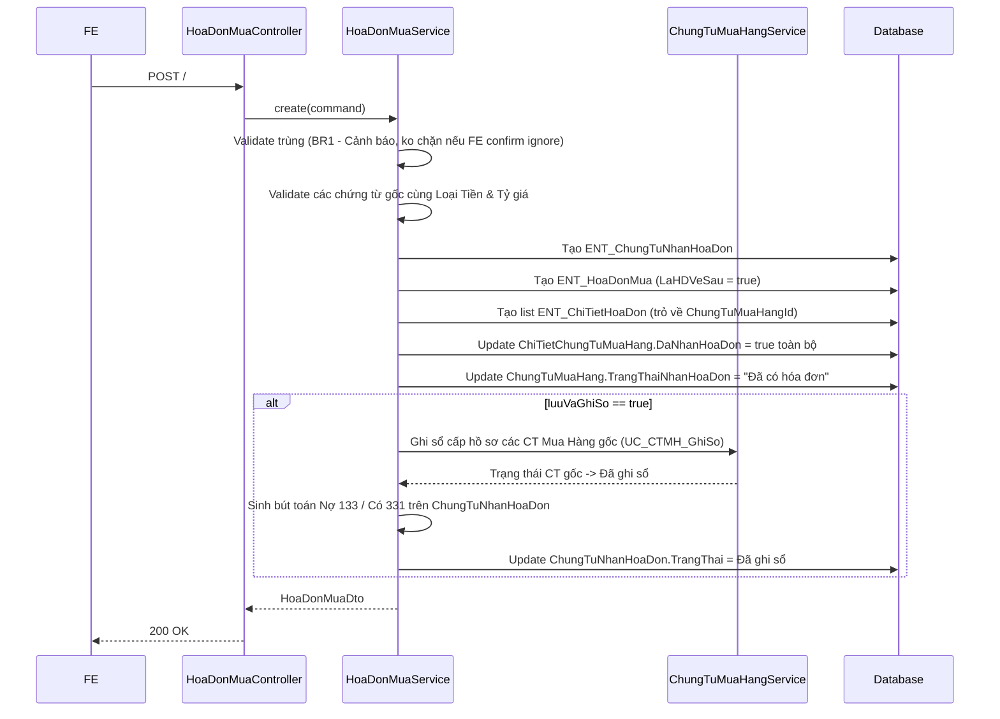

# Chi tiết triển khai - PMKT-U-01162_ThemMoi

## 1. Hợp đồng API (Base Create)

**Endpoint:** `POST /api/mua-hang/hoa-don-mua`
**Quyền:** `NhanHoaDon.Create`

```jsonc
// Request Body (Lưu)
{
  "luuVaGhiSo": false, // boolean: true nếu là nút Lưu và ghi sổ
  "chungTuNhanHoaDon": {
    "soChungTu": "CT-1234",
    "ngayChungTu": "2023-10-01",
    "ngayHachToan": "2023-10-01",
    "dienGiai": "Nhận hóa đơn cho CT Mua hàng ABC",
    "loaiTienId": "uuid",
    "tyGia": 1.0
  },
  "hoaDonMua": {
    "nhaCungCapId": "uuid",
    "mauSoHoaDon": "01GTKT",
    "kyHieuHoaDon": "AA/20E",
    "soHoaDon": "1234567",
    "ngayHoaDon": "2023-10-01"
  },
  "chiTietHoaDon": [
    {
      "chungTuMuaHangId": "uuid", // chứng từ gốc
      "maThueId": "uuid",
      "tienThueGTGT": 10000,
      "tienThueGTGTQuyDoi": 10000,
      "nhomHHDVMuaVaoId": "uuid"
    }
  ],
  "chungTuThamChieuIds": ["uuid", "uuid"]
}

// Response 200 OK
{
  "code": 200,
  "data": { ... HoaDonMuaDto ... },
  "message": "Lưu hóa đơn thành công" // MSG_PMKT-E-00542_003
}
```

## 2. Luồng xử lý



## 3. Đặc thù nghiệp vụ

- **BR1 Check Trùng**: Nếu phát hiện trùng (NCC + Số + Ký hiệu + Mẫu số), ném exception đặc thù (Warning 409 hoặc 400 kèm flag cảnh báo). FE bắt được sẽ show popup. Nếu người dùng chọn "Tiếp tục Lưu", FE gửi lại request với flag `ignoreWarningTrungHoaDon = true`.
- **Giao dịch trọn gói**: Nút "Lưu và ghi sổ" bắt buộc thực hiện trong 1 `@Transactional`. Nếu `CTMH` lỗi ghi sổ, toàn bộ flow Nhận Hóa Đơn sẽ bị rollback.

## 4. Message sử dụng
- `MSG_PMKT-E-00542_001`: Nhập thiếu
- `MSG_PMKT-E-00542_002`: Hóa đơn trùng (Warning)
- `MSG_PMKT-E-00542_003`: Lưu thành công
- `MSG_PMKT-E-00542_007`: Chưa chọn CT
- `MSG_PMKT-E-00542_008`: Sai loại tiền/tỷ giá
- `MSG_PMKT-E-00542_022`: Ngày hạch toán < Ngày CT
