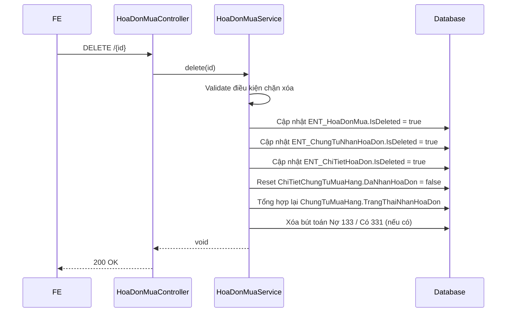

# Chi tiết triển khai - PMKT-U-01164_Xoa

## 1. Hợp đồng API (Base Delete)

**Endpoint:** `DELETE /api/mua-hang/hoa-don-mua/{id}`
**Quyền:** `NhanHoaDon.Delete`

```jsonc
// Response 200 OK
{
  "code": 200,
  "data": null,
  "message": "Xóa hóa đơn thành công" // MSG_PMKT-E-00542_006
}
```

## 2. Luồng xử lý



## 3. Đặc thù nghiệp vụ

- Xóa là **xóa mềm** `IsDeleted = true`, không phải vật lý.
- Cần validate chặn xóa:
  - Hóa đơn đã ghi sổ (MSG_PMKT-E-00542_012)
  - Có phiếu chi/thanh toán liên kết (MSG_PMKT-E-00542_013)
  - Kỳ kế toán khóa (MSG_PMKT-E-00542_014)
  - Có tham chiếu khác (MSG_PMKT-E-00542_015)
- Khi xóa thành công, cần release (giải phóng) các dòng hàng hóa về "Chưa có hóa đơn". Trạng thái của chứng từ gốc (`ChungTuMuaHang`) về mặt ghi sổ không bị thay đổi.
