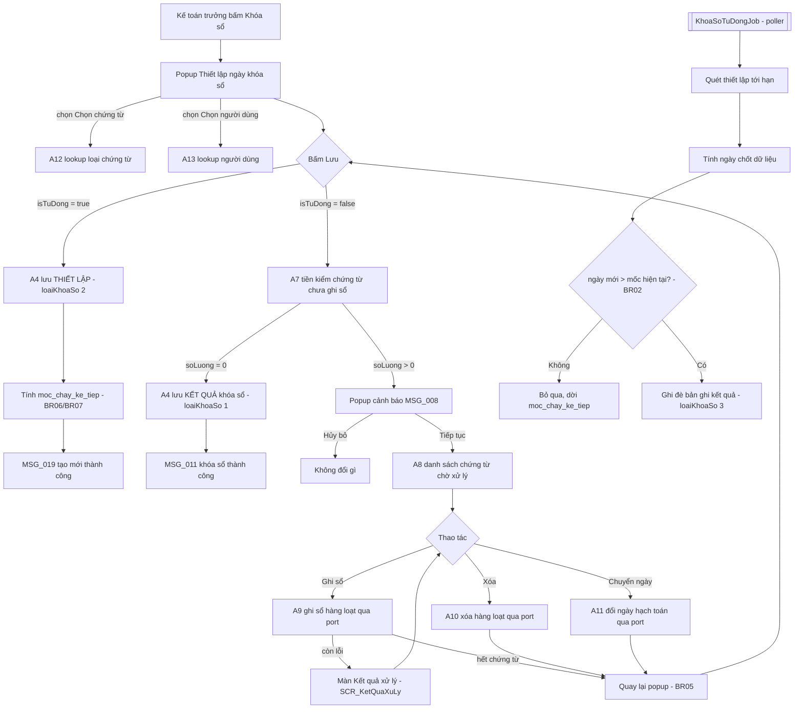

# PMKT-E-07528 — Kế hoạch tổng thể API Khóa sổ kế toán

> **Trạng thái:** BẢN NHÁP CHỜ REVIEW — cần 1 BA chốt §12 và 1 Dev BE/DBA chốt [09-thiet-ke-db.md](09-thiet-ke-db.md), §10, §9-rủi-ro
> **Ngày khảo sát code:** 2026-08-11
> **Người review cần có:** 1 BA (chốt Q1…Q13) + 1 Dev BE/DBA (chốt thiết kế DB + 3 migration + rủi ro R1…R9)
> **Chưa code gì** — skill `/plan-be` chỉ sinh tài liệu.

| Mục | Nội dung |
|---|---|
| Epic | `PMKT-E-07528_KhoaSo` — 12 use case, 8 màn hình |
| Tài liệu nguồn | `../../../pmkt-docs/ba/PMKT-E-07528_KhoaSo` + `../../../pmkt-docs/ba/Common/business_rules.md` |
| Module BE | `cell-app/src/main/java/vn/dopai/pmkt/cell/accounting_core/khoa_so/` (sub-module MỚI của `accounting_core`) |
| Bảng DB | `cfg_thiet_lap_khoa_so`, `cfg_thiet_lap_khoa_so_chung_tu`, `cfg_thiet_lap_khoa_so_nguoi_dung` — **đã có sẵn từ V1 baseline, đang RỖNG, phải sửa schema** |
| Mã chức năng | `HTKhoaSo` (đã khai ở `common/constant/MaChucNang.java:159`) — **chưa seed quyền nào** |
| Base path | `/api/he-thong/khoa-so` |

---

## 0. Các quyết định đã chốt (đề xuất — chờ review)

| # | Quyết định | Hệ quả cụ thể lên code |
|---|---|---|
| **D1** | Khóa sổ là **sub-module của `accounting_core`**: `accounting_core/khoa_so/{api,internal}`, KHÔNG tạo module cấp 1 mới | `KhoaSoRepository` + `KyKeToanChecker` (`accounting_core/hach_toan/internal/ky_ke_toan/`) đang đọc thẳng `cfg_thiet_lap_khoa_so`. Đặt bảng đó dưới quyền sở hữu của một module cấp 1 khác ⇒ `accounting_core` đọc bảng của module khác ⇒ vi phạm ranh giới Modulith ngay ngày đầu. Là sub-module thì `hach_toan` và `khoa_so` cùng nằm trong MỘT application module, truy cập nhau tự do — xem §3.2 |
| **D2** | **Dùng lại 3 bảng `cfg_` sẵn có**, không tạo bảng `acc_khoa_so_*` mới | Trigger DB `acc_so_cai_period_guard` (`V1__baseline.sql:121-161`) và `KhoaSoRepository.SQL_MOC_KHOA` (`KhoaSoRepository.java:25-38`) đều trỏ vào `cfg_thiet_lap_khoa_so`. Đổi bảng = phải viết lại cả hai + migrate; dùng lại = chỉ ALTER. Bảng đang **rỗng** (V1 baseline không COPY dòng nào — `V1__baseline.sql:3183-3195`) nên ALTER phá huỷ vẫn an toàn |
| **D3** | Kế thừa `core.controller.BaseCrudController` cho màn danh sách; **override** `create`/`update`/`delete` vì nghiệp vụ khóa sổ không phải CRUD thuần | Được miễn phí `POST /search`, `GET /cot`, `GET /{id}`, `DynamicSpecification`, `PageResponse`, whitelist `@Searchable`. Hai endpoint `POST /export` + `POST /import` bị base làm lộ ⇒ phải override trả `400 CHUA_HO_TRO` **sau** khi gọi `quyen.require(...)` (nếu không `HandlerAuthorizationArchTest` đỏ build) — xem §4.x |
| **D4** | Một endpoint DUY NHẤT `POST /them-moi` phục vụ CẢ 6 use case tạo (thủ công HT/LoạiCT/NgườiDùng + tự động HT/LoạiCT/NgườiDùng) | BA mô tả 6 UC nhưng **cùng một popup, cùng một nút Lưu** (`SCR_ThietLapNgayKhoaSo.md`). Sáu endpoint = sáu bản sao validation. Phân biệt bằng `loaiDoiTuong` + `loaiChonNguoiDung` + `isTuDong` trong body — xem [02-tao-thiet-lap-khoa-so.md](02-tao-thiet-lap-khoa-so.md) |
| **D5** | Quét chứng từ chưa ghi sổ (BR01 `SCR_PopupCanhBaoChungTu`) chạy **ở server trong chính transaction lưu**, không tin FE đã gọi `/tien-kiem` | FE gọi `/tien-kiem` chỉ để dựng popup cảnh báo; server vẫn kiểm lại và trả `409 CO_CHUNG_TU_CHUA_GHI_SO` kèm `soLuong`. Kiểm chỉ ở FE là bỏ ngỏ đường gọi API trực tiếp |
| **D6** | Danh sách chứng từ chờ xử lý lấy qua **SPI đảo chiều** `ChungTuChoXuLyPort`, mỗi module chứng từ tự cài một bean | `accounting_core` không được import `internal` của `chung_tu_ban_hang`/`chung_tu_mua_hang`. Cùng khuôn với `quan_he_chung_tu/api/DongChungTuPort.java:26`. **Hệ quả phải nói thẳng:** hôm nay repo chỉ có 2 entity chứng từ ở tầng Java (`ChungTuBanHang`, `ChungTuMuaHang`) ⇒ đợt 1 chỉ phủ 2 loại — xem R3 |
| **D7** | Job khóa sổ tự động là **MỘT poller cố định quét bảng thiết lập**, không phải một Quartz trigger cho mỗi thiết lập | `spring.quartz.job-store-type=memory` (`application.yml:53-54`) ⇒ mỗi instance có scheduler riêng, trigger-per-setting sẽ chạy trùng N lần. Poller + cột `moc_chay_ke_tiep` + `SELECT … FOR UPDATE SKIP LOCKED` là chốt chặn chạy-một-lần duy nhất đúng — xem [07-job-tu-dong-khoa-so.md](07-job-tu-dong-khoa-so.md) |
| **D8** | Chống trùng phạm vi (BR03 ghi đè) cưỡng chế **ở DB** bằng cột băm `pham_vi_hash` + partial unique index, không chỉ kiểm ở service | Kiểm ở service là check-then-act: hai request đồng thời cùng phạm vi tạo được 2 bản ghi hiệu lực, và từ đó BR01 "mốc muộn nhất" trả kết quả không xác định. Công thức băm ở [09-thiet-ke-db.md §4](09-thiet-ke-db.md) |
| **D9** | Phạm vi **người dùng** phải được đưa vào cả `KyKeToanApi` lẫn trigger DB — không cài nửa vời | Hôm nay `KhoaSoRepository.mocKhoaSo(tenantId, maLoaiChungTu)` **bỏ qua hoàn toàn** bảng `cfg_thiet_lap_khoa_so_nguoi_dung`. Nếu cho phép tạo thiết lập theo người dùng mà không sửa cổng kiểm, hệ thống sẽ **khóa nhầm cho tất cả mọi người**. Đây là thay đổi chữ ký API công khai — xem [08-ap-dung-moc-khoa-so.md](08-ap-dung-moc-khoa-so.md) và R1 |
| **D10** | Bản ghi mặc định (BR04) sinh khi **provisioning tenant**, cờ `la_mac_dinh` chặn xoá ở service + CHECK ở DB | BA: "Khi công ty mới bắt đầu sử dụng, hệ thống tự động sinh 01 bản ghi… Ngày khóa sổ = [Ngày bắt đầu dữ liệu] - 1". "Ngày bắt đầu dữ liệu" chưa có nguồn xác định trong repo ⇒ **Q6** |

> ⚠️ **Cảnh báo môi trường:**
> 1. `accounting_core/hach_toan/**` đang là kernel dùng chung cho mọi module chứng từ. Mọi thay đổi chữ ký ở `KyKeToanApi` **chạm tới `ChungTuTemplate`, `GhiSoApi`, và cả 2 module chứng từ hiện có** — đọc lại chữ ký ngay trước khi code.
> 2. Số migration lớn nhất lúc khảo sát là **V357** (`V357__chung_tu_tra_ten_cot_stt_ve_thu_tu.sql`). Con số này trôi rất nhanh — chạy `ls cell-app/src/main/resources/db/migration | sort -V | tail -1` ngay trước khi đặt tên file, đừng tin số ghi ở đây.

---

## 1. Phạm vi

### 1.1 Trong phạm vi — bộ tài liệu con

| Mã | Chức năng | UC / SCR nguồn | Tài liệu |
|---|---|---|---|
| **F01** | Xem danh sách thiết lập khóa sổ (tìm kiếm, lọc, sắp xếp, phân trang, action metadata) | U-09190 · `SCR_XemDanhSachThietLapKhoaSo` | [01-xem-danh-sach-thiet-lap.md](01-xem-danh-sach-thiet-lap.md) |
| **F02** | Tạo thiết lập / thực hiện khóa sổ — thủ công + tự động, cả 3 phạm vi | U-09187, U-09188, U-09189, U-09193, U-09194, U-09195 · `SCR_ThietLapNgayKhoaSo` | [02-tao-thiet-lap-khoa-so.md](02-tao-thiet-lap-khoa-so.md) |
| **F03** | Chỉnh sửa thiết lập | U-11303 | [03-chinh-sua-thiet-lap.md](03-chinh-sua-thiet-lap.md) |
| **F04** | Xóa thiết lập | U-11304 | [04-xoa-thiet-lap.md](04-xoa-thiet-lap.md) |
| **F05** | Nguồn chọn Loại chứng từ / Người dùng | U-09191 · `SCR_PopupChonLoaiChungTu`, `SCR_PopupChonNguoiDung` | [05-nguon-chon-loai-ct-nguoi-dung.md](05-nguon-chon-loai-ct-nguoi-dung.md) |
| **F06** | Chứng từ chờ xử lý: tiền kiểm, danh sách, ghi sổ / xóa / chuyển ngày hàng loạt, màn kết quả | U-09196, U-09192 · `SCR_PopupCanhBaoChungTu`, `SCR_DanhSachChungTuChoXuLy`, `SCR_KetQuaXuLy`, `SCR_PopupChonNgayHachToan` | [06-chung-tu-cho-xu-ly.md](06-chung-tu-cho-xu-ly.md) |
| **F07** | Job khóa sổ tự động (chu kỳ, độ trễ, điều kiện thực thi BR02) | BR04–BR07 của `SCR_ThietLapNgayKhoaSo`, BR02 của `SCR_XemDanhSachThietLapKhoaSo` | [07-job-tu-dong-khoa-so.md](07-job-tu-dong-khoa-so.md) |
| **F08** | Áp dụng mốc khóa sổ: BR01 mốc muộn nhất + BR07 chặn thêm/sửa/xóa/ghi sổ/bỏ ghi sổ | BR01 + BR07 của `SCR_XemDanhSachThietLapKhoaSo`, BR17 Common | [08-ap-dung-moc-khoa-so.md](08-ap-dung-moc-khoa-so.md) |
| **F09** | Thiết kế DB chi tiết + migration — **chốt trước mọi PR chạm DB** | — | [09-thiet-ke-db.md](09-thiet-ke-db.md) |

### 1.2 NGOÀI phạm vi (không cài lần này)

| Hạng mục | Vì sao loại | Ai chịu trách nhiệm |
|---|---|---|
| **Notification cảnh báo job thất bại** (BR05 `SCR_XemDanhSachThietLapKhoaSo`) | Chính BA đã ghi: *"Chức năng notification này hệ thống chưa hỗ trợ ở phiên bản hiện tại, sẽ được phát triển sau"* | Epic notification. Hạ tầng `common/notice/api/NoticeIssuerService.java` đã có sẵn — chỉ cần đấu dây khi BA chốt nội dung |
| **Chứng từ chờ xử lý của các loại chứng từ chưa có module Java** (kho, tiền mặt, TSCĐ, CCDC, thuế, giá thành…) | Chỉ 2 entity kế thừa `BaseChungTuEntity` tồn tại: `chung_tu_ban_hang/internal/entity/ChungTuBanHang.java`, `chung_tu_mua_hang/internal/entity/ChungTuMuaHang.java` | Từng module chứng từ, khi ra đời, tự cài `ChungTuChoXuLyPort` — xem [06 §5](06-chung-tu-cho-xu-ly.md) |
| **Xuất Excel danh sách thiết lập** (`POST /export`) và **nhập Excel** (`POST /import`) | Không có trong `SCR_XemDanhSachThietLapKhoaSo` (thanh công cụ chỉ có Khóa sổ / Tìm kiếm / Lọc / Làm mới) | Endpoint **vẫn hiện diện** do kế thừa base ⇒ trả `400 CHUA_HO_TRO` — §4.x |
| **Khóa sổ theo chi nhánh** | BA không có trường chi nhánh trên popup. Cột `chi_nhanh_id` là GAP-FILL còn sót (`V1__baseline.sql:1164`, ghi chú ở `V36__drop_chi_nhanh.sql:10`) | Đề xuất DROP — chốt ở **Q11** |
| **Lịch sử khóa sổ (`ENT_LichSuKhoaSo`)** | Xuất hiện ở `5.crud-matrix.puml:8` và mục "Liên kết" của 6 UC, nhưng **không có màn hình nào hiển thị nó** và không có UC "Xem lịch sử khóa sổ" | Đề xuất dùng `aud_audit_log` sẵn có (trigger `trg_audit_cfg_thiet_lap_khoa_so` đã bật từ V1 — `V1__baseline.sql:6534`) thay vì bảng mới — chốt ở **Q5** |

---

## 2. Hiện trạng đã khảo sát

### 2.1 Code hiện có — **brownfield một nửa**

```bash
grep -rn "khoa_so\|KhoaSo" cell-app/src/main/java --include=*.java -l
```

```
accounting_core/hach_toan/internal/ky_ke_toan/KhoaSoRepository.java
accounting_core/hach_toan/internal/ky_ke_toan/KyKeToanChecker.java
accounting_core/hach_toan/api/KyKeToanApi.java
core/shared/error/PeriodLockedException.java
common/constant/MaChucNang.java        (HT_KHOA_SO = "HTKhoaSo", dòng 159)
```

**Kết luận:** phần **ĐỌC mốc khóa sổ đã tồn tại và đang chạy** (kernel hạch toán dùng nó ở mọi lần ghi sổ). Phần **QUẢN TRỊ thiết lập khóa sổ (CRUD, job, chứng từ chờ xử lý) là greenfield hoàn toàn** — không có controller / service / entity / DTO nào.

Cụ thể phần đã có:

| Lớp | Làm gì hôm nay | Thiếu gì so với BA |
|---|---|---|
| `KhoaSoRepository.java:25-38` | `MAX(ngay_khoa_so)` theo `loai_doi_tuong = 1` (toàn hệ thống) hoặc `= 2` + khớp `ma_loai_chung_tu` | **Bỏ qua hoàn toàn phạm vi người dùng** (`cfg_thiet_lap_khoa_so_nguoi_dung`) |
| `KyKeToanChecker.java:32-46` | `kiemTraKyMo(ngayHachToan, maLoaiChungTu)` → ném `PeriodLockedException` | Message tự viết (`"Kỳ kế toán đã khoá đến %s…"`), **không dùng MSG_PMKT-E-07528_026**; chữ ký không nhận người tạo chứng từ |
| Trigger `acc_so_cai_period_guard` (`V1__baseline.sql:121-161`) | Chặn INSERT/UPDATE/DELETE `acc_so_cai` vào kỳ đã khóa, 2 phạm vi | Cũng bỏ qua phạm vi người dùng ⇒ phải sửa **cùng lúc** với repository (javadoc `KhoaSoRepository.java:14-19` ràng buộc điều này) |
| `GlobalExceptionHandler.java:302` | `PeriodLockedException` → **HTTP 409** | — |

### 2.2 Hiện trạng DB

Ba bảng đã được dựng ở `V1__baseline.sql` theo LDM cũ, sau đó bị 4 migration conform chỉnh cột:

| Migration | Ảnh hưởng tới 3 bảng khóa sổ |
|---|---|
| `V1__baseline.sql:1145-1257` | Tạo cả 3 bảng + RLS + policy `tenant_isolation` + trigger audit + index |
| `V3__conform_softdelete_da_xoa.sql` | `is_deleted → da_xoa`, `deleted_at → ngay_xoa` |
| `V6__conform_ledger_audit_convention.sql:17-18` | `version → phien_ban`, thêm `nguoi_xoa`; rename `created_*`/`updated_*` **chỉ ở 2 bảng con** (bảng cha đã có sẵn `ngay_tao`/`nguoi_tao`/`ngay_cap_nhat`/`nguoi_cap_nhat` nên bị skip) |
| `V16__drop_cfg_audit_dup.sql:3-5` | Dọn cột dup ở bảng cha: DROP `created_at`, `created_by`, `updated_at` — **quên `updated_by`** |
| `V354__conform_cot_xoa_mem_ngay_xoa_nguoi_xoa.sql` | Quét toàn bộ bảng có `da_xoa`, thêm `ngay_xoa`/`nguoi_xoa` nếu thiếu |

**Số hiệu migration lớn nhất lúc khảo sát: `V357`** ⇒ file mới dự kiến `V358`. Kiểm lại trước khi đặt tên.

Ba vấn đề chặn phải xử lý trong migration mới (chi tiết + SQL ở [09-thiet-ke-db.md](09-thiet-ke-db.md)):

| # | Vấn đề | Bằng chứng | Hệ quả nếu bỏ qua |
|---|---|---|---|
| 1 | **`UNIQUE (tenant_id, nam_tai_chinh, ky)`** | `V1__baseline.sql:4405-4409` | Mỗi tenant chỉ lưu được **một** thiết lập cho mỗi cặp (năm, kỳ) — mô hình BA cần N bản ghi song song. Phải DROP |
| 2 | **Cột legacy NOT NULL không có trong BA**: `nam_tai_chinh`, `ky`, `trang_thai` | `V1__baseline.sql:1148-1150` | INSERT sẽ vỡ vì thiếu giá trị bắt buộc, hoặc phải bịa giá trị giả |
| 3 | **Cột dup `updated_by`** còn sót cạnh `nguoi_cap_nhat` | V16 drop 3/4 cột, thiếu `updated_by` | Không vỡ, nhưng Hibernate không map → cột chết vĩnh viễn. Dọn luôn trong cùng migration |

### 2.3 Hạ tầng base đã có sẵn — KHÔNG viết lại

| Cần | Đã có ở base | Vị trí |
|---|---|---|
| 8 endpoint CRUD + tìm kiếm động | `BaseCrudController` | `core/controller/BaseCrudController.java:67` |
| CRUD service + hook `validateCreate/validateUpdate/validateDelete/beforeSave/afterSave` | `AbstractCrudService` | `core/service/AbstractCrudService.java:37` |
| Body tìm kiếm chuẩn (`page/pageSize/sort/keyword/filters/logic`) | `SearchRequest` | `core/request/SearchRequest.java:32` |
| 14 toán tử lọc (`EQ … BETWEEN`, `IN`, `IS_NULL`…) | `FilterOperator` | `core/request/FilterOperator.java:12-38` |
| Whitelist lọc/sắp xếp | `@Searchable` + `SearchableRegistry` + `DynamicSpecification` | `core/shared/search/` |
| Sort mặc định **đa khoá** (`"loaiDoiTuong:asc,ngayCapNhat:desc"`) | `SortResolver.sort(...)` — `defaultSpec` nhận cùng cú pháp với `rawSort` | `core/shared/search/SortResolver.java:78-90` |
| Envelope phân trang `{data, pagination, summary}` | `PageResponse` | `core/response/PageResponse.java:20` |
| Envelope thành công `{data, message, messageId}` | `ApiResponse` | `core/response/ApiResponse.java:20` |
| Envelope lỗi `{code, message, messageId, details}` | `ApiError` + `GlobalExceptionHandler` | `core/shared/error/ApiError.java:11` |
| Kiểm quyền `<MaChucNang>.<HanhDong>` | `QuyenChecker` | `core/controller/QuyenChecker.java:24` |
| Tenant + RLS tự động | `TenantedEntity` + `TenantRlsAspect` | `core/entity/TenantedEntity.java:15`, `core/config/TenantRlsAspect.java` |
| Audit + soft-delete 7 cột (BR46) | `BaseEntity` | `core/entity/BaseEntity.java:18-44` |
| Optimistic lock `phien_ban` | `AggregateRootEntity` | `core/entity/AggregateRootEntity.java:18` |
| **Thao tác hàng loạt lỗi-từng-phần** (mỗi bản ghi 1 transaction, trả `{thanhCong, thatBai, loi[]}`) | `HangLoatChungTuService` + `KetQuaHangLoatDto` | `accounting_core/chung_tu/service/HangLoatChungTuService.java:32`, `dto/KetQuaHangLoatDto.java:17` |
| Đổi mã loại chứng từ → id (có cache) | `LoaiChungTuLookup` | `accounting_core/hach_toan/internal/loai_chung_tu/LoaiChungTuLookup.java:24` |
| Kiểm kỳ mở/đóng | `KyKeToanApi` | `accounting_core/hach_toan/api/KyKeToanApi.java:12` |
| Khóa tương tranh theo chứng từ (`pg_advisory_xact_lock`) | `ChungTuKhoaApi` | `accounting_core/hach_toan/api/ChungTuKhoaApi.java:23` |
| SPI đảo chiều (khuôn mẫu cho `ChungTuChoXuLyPort`) | `DongChungTuPort` | `quan_he_chung_tu/api/DongChungTuPort.java:26` |

---

## 3. Kiến trúc

### 3.1 Phân tầng

```
KhoaSoController                     extends BaseCrudController<ThietLapKhoaSo, ThietLapKhoaSoDto, LuuThietLapKhoaSoRequest, LuuThietLapKhoaSoRequest>
ChungTuChoXuLyController             (mới, không kế thừa base — không phải màn CRUD)
        ▼
ThietLapKhoaSoCrudService            extends AbstractCrudService<…>
        │   ├── kế thừa : search / moTaCot / get / duLieuExport
        │   ├── override: create · update · delete · defaultSortAlias · summary(=null)
        │   └── cài mới : luuThietLap() — quyết định TẠO hay GHI ĐÈ (BR03)
        ▼
business/                            KhoaSoValidator · PhamViKhoaSoHasher · ChuKyKhoaSoCalculator
                                     · ThietLapKhoaSoMapper
        ▼
ThietLapKhoaSoRepository             extends BaseRepository<ThietLapKhoaSo>
ChungTuChoXuLyService  ──(SPI)──▶    ChungTuChoXuLyPort  ◀──cài──  chung_tu_ban_hang / chung_tu_mua_hang
KhoaSoTuDongJob        ──gọi──▶      ThietLapKhoaSoCrudService.thucThiTuDong(...)
        ▼
ThietLapKhoaSo (@Table "cfg_thiet_lap_khoa_so")  extends AggregateRootEntity
  ├─ @OneToMany ThietLapKhoaSoChungTu   (cascade = ALL, orphanRemoval = true)
  └─ @OneToMany ThietLapKhoaSoNguoiDung (cascade = ALL, orphanRemoval = true)
```

### 3.2 Lựa chọn kiến trúc + lý do

**Vị trí module** — vì sao KHÔNG mở module cấp 1 `khoa_so/`:

| | Phương án A — module cấp 1 `cell/khoa_so/` | **Phương án B (chọn) — `cell/accounting_core/khoa_so/`** |
|---|---|---|
| Quyền sở hữu bảng `cfg_thiet_lap_khoa_so` | Thuộc `khoa_so`. Nhưng `accounting_core/hach_toan` **đang đọc thẳng bảng này** ⇒ vi phạm ranh giới ngay ngày đầu | Cùng một application module ⇒ `hach_toan.internal` và `khoa_so.internal` truy cập nhau hợp lệ |
| Cách chữa nếu chọn A | Phải đẩy `KyKeToanApi` xuống `khoa_so/api` và bắt `accounting_core → khoa_so`, trong khi `khoa_so` lại cần `GhiSoApi` của `accounting_core` để ghi sổ chứng từ chờ xử lý ⇒ **phụ thuộc vòng** | Không có vòng |
| Tiền tố bảng | Phải xin tiền tố mới, nhưng bảng đã tên `cfg_` từ V1 | Giữ `cfg_` (ngoại lệ có tài liệu: bảng có trước quy ước tiền tố, ghi rõ ở `package-info.java`) |
| Ranh giới với module chứng từ | Như nhau — cả hai đều phải đi qua SPI `ChungTuChoXuLyPort` | Như nhau |
| Rủi ro | Phụ thuộc vòng Modulith ⇒ `ProxyModularityTest` đỏ, không có cách vá sạch | `accounting_core` phình thêm 1 sub-module. Chốt an toàn: `khoa_so/api` chỉ lộ đúng `ChungTuChoXuLyPort` + DTO của nó; không sub-module nào ngoài `hach_toan` được đọc `khoa_so.internal` |

**Chống trùng phạm vi** — vì sao băm ở DB chứ không kiểm ở service:

| | Phương án A — chỉ kiểm ở service | **Phương án B (chọn) — cột `pham_vi_hash` + partial unique index** |
|---|---|---|
| Hai request đồng thời cùng phạm vi | Cả hai đọc "chưa có", cả hai INSERT ⇒ 2 bản ghi hiệu lực | Request sau nhận `DuplicateKeyException` → `GlobalExceptionHandler.java:80` trả 409 |
| Hệ quả của việc để lọt | BR01 "mốc muộn nhất" vẫn cho kết quả (MAX), nhưng màn danh sách hiện 2 dòng trùng và người dùng không xoá được (loại 1/3 không cho xoá) | — |
| Chi phí | 0 | Thêm 1 cột `char(64)` + 1 index; mỗi lần lưu tính 1 lần SHA-256 trên chuỗi ngắn |
| Rủi ro | Không phát hiện được bằng test đơn luồng | Băm phải **ổn định** (sắp xếp danh sách trước khi nối). Chốt an toàn: unit test pin đúng chuỗi băm cho 6 tổ hợp phạm vi — [09-thiet-ke-db.md §4](09-thiet-ke-db.md) |

### 3.3 Cấu trúc thư mục

```
cell/accounting_core/khoa_so/
├── api/
│   ├── package-info.java              @NamedInterface("khoa-so")
│   ├── ChungTuChoXuLyPort.java        SPI: hợp đồng, module chứng từ tự cài
│   ├── AbstractChungTuChoXuLyAdapter.java   lớp cha giữ 5 điều kiện lọc dùng chung
│   └── dto/
│       ├── package-info.java          @NamedInterface("khoa-so-dto")
│       ├── ChungTuChoXuLyDto.java
│       ├── PhamViKhoaSo.java          record phạm vi truyền cho port
│       └── KetQuaXuLyChungTuDto.java
└── internal/
    ├── controller/
    │   ├── KhoaSoController.java              package-private
    │   └── ChungTuChoXuLyController.java      package-private
    ├── dto/
    │   ├── LuuThietLapKhoaSoRequest.java
    │   ├── ThietLapKhoaSoDto.java
    │   ├── TienKiemKhoaSoRequest.java / …Response.java
    │   ├── DoiNgayHachToanRequest.java
    │   ├── LoaiChungTuLookupDto.java
    │   └── NguoiDungLookupDto.java
    ├── entity/
    │   ├── ThietLapKhoaSo.java
    │   ├── ThietLapKhoaSoChungTu.java
    │   └── ThietLapKhoaSoNguoiDung.java
    ├── model/
    │   ├── LoaiDoiTuongKhoaSo.java      1 = TOAN_HE_THONG, 2 = CHON_CHUNG_TU
    │   ├── LoaiKhoaSo.java              1 = THU_CONG, 2 = THIET_LAP, 3 = TU_DONG
    │   ├── LoaiChonNguoiDung.java       1 = TAT_CA, 2 = CHON_NGUOI_DUNG
    │   ├── KyKhoaSo.java                1 = HANG_NGAY, 2 = HANG_TUAN, 3 = HANG_THANG
    │   ├── MaLoiKhoaSo.java             mã lỗi + hằng messageId MSG_PMKT-E-07528_*
    │   └── HangSoKhoaSo.java            NGAY_CUOI_THANG = 32, giới hạn độ trễ…
    ├── repository/
    │   ├── ThietLapKhoaSoRepository.java
    │   └── ThietLapKhoaSoRepositoryCustom.java / …Impl.java   (query "mốc hiệu lực theo phạm vi")
    ├── job/
    │   └── KhoaSoTuDongJob.java
    └── service/
        ├── ThietLapKhoaSoCrudService.java
        ├── ChungTuChoXuLyService.java
        ├── KhoaSoLookupService.java
        └── business/
            ├── KhoaSoValidator.java             BR02/BR03 popup + MSG_005…_022
            ├── PhamViKhoaSoHasher.java          D8
            ├── ChuKyKhoaSoCalculator.java       BR06 + BR07 popup (mốc chốt + thời điểm chạy)
            └── ThietLapKhoaSoMapper.java
```

---

## 4. Danh mục API mục tiêu

Base path: **`/api/he-thong/khoa-so`** · Mã chức năng: **`HTKhoaSo`**

| # | Nguồn | Method | Path | Quyền | Trả về | Chi tiết |
|---|---|---|---|---|---|---|
| A1 | base | `POST` | `/search` | `.View` | `PageResponse<ThietLapKhoaSoDto>` | [F01](01-xem-danh-sach-thiet-lap.md) |
| A2 | base | `GET` | `/cot` | `.View` | `ApiResponse<List<CotMoTa>>` | [F01](01-xem-danh-sach-thiet-lap.md) |
| A3 | base | `GET` | `/{id}` | `.View.Detail` | `ApiResponse<ThietLapKhoaSoDto>` | [F01](01-xem-danh-sach-thiet-lap.md) |
| A4 | **override** | `POST` | `/them-moi` | `.Create` (+ `.Execute` khi `isTuDong=false`) | `ApiResponse<ThietLapKhoaSoDto>` 201 | [F02](02-tao-thiet-lap-khoa-so.md) |
| A5 | **override** | `PUT` | `/{id}` | `.Edit` (+ `.Execute` khi `isTuDong=false`) | `ApiResponse<ThietLapKhoaSoDto>` | [F03](03-chinh-sua-thiet-lap.md) |
| A6 | **override** | `DELETE` | `/{id}` | `.Delete` | `ApiResponse<Void>` | [F04](04-xoa-thiet-lap.md) |
| A7 | mới | `POST` | `/tien-kiem` | `.Execute` | `ApiResponse<TienKiemKhoaSoResponse>` | [F06 §2](06-chung-tu-cho-xu-ly.md) |
| A8 | mới | `POST` | `/chung-tu-cho-xu-ly/search` | `.Reprocess` | `PageResponse<ChungTuChoXuLyDto>` | [F06 §3](06-chung-tu-cho-xu-ly.md) |
| A9 | mới | `POST` | `/chung-tu-cho-xu-ly/ghi-so` | `.Reprocess` | `ApiResponse<KetQuaXuLyChungTuDto>` | [F06 §4](06-chung-tu-cho-xu-ly.md) |
| A10 | mới | `POST` | `/chung-tu-cho-xu-ly/xoa` | `.Reprocess` | `ApiResponse<KetQuaXuLyChungTuDto>` | [F06 §5](06-chung-tu-cho-xu-ly.md) |
| A11 | mới | `POST` | `/chung-tu-cho-xu-ly/doi-ngay-hach-toan` | `.Reprocess` | `ApiResponse<KetQuaXuLyChungTuDto>` | [F06 §6](06-chung-tu-cho-xu-ly.md) |
| A12 | mới | `POST` | `/loai-chung-tu/lookup` | `.View` | `PageResponse<LoaiChungTuLookupDto>` | [F05 §2](05-nguon-chon-loai-ct-nguoi-dung.md) |
| A13 | mới | `POST` | `/nguoi-dung/lookup` | `.View` | `PageResponse<NguoiDungLookupDto>` | [F05 §3](05-nguon-chon-loai-ct-nguoi-dung.md) |

**Envelope thành công:** `{ "data": …, "message": …, "messageId": … }` (`ApiResponse`) — riêng danh sách là `{ "data": [...], "pagination": {page,pageSize,totalItems,totalPages}, "summary": null }` (`PageResponse`).

**Envelope lỗi:** `{ "code": "...", "message": "...", "messageId": "MSG_PMKT-E-07528_0xx", "details": [ {field, message} ] }` — dựng ở `GlobalExceptionHandler`, `ApiError.java:11`.

**Quy ước enum trên wire:** dùng **số nguyên** đúng như giá trị lưu DB (`loaiDoiTuong: 1|2`, `loaiKhoaSo: 1|2|3`, `kyKhoaSo: 1|2|3`, `loaiChonNguoiDung: 1|2`) cho **cả `filters` lẫn `data`**.
*Vì sao không dùng tên hằng như `TrangThaiChungTu`:* cột đã tồn tại kiểu `integer` từ V1 baseline và **trigger DB `acc_so_cai_period_guard` so trực tiếp `t.loai_doi_tuong = 1`** (`V1__baseline.sql:143`). Đổi sang chuỗi buộc phải sửa trigger + repository kernel cùng lúc, để lấy về đúng một chút dễ đọc trên wire. Bù lại: DTO trả kèm nhãn hiển thị (`loaiKhoaSoText`) để FE không tự map — xem [F01 §3](01-xem-danh-sach-thiet-lap.md).

### 4.x Endpoint bị base làm lộ nhưng KHÔNG cài

| Endpoint | Hành vi | Vì sao không xoá mapping |
|---|---|---|
| `POST /export` | `quyen.require(HTKhoaSo, "View")` → ném `400 CHUA_HO_TRO` / `MSG_CORE_EXPORT_NOT_SUPPORTED` | Bỏ `@PostMapping` ở lớp con không gỡ được mapping kế thừa; và mọi handler **phải** gọi `quyen.require(...)` nếu không `HandlerAuthorizationArchTest` làm đỏ build |
| `POST /import` | như trên, mã `IMPORT_NOT_SUPPORTED` — base đã có sẵn hành vi này ở `BaseCrudController.java:113-116` | Chỉ cần **không** override `nhapDuLieu` là base tự trả 400. Nhưng `quyen.require(…, IMPORT)` chạy trước ⇒ vẫn phải seed `.Import` hoặc override — chọn **override** để không seed quyền chỉ nhằm che endpoint |

---

## 5. Ma trận UC → endpoint → tài liệu

| UC | Tên | Endpoint chính | Tài liệu |
|---|---|---|---|
| U-09190 | Xem danh sách thiết lập khóa sổ | A1, A2, A3 | [01](01-xem-danh-sach-thiet-lap.md) |
| U-09187 | Khóa sổ theo hệ thống | A7 → A4 (`loaiDoiTuong=1`, `isTuDong=false`) | [02](02-tao-thiet-lap-khoa-so.md) |
| U-09188 | Khóa sổ theo loại chứng từ | A7 → A4 (`loaiDoiTuong=2`, `loaiChonNguoiDung=1`) | [02](02-tao-thiet-lap-khoa-so.md) |
| U-09189 | Khóa sổ theo người dùng | A7 → A4 (`loaiDoiTuong=2`, `loaiChonNguoiDung=2`) | [02](02-tao-thiet-lap-khoa-so.md) |
| U-09193 | Thiết lập tự động theo hệ thống | A4 (`loaiDoiTuong=1`, `isTuDong=true`) | [02](02-tao-thiet-lap-khoa-so.md) + [07](07-job-tu-dong-khoa-so.md) |
| U-09194 | Thiết lập tự động theo loại chứng từ | A4 (`loaiDoiTuong=2`, `isTuDong=true`) | [02](02-tao-thiet-lap-khoa-so.md) + [07](07-job-tu-dong-khoa-so.md) |
| U-09195 | Thiết lập tự động theo người dùng | A4 (`loaiChonNguoiDung=2`, `isTuDong=true`) | [02](02-tao-thiet-lap-khoa-so.md) + [07](07-job-tu-dong-khoa-so.md) |
| U-11303 | Chỉnh sửa thiết lập khóa sổ | A5 | [03](03-chinh-sua-thiet-lap.md) |
| U-11304 | Xóa thiết lập khóa sổ | A6 | [04](04-xoa-thiet-lap.md) |
| U-09191 | Chọn nguồn chứng từ | A12 (+ A13 cho popup người dùng) | [05](05-nguon-chon-loai-ct-nguoi-dung.md) |
| U-09196 | Xem danh sách chứng từ chờ xử lý | A8 | [06](06-chung-tu-cho-xu-ly.md) |
| U-09192 | Xử lý lại danh sách chứng từ | A9, A10, A11 | [06](06-chung-tu-cho-xu-ly.md) |

---

## 6. Luồng tổng thể



---

## 7. Migration dự kiến

| Migration | Nội dung | SQL đầy đủ |
|---|---|---|
| **V358** *(kiểm lại số trước khi đặt tên)* | `cfg_thiet_lap_khoa_so` — DROP unique legacy + 6 cột legacy, siết 3 cột NOT NULL, ADD 6 cột mới (1 cột sinh), 10 CHECK, 3 partial unique, 1 partial index; 2 bảng con — chuyển `loai_chon_nguoi_dung` lên cha, siết `user_id`, 2 FK `ON DELETE RESTRICT` | [09 §5.1](09-thiet-ke-db.md) |
| **V359** | `CREATE OR REPLACE FUNCTION acc_so_cai_period_guard()` — thêm **phạm vi người dùng** thật (đọc `acc_so_cai.nguoi_tao`), khả thi nhờ chốt A1. Không chỉ là `AND t.loai_chon_nguoi_dung = 1` như bản kế hoạch đầu | [09 §5.2](09-thiet-ke-db.md) + [08 §4.1](08-ap-dung-moc-khoa-so.md) |
| **V360** | Seed quyền: `INSERT iam_hanh_dong_lop` cho `Execute` + `Reprocess` **trước** (khoá ngoại), rồi `INSERT iam_quyen` 7 mã `HTKhoaSo.*`, rồi đồng bộ 4 cột `lop_*` | [09 §5.3](09-thiet-ke-db.md) + §10 dưới đây |
| **V361** *(phát sinh)* | `fn_khoa_so_thiet_lap_toi_han(timestamptz, integer)` — function `SECURITY DEFINER` lặp qua `iam_tenant` ACTIVE để job đọc được **cắt ngang tenant** dưới `FORCE ROW LEVEL SECURITY`. Chỉ trả bộ định danh; `REVOKE FROM PUBLIC` + `GRANT` riêng `pmkt_app`. Giải quyết R4 | [07](07-job-tu-dong-khoa-so.md) |
| **V362** *(phát sinh)* | `acc_so_cai_period_guard()` — thêm **phạm vi chi nhánh** (`cfg_thiet_lap_khoa_so.chi_nhanh_id` ↔ `acc_so_cai.ma_don_vi_id`). Chốt Q15 | [08 §4.2](08-ap-dung-moc-khoa-so.md) |
| **V363** *(phát sinh)* | Dựng lại closure phân quyền sau khi V360 thêm 7 mã `HTKhoaSo` — không có nó thì `/search` trả 403 cho mọi người, kể cả chủ tenant | — |

**File Java có sẵn phải sửa kèm:**

| File | Sửa gì | Vì sao |
|---|---|---|
| `accounting_core/hach_toan/api/KyKeToanApi.java` | Thêm phạm vi người dùng vào chữ ký | D9 — nếu không, khóa theo người dùng khóa nhầm cho tất cả |
| `accounting_core/hach_toan/internal/ky_ke_toan/KhoaSoRepository.java` | Bổ sung nhánh `cfg_thiet_lap_khoa_so_nguoi_dung` vào `SQL_MOC_KHOA` | D9 |
| `accounting_core/hach_toan/internal/ky_ke_toan/KyKeToanChecker.java` | Đổi message sang `MSG_PMKT-E-07528_026` (có tham số ngày khóa sổ + tên thao tác) | BR07 `SCR_XemDanhSachThietLapKhoaSo.md:92` |
| `chung_tu_ban_hang/internal/…`, `chung_tu_mua_hang/internal/…` | Thêm adapter cài `ChungTuChoXuLyPort` | D6 |

---

## 8. Thứ tự thực hiện

| PR | Nội dung | Phụ thuộc | Cổng qua |
|---|---|---|---|
| **PR-1** | Migration V358 + V360 (schema + quyền). Chưa có Java nào | Q1, Q2, Q4, Q6, Q11 đã chốt | Flyway chạy sạch trên DB dev; `SELECT` kiểm 3 bảng đúng cột; `iam_quyen` có đủ 7 mã |
| **PR-2** | Model (`enum` + `MaLoiKhoaSo`) + entity + repository + whitelist `@Searchable` + unit test pin whitelist và pin chuỗi băm phạm vi | PR-1 | `unitTest` xanh |
| **PR-3** | **F01** danh sách + **F05** hai lookup — luồng ĐỌC, không đụng gì đang chạy | PR-2 | contract test 3 endpoint; test quyền |
| **PR-4** | **F02 + F03 + F04** — lưu / sửa / xoá thiết lập, validator BR02/BR03, ghi đè BR03 | PR-3 | ma trận validation MSG_005…_027; test đồng thời 2 request cùng phạm vi → 1 thành công + 1 lỗi 409 |
| **PR-5** | **F08** — mở rộng `KyKeToanApi` + `KhoaSoRepository` + V359 trigger. **Thay đổi base, PR riêng, review/revert độc lập** | PR-4 | test đối chiếu Java ↔ trigger trên cùng bộ dữ liệu (bắt buộc — javadoc `KhoaSoRepository.java:14-19`); hồi quy 2 module chứng từ |
| **PR-6** | **F06** — SPI `ChungTuChoXuLyPort` + adapter 2 module + 4 endpoint chứng từ chờ xử lý | PR-5 | test lỗi-từng-phần; test port không có bean cho một loại → bỏ qua có log, không 500 |
| **PR-7** | **F07** — job tự động + `@EnableScheduling` + cột lịch chạy | PR-5 | test 2 instance chạy song song chỉ khóa 1 lần; test BR02 bỏ qua khi ngày mới ≤ mốc hiện tại |
| **PR-8** | **Xuất `docs/json/PMKT-khoa-so.postman_collection.json`** (§15.2) + chú thích OpenAPI cho 13 endpoint (§15.3) + rà DoD §13 | tất cả | Bộ Postman chạy hết từ trên xuống trên DB sạch, không request nào phải sửa tay; nhóm "Ca kiểm thử kỳ vọng LỖI" trả đúng `messageId` |

Không gộp PR-5 vào PR nghiệp vụ: đó là thay đổi kernel dùng chung, phải review và revert được độc lập.

---

## 9. Rủi ro kỹ thuật

| # | Rủi ro | Mức | Giảm thiểu |
|---|---|---|---|
| **R1** | Sửa `KyKeToanApi` chạm kernel đang chạy: `ChungTuTemplate`, `GhiSoApi`, 2 module chứng từ | **Cao** | ✅ **Đã xử lý khác kế hoạch.** Không giữ overload `@Deprecated`: thực tế chỉ có **3 call-site**, nên đổi thẳng chữ ký. Overload "chạy được nhưng thiếu một chiều phạm vi" là bẫy im lặng cho module mới — xem [08 §3.1](08-ap-dung-moc-khoa-so.md) |
| **R2** | Java và trigger DB **lệch nhau** về công thức mốc khóa | **Cao** | ⚠️ **Còn mở.** Truy vấn Java (`KhoaSoRepository`) và trigger (V359+V362) đã viết đối xứng trên cả 3 chiều và javadoc hai bên trỏ chéo nhau, nhưng `KyKhoaSoDoiChieuIT` **chưa viết** — cần Docker. Bảng ca kiểm ở [08 §6.2](08-ap-dung-moc-khoa-so.md) |
| **R3** | Chứng từ chờ xử lý chỉ phủ 2/nhiều loại chứng từ ⇒ người dùng khóa sổ xong vẫn còn chứng từ chưa ghi sổ ở loại khác | **Cao** | Không cách nào phủ hết bằng code lần này. Bắt buộc: (a) log rõ loại nào chưa có port, (b) trả về danh sách `loaiChungTuChuaHoTro` trong `TienKiemKhoaSoResponse` để FE cảnh báo, (c) ghi vào DoD là hạng mục còn mở. **Trạng thái:** đã có đủ **2/2** adapter cho 2 entity chứng từ hiện có (`CTBH` bán hàng, `CTMH` mua hàng) — không loại nào bị bỏ đếm im lặng. Rủi ro còn lại là các loại chứng từ **chưa có tầng Java** |
| **R4** | Job chạy **ngoài request** ⇒ không có `TenantContext` ⇒ RLS trả tập rỗng hoặc ghi sai tenant | **Cao** | ✅ **Đã đóng.** Vòng ngoài đi qua `fn_khoa_so_thiet_lap_toi_han` (V361, `SECURITY DEFINER`, lặp `iam_tenant` ACTIVE); vòng trong bind `TenantContext` từng tenant rồi mới mở transaction. Bước xử lý tách sang bean riêng `KhoaSoTuDongXuLy` — cùng lớp thì self-invocation ăn mất `@Transactional(REQUIRES_NEW)` và kéo theo cả `FOR UPDATE SKIP LOCKED` lẫn GUC tenant |
| **R5** | Quartz `job-store-type: memory` + nhiều instance ⇒ job chạy trùng | TB | D7: poller + `SELECT … FOR UPDATE SKIP LOCKED` trên chính dòng thiết lập + so `moc_chay_ke_tiep` trong cùng transaction |
| **R6** | `UNIQUE (tenant_id, nam_tai_chinh, ky)` không được DROP kịp ⇒ tenant chỉ tạo được 1 thiết lập | TB | Nằm ở PR-1, là việc đầu tiên. Migration test khẳng định constraint đã biến mất |
| **R7** | "Chuyển ngày hạch toán" đi đường tắt (UPDATE thẳng cột) sẽ **phá bất biến kế toán** (không kiểm kỳ, không sinh lại bút toán, không tăng `phien_ban`) | TB | ✅ **Đã đóng cho bán hàng:** `DoiNgayHachToanChungTuBanHang` là một `ChungTuTemplate` hành động SUA, áp BR37, kiểm kỳ trên ngày MỚI. **Mua hàng:** uỷ quyền cho `ChungTuMuaHangCrudService.update()` — hiện ném `CHUA_HO_TRO` (U-00503 chưa cài), tức lỗi đọc được chứ không UPDATE thẳng |
| **R8** | Máy dev không có Docker ⇒ `./gradlew build` đỏ ở ~25 test Testcontainers | Thấp | Dùng `./gradlew unitTest` làm cổng xanh và **nói rõ** đã thay cổng. Migration test + test trigger **bắt buộc chạy ở CI có Docker** |
| **R9** | `accounting_core` phình thêm sub-module ⇒ ranh giới nội bộ dễ nhoè | Thấp | ✅ **Đã đóng.** `khoa_so/api` chỉ lộ `ChungTuChoXuLyPort` + dto của nó; `ProxyModularityTest.khoaSoKhongCoViPhamRanhGioiNao()` xanh |
| **R10** | **Kẹt cứng "không mở sổ được, không ghi sổ được"** nếu quét chứng từ chưa ghi sổ theo nguyên văn BA. Kích hoạt bởi chính R3 nên **không phải giả định** | **Cao** | Cận dưới `mocCu` ở [02 §4.2.1](02-tao-thiet-lap-khoa-so.md) + [03 §4quater](03-chinh-sua-thiet-lap.md) — chờ **Q14**. Bắt buộc có test tích hợp tái hiện đúng 4 bước của bẫy và khẳng định bước 2 đi qua được |

---

## 10. Quyền — chưa seed dòng nào, phải seed trước khi test

```bash
grep -rn "HTKhoaSo" cell-app/src/main/resources/db/migration/*.sql   # → không kết quả
grep -rho "'[A-Za-z]*\.Execute'" cell-app/src/main/resources/db/migration/*.sql | sort -u   # → không kết quả
```

Bảy mã cần seed và hành động tương ứng:

| Mã quyền | Dùng ở | `hanh_dong` đã có trong `iam_hanh_dong_lop`? |
|---|---|---|
| `HTKhoaSo.View` | A1, A2, A12, A13 | ✅ (V303) |
| `HTKhoaSo.View.Detail` | A3 | ✅ (V303) |
| `HTKhoaSo.Create` | A4 | ✅ (V303) |
| `HTKhoaSo.Edit` | A5 | ✅ (V303) |
| `HTKhoaSo.Delete` | A6 | ✅ (V303) |
| `HTKhoaSo.Execute` | A4/A5 khi thực hiện khóa ngay, A7 | ❌ **phải INSERT trước** |
| `HTKhoaSo.Reprocess` | A8, A9, A10, A11 | ❌ **phải INSERT trước** |

`iam_quyen.hanh_dong` có khóa ngoại sang `iam_hanh_dong_lop` (`V303__iam_quyen_ba_truc.sql:85-96` — *"Mọi giá trị `iam_quyen.hanh_dong` phải có một dòng ở đây — khoá ngoại ép điều đó"*). Seed `HTKhoaSo.Execute` mà chưa có dòng `Execute` = migration hỏng. Phân loại đề xuất:

| `hanh_dong` | `lop_doc` | `lop_tao` | `lop_sua` | `lop_xoa` | `suy_dien_xem` | Lý do |
|---|---|---|---|---|---|---|
| `Execute` | true | false | **true** | false | **true** | Khóa sổ là ghi (đổi `ngay_khoa_so`), cùng nhóm với `Calculate`/`Post` ở V303 |
| `Reprocess` | true | false | **true** | **true** | **true** | Xử lý lại có cả ghi sổ, đổi ngày **và xoá chứng từ** |

Tên `HTKhoaSo` + hai hành động `Execute`/`Reprocess` lấy nguyên văn từ tiền điều kiện của UC (`UC_KhoaSoHeThong.md:19`, `UC_XuLyLaiDanhSachChungTu.md:18`) và javadoc `MaChucNang.java:158`.

---

## 11. Mã thông báo — lấy từ `6.messages.md` của epic

| Hằng (`MaLoiKhoaSo`) | messageId | Nội dung | Dùng ở |
|---|---|---|---|
| `KHONG_CO_THIET_LAP` | `MSG_PMKT-E-07528_001` | Không có thiết lập khóa sổ nào | F01 (FE, khi `data` rỗng) |
| `LOI_TAI_DANH_SACH` | `MSG_PMKT-E-07528_002` | Có lỗi xảy ra khi tải danh sách thiết lập khóa sổ | F01 (FE, lỗi 5xx) |
| `LOI_XU_LY_CHUNG_TU` | `MSG_PMKT-E-07528_003` | Có lỗi xảy ra khi xử lý chứng từ | F06 |
| `LOI_KHOA_SO` | `MSG_PMKT-E-07528_004` | Có lỗi xảy ra khi thực hiện khóa sổ | F02 |
| `THIEU_LOAI_CHUNG_TU` | `MSG_PMKT-E-07528_005` | Vui lòng chọn ít nhất 1 loại chứng từ | F02 validator |
| `THIEU_NGUOI_DUNG` | `MSG_PMKT-E-07528_006` | Vui lòng chọn ít nhất 1 người dùng | F02 validator |
| `THIEU_GIO_THUC_THI` | `MSG_PMKT-E-07528_007` | Vui lòng chọn giờ thực thi | F02 validator |
| `CO_CHUNG_TU_CHUA_GHI_SO` | `MSG_PMKT-E-07528_008` | Có **{0}** chứng từ chưa ghi sổ… | A4/A7 |
| — | `MSG_PMKT-E-07528_009` | Bạn có chắc chắn muốn xóa thiết lập khóa sổ này? | F04 (FE) |
| — | `MSG_PMKT-E-07528_010` | Bạn có chắc chắn muốn xóa chứng từ này? | F06 (FE) |
| `KHOA_SO_THANH_CONG` | `MSG_PMKT-E-07528_011` | Khóa sổ thành công | A4 (`isTuDong=false`) |
| `KHONG_CO_CHUNG_TU_CAN_XU_LY` | `MSG_PMKT-E-07528_012` | Không có chứng từ nào cần xử lý | A8 |
| `THIEU_NGAY_HACH_TOAN_MOI` | `MSG_PMKT-E-07528_013` | Vui lòng nhập ngày hạch toán mới | A11 |
| `THIEU_NGAY_KHOA_SO` | `MSG_PMKT-E-07528_015` | Vui lòng chọn ngày khóa sổ | F02 validator |
| `THIEU_NGAY_TRONG_TUAN` | `MSG_PMKT-E-07528_017` | Vui lòng chọn ngày trong tuần | F02 validator |
| `THIEU_NGAY_TRONG_THANG` | `MSG_PMKT-E-07528_018` | Vui lòng chọn ngày trong tháng | F02 validator |
| `TAO_MOI_THANH_CONG` | `MSG_PMKT-E-07528_019` | Thiết lập khóa sổ đã được tạo mới thành công | A4 |
| `CAP_NHAT_THANH_CONG` | `MSG_PMKT-E-07528_020` | Thiết lập khóa sổ đã được cập nhật thành công | A5 |
| `XOA_THANH_CONG` | `MSG_PMKT-E-07528_021` | Thiết lập khóa sổ đã được xóa thành công | A6 |
| `THIEU_CHU_KY` | `MSG_PMKT-E-07528_022` | Vui lòng chọn chu kỳ khóa sổ | F02 validator |
| `KHONG_THE_XOA` | `MSG_PMKT-E-07528_023` | Không thể xóa thiết lập khóa sổ này | A6 |
| `LOI_XOA_THIET_LAP` | `MSG_PMKT-E-07528_024` | Có lỗi xảy ra khi xóa thiết lập khóa sổ | A6 |
| `LOI_CAP_NHAT_THIET_LAP` | `MSG_PMKT-E-07528_025` | Có lỗi xảy ra khi cập nhật thiết lập khóa sổ | A5 |
| `KY_DA_KHOA_SO` | `MSG_PMKT-E-07528_026` | Chứng từ thuộc kỳ đã khóa sổ (ngày khóa sổ: {0}). Không thể {1} | **`KyKeToanChecker`** — F08 |
| `GIAO_THOA_PHAM_VI` | `MSG_PMKT-E-07528_027` | Chứng từ {0} đã có bản ghi khóa sổ, vui lòng bỏ thiết lập này… | F02 validator |

> `MSG_PMKT-E-07528_014` và `_016` **không tồn tại** trong `6.messages.md` — không bịa thêm, không tái dùng mã của epic khác.

---

## 12. ⚠️ Điểm cần BA xác nhận

| # | Vấn đề | Bằng chứng mâu thuẫn / thiếu | Xử lý tạm để code không bị chặn |
|---|---|---|---|
| **Q1** | **Độ trễ hàng ngày**: `SCR_ThietLapNgayKhoaSo.md:52-54` cho phép **-31…31**; BR06 cùng file, dòng 113 nói hàng ngày là *"số nguyên **≥ 0** (không áp dụng số âm)"*, hàng tuần **-7…7**, hàng tháng **-31…31**. `UC_ThietLapTuDongKhoaSoHeThong.md:11` lại ghi *"độ trễ ngày thực thi (0-7 ngày)"* — ba nguồn, ba khoảng | Lấy **BR06** (cụ thể nhất, có ví dụ): ngày `0…31`, tuần `-7…7`, tháng `-31…31`. Validate theo `kyKhoaSo` |
| **Q2** | **"Ngày cuối tháng"** lưu bằng giá trị gì trong `gia_tri_ky`? BA chỉ ghi *"Select (Ngày 1 - 31, Ngày cuối tháng)"* (`SCR_ThietLapNgayKhoaSo.md:47`) | Dùng hằng **`32 = NGAY_CUOI_THANG`**, khai ở `HangSoKhoaSo`. Cần BA xác nhận để FE dùng cùng giá trị |
| **Q3** | **Khi `isTuDong = true` có quét chứng từ chưa ghi sổ không?** SCR nói *"Nút Lưu… Nếu có chứng từ chưa ghi sổ, mở SCR_PopupCanhBaoChungTu"* không phân biệt; nhưng bản ghi "Thiết lập" **không khóa gì tại thời điểm lưu** | **Không quét** khi `isTuDong = true`. Job sẽ quét lúc chạy và (theo BR05) gửi notification — chức năng notification lại ngoài phạm vi ⇒ hệ quả: job gặp chứng từ chưa ghi sổ thì **bỏ qua lần chạy đó và ghi log**. Cần BA chốt: bỏ qua hay khóa luôn? |
| **Q4** | **"Người dùng" của một chứng từ là ai?** BA nói *"khóa sổ theo người dùng"* nhưng không định nghĩa: người tạo, người ghi sổ, hay người sửa cuối? | ✅ **Chốt A1 (2026-08-11): người đang thao tác** (người ghi sổ) ⇒ `acc_so_cai.nguoi_tao` mang đúng giá trị đó, trigger cưỡng chế được (V359), không cần cột mới. Xem [08 §4.1](08-ap-dung-moc-khoa-so.md) |
| **Q5** | **`ENT_LichSuKhoaSo`** có phải bảng thật không? Có ở `5.crud-matrix.puml:8` và mục "Liên kết" của 6 UC, nhưng **không màn hình nào đọc nó**, không UC nào xem nó | Không tạo bảng mới; dùng `aud_audit_log` (trigger đã bật sẵn từ V1). Nếu BA cần màn "Lịch sử khóa sổ" thì mở UC riêng |
| **Q6** | **"Ngày bắt đầu dữ liệu"** của BR04 lấy ở đâu? Không có trường nào tên như vậy trong repo | Dùng ngày bắt đầu năm tài chính đầu tiên của tenant nếu có; nếu không có, tạo bản ghi mặc định với `ngay_khoa_so = NULL` (không khóa gì) và `la_mac_dinh = true`. Cần BA chỉ đúng nguồn |
| **Q7** | **Lọc người dùng theo quyền** (BR01 `SCR_PopupChonNguoiDung.md:53-55`): *"Chỉ hiển thị người dùng được phân quyền truy cập cho ít nhất một trong các loại chứng từ đã chọn"*. Không có bảng nào ánh xạ `mst_loai_chung_tu.code` → mã chức năng quyền | Đợt 1 trả **toàn bộ người dùng đang hoạt động của tenant**, có cờ `loc_theo_quyen: false` trong response để FE biết. Cần BA cung cấp bảng ánh xạ loại CT → mã chức năng |
| **Q8** | **Cột "Phân hệ"** ở `SCR_PopupChonLoaiChungTu.md:34`: bảng `mst_loai_chung_tu` chỉ có `(id, code, ten)` (`V1__baseline.sql:1951-1955`), không có phân hệ | Trả `phanHe = null` đợt 1, hoặc BA cung cấp bảng ánh xạ code → phân hệ để seed thêm cột. Cần BA chốt |
| **Q9** | **Giao thoa một phần (MSG_027) so trên tập nào?** BA nói *"giao thoa một phần… (cùng loại khóa sổ)"* (`UC_KhoaSoLoaiChungTu.md:47`) — chỉ nói tập loại chứng từ, **không nói tập người dùng** | Kiểm giao thoa trên **cả hai chiều** (loại CT và người dùng) trong cùng `nhom_ban_ghi`. Cần BA xác nhận, vì kiểm chặt hơn BA sẽ chặn thao tác BA cho phép |
| **Q10** | **"Thời gian khóa sổ" hiển thị `DD/MM/YYYY HH:mm`** (`SCR_XemDanhSachThietLapKhoaSo.md:38`) nhưng người dùng chỉ nhập **ngày** (`SCR_ThietLapNgayKhoaSo.md:25`). Phần giờ ở đâu ra? | Khóa thủ công: `HH:mm = 23:59`. Khóa tự động hàng ngày: lấy `[Giờ]` đã cấu hình (BR06 *"khóa đến hết đúng `[Giờ]` của ngày T"*); hàng tuần/tháng: `23:59:59`. **Nhưng** trigger DB và `KhoaSoRepository` đều so bằng `::date` — phần giờ hiện **không có tác dụng chặn**. Cần BA chốt: giờ là hiển thị thuần hay phải chặn tới giờ? |
| **Q11** | **Cột `chi_nhanh_id`** trên bảng thiết lập — BA không có phạm vi chi nhánh | Đề xuất **DROP**. Cần Dev BE/DBA xác nhận không có consumer nào khác |
| **Q12** | **BR03 ghi đè vs BR01 mốc muộn nhất** đá nhau trong đúng một ca: nếu bản ghi cũ khóa tới 31/05 và người dùng lưu bản mới **cùng phạm vi** với ngày 10/04, BR03 nói ghi đè (mốc lùi về 10/04 = mở sổ), BR01 nói lấy mốc lớn nhất (giữ 31/05) | Lấy **BR03 trong cùng phạm vi** (ghi đè, cho phép lùi — đúng ý "Mở sổ" ở BR01 `SCR_ThietLapNgayKhoaSo.md:91`), và **BR01 giữa các phạm vi khác nhau** (MAX). Cần BA xác nhận cách diễn giải này. **Kèm theo**: ca "bật `isTuDong` trên bản ghi kết quả" BA không mô tả — plan chọn **tách thành 2 bản ghi** để mốc khóa đang hiệu lực không biến mất, xem [03 §5](03-chinh-sua-thiet-lap.md) |
| **Q14** ⚠️ | **Quét chứng từ chưa ghi sổ: toàn bộ khoảng hay chỉ phần mới bị khoá thêm?** BR01 `SCR_PopupCanhBaoChungTu.md:41` viết *"(1) Ngày hạch toán <= ngày khóa sổ"* — không có cận dưới. Nhưng đọc nguyên văn thì luồng **Mở sổ** (BR01 `SCR_ThietLapNgayKhoaSo.md:91` — lùi ngày để mở lại kỳ) **tự chặn chính nó**: chứng từ chưa ghi sổ trong kỳ đã khoá làm 409, mà chúng lại **không ghi sổ được** vì BR07 `SCR_XemDanhSachThietLapKhoaSo.md:85-92` chặn ghi sổ trong kỳ đã khoá ⇒ **kẹt cứng, chỉ thoát bằng sửa DB**. Ca này **chắc chắn xảy ra ở bản đầu** do R3 | Thêm cận dưới: chỉ quét `mocCu < ngay_hach_toan <= ngayKhoaSo`, với `mocCu` là mốc đang hiệu lực cho phạm vi đó theo BR01. Lùi ngày ⇒ không quét gì. Công thức này **tổng quát hoá** điều kiện BA (chưa có thiết lập nào ⇒ `mocCu = null` ⇒ về đúng điều kiện gốc). Xem [02 §4.2.1](02-tao-thiet-lap-khoa-so.md) và [03 §4quater](03-chinh-sua-thiet-lap.md). **Nếu BA giữ nguyên văn thì phải cấp một lối thoát khác cho ca mở sổ**, nếu không hệ thống có trạng thái không tự thoát được |
| **Q15** ✅ | **Khoá sổ theo chi nhánh có cưỡng chế ở DB không?** `cfg_thiet_lap_khoa_so.chi_nhanh_id` có sẵn từ V1 và tham gia `pham_vi_hash`, nhưng `acc_so_cai` khi đó không mang chi nhánh nên trigger không có gì để so — thêm mệnh đề sẽ khiến khoá theo chi nhánh **im lặng không chặn ai** | **User chốt 2026-08-11: dùng cả `chi_nhanh_id` và `ma_don_vi_id`.** Đã cài: `SoCaiEntity` map `ma_don_vi_id`, `GhiSoRequest`/`ChungTuContext` mang `chiNhanhId`, trigger V362 + `KhoaSoRepository` cùng kiểm. **Giới hạn còn lại:** dòng sổ cái ghi trước V362 có `ma_don_vi_id = NULL` nên chỉ chịu khoá cấp pháp nhân — backfill là migration riêng, xem [08 §4.2](08-ap-dung-moc-khoa-so.md) |
| **Q13** | **BR29.4 vs BR6 Common** (sort mặc định): BR29.4 nói *"sau khi sửa… giữ người dùng ở đúng vị trí trang hiện tại"*, nhưng sort mặc định theo BR6 là `ngayCapNhat:desc` ⇒ bản ghi vừa sửa **nhảy lên đầu**, không còn ở vị trí cũ | Giữ sort theo **BR6** (là quy tắc riêng của epic, thắng trong phạm vi epic) và coi BR29.4 là "không nhảy về trang 1", không phải "dòng không được đổi chỗ". Cần BA xác nhận — nếu BA muốn dòng đứng yên thì phải đổi sort mặc định của [F01 §5.2](01-xem-danh-sach-thiet-lap.md) |

---

## 13. Điều kiện hoàn thành để nghiệm thu

### BA xác nhận
- [ ] Đủ 8 cột màn danh sách, đúng nhãn "Hệ thống"/"Tất cả"/"Thủ công · Thiết lập · Tự động", đúng chuỗi "Thời gian thực hiện".
- [ ] Nút Xóa chỉ active với `loaiKhoaSo = 2`; bản ghi mặc định không xóa được (MSG_023).
- [ ] Đủ 10 ca validation của popup (MSG_005, _006, _007, _015, _017, _018, _022, _027 + ghi đè + giao thoa).
- [ ] Luồng cảnh báo → xử lý → quay lại popup giữ nguyên giá trị (BR05 `SCR_DanhSachChungTuChoXuLy.md:93-94`).
- [ ] Job tự động: đúng mốc chốt và đúng thời điểm chạy cho cả 3 chu kỳ, kể cả độ trễ âm (ví dụ BR07: "khóa đến hết 31, thực hiện sau -3 ngày, lúc 02:00" → chạy 02:00 ngày 28).
- [ ] Chốt Q1…Q12.

### Dev BE xác nhận
- [ ] Controller không gọi repository; business logic ở service; Entity không lọt ra ngoài.
- [ ] Dùng lại `core` (`SearchRequest`, `DynamicSpecification`, `PageResponse`, `ApiResponse`, `QuyenChecker`) thay vì tự viết.
- [ ] Mọi filter/sort đi qua whitelist `@Searchable`; tenant / soft-delete không nhận từ client.
- [ ] Mọi handler gọi `quyen.require(...)` (nếu không `HandlerAuthorizationArchTest` đỏ build).
- [ ] Không hardcode magic value (`1`, `2`, `3`, `32`, `23:59` đều là hằng có tên).
- [ ] **Java và trigger DB cho cùng kết luận** trên bộ dữ liệu kiểm chứng (R2).
- [ ] Job chạy 2 instance song song chỉ khóa một lần (R5); job bind đúng tenant (R4).
- [ ] `./gradlew unitTest` xanh; `./gradlew build` xanh ở CI có Docker — **báo trung thực** mục nào chưa đạt.
- [ ] Không tăng số vi phạm ranh giới Modulith; `khoa_so` sạch tuyệt đối.
- [ ] **Đã xuất `docs/json/PMKT-khoa-so.postman_collection.json`** (§15.2) và chạy hết bộ từ trên xuống trên DB sạch — không request nào phải sửa tay.
- [ ] Nhóm "Ca kiểm thử kỳ vọng LỖI" của bộ Postman phủ **đủ 13 mã thông báo có nhánh lỗi** ở §11, mỗi mã trả đúng `messageId`.
- [ ] Spec `/v3/api-docs` khớp §4 (đủ 13 endpoint, đúng quyền, đúng hình dạng request/response).
- [ ] File mới đã `git add` — `git status` sạch, `npm run check:committed` không áp dụng (không chạm `../../../client`) nhưng vẫn phải kiểm không còn dòng `??` trong `../../../cell-app/src`.

---

## 14. Quy chuẩn nghiệp vụ (BR) áp dụng

| BR | Áp ở đâu |
|---|---|
| BR1 phân trang · BR2 hiển thị & sắp xếp · BR11 tìm kiếm/lọc/sắp xếp · BR13.1 nút thao tác · BR44 truncate | F01, F06 |
| BR3 popup · BR14 chế độ form · BR15 validation · BR43 trim | F02, F03 |
| BR12 trạng thái chứng từ · BR17 kiểm tra kỳ kế toán · BR36 ghi sổ · BR37 ngày hạch toán · BR42 bỏ ghi sổ | F06, F08 |
| BR45 thao tác hàng loạt (popup kết quả, reload sau đóng) | F06 |
| BR19 kiểm tra trùng · BR28 multi-tenant · BR29 chính sách xóa · BR46 trường hệ thống bắt buộc | F09, toàn bộ entity |
| BR25 phân quyền | §10 |
| BR26 toast/notification | F02, F04 (messageId trả về) |
| BR8 khoảng thời gian | F06 (lọc theo ngày hạch toán) |

**Lệch BR đã biết:** BR31 (dòng tổng cộng) **không áp dụng** — cả hai màn danh sách của epic đều không có cột số lượng/số tiền, nên `summary` trả `null`. BR39 (xuất Excel) **không áp dụng** — xem §1.2.

---

## 15. Sản phẩm bàn giao

### 15.1 File Java / SQL

| # | File | Loại | PR |
|---|---|---|---|
| 1 | `db/migration/V358__cfg_thiet_lap_khoa_so_theo_ba_khoa_so.sql` | mới | PR-1 |
| 2 | `db/migration/V359__acc_so_cai_period_guard_pham_vi_nguoi_dung.sql` | mới | PR-5 |
| 3 | `db/migration/V360__seed_quyen_ht_khoa_so.sql` | mới | PR-1 |
| 3b | `db/migration/V361__fn_khoa_so_thiet_lap_toi_han.sql` | mới *(phát sinh)* | PR-7 |
| 3c | `db/migration/V362__acc_so_cai_period_guard_pham_vi_chi_nhanh.sql` | mới *(phát sinh)* | PR-5 |
| 3d | `db/migration/V363__rebuild_pham_vi_sau_seed_quyen.sql` | mới *(phát sinh)* — dựng lại closure quyền sau V360 | PR-1 |
| 4 | `accounting_core/khoa_so/**` — 3 entity · 2 repository · 3 controller · ~8 dto · 6 model · 4 business · 3 service · 1 job · 2 `package-info` | mới (~32 file) | PR-2…PR-7 |
| 5 | `accounting_core/khoa_so/api/{ChungTuChoXuLyPort,AbstractChungTuChoXuLyAdapter}.java` + `api/dto/**` + 2 `package-info` khai `@NamedInterface` | mới | PR-6 |
| 6 | `accounting_core/hach_toan/api/KyKeToanApi.java` | **sửa** — thêm tham số `chiNhanhId`; người thao tác đọc từ `TenantContext`, không qua tham số ([08 §3.1](08-ap-dung-moc-khoa-so.md)) | PR-5 |
| 7 | `accounting_core/hach_toan/internal/ky_ke_toan/KhoaSoRepository.java` | **sửa** — thêm nhánh người dùng + chi nhánh | PR-5 |
| 7b | `accounting_core/hach_toan/internal/so_cai/SoCaiEntity.java` | **sửa** — map `ma_don_vi_id` + `voiChiNhanh()` | PR-5 |
| 7c | `accounting_core/hach_toan/api/dto/GhiSoRequest.java` · `internal/ghi_so/GhiSoService.java` · `internal/ghi_so/RequestHash.java` | **sửa** — mang `chiNhanhId` xuống dòng sổ cái; `RequestHash` cố ý KHÔNG lấy nó | PR-5 |
| 7d | `accounting_core/chung_tu/model/ChungTuContext.java` · `service/ChungTuTemplate.java` | **sửa** — `chiNhanhId` + overload `ghiNhanChungTu(BaseChungTuEntity)` | PR-5 |
| 8 | `accounting_core/hach_toan/internal/ky_ke_toan/KyKeToanChecker.java` | **sửa** — message theo `MSG_PMKT-E-07528_026` | PR-5 |
| 9 | `accounting_core/hach_toan/internal/loai_chung_tu/LoaiChungTuLookup.java` | **sửa** — thêm `tatCa()` + `tenTheoMa()` | PR-3 |
| 10 | `core/shared/error/PeriodLockedException.java` | **sửa** — mang `mocKhoa` + `messageId` | PR-5 |
| 11 | `platform_iam/nguoi_dung/api/{package-info,NguoiDungLookupApi}.java` + `api/dto/**` | mới + **sửa** `package-info` (thêm `@NamedInterface`) | PR-3 |
| 12 | `chung_tu_ban_hang/internal/adapter/ChungTuBanHangChoXuLyAdapter.java`, `chung_tu_mua_hang/internal/adapter/ChungTuMuaHangChoXuLyAdapter.java` | mới — 2 bản cài `ChungTuChoXuLyPort`, kế thừa `AbstractChungTuChoXuLyAdapter` ([06 §2.1.1](06-chung-tu-cho-xu-ly.md)) | PR-6 |
| 13 | `src/test/java/…/khoa_so/**` (song ánh cây `main`) + `arch/ProxyModularityTest.java` (**sửa** — thêm case module mới) | mới + sửa | mọi PR |

| 14 *(phát sinh)* | `chung_tu_ban_hang/internal/service/business/{LenhBanHang,DoiNgayHachToanChungTuBanHang,KiemTraBanHang}.java` + `ChungTuBanHangCrudService` | mới + **sửa** — luồng SỬA hẹp cho "Chuyển ngày hạch toán" (A10), áp BR37. Gỡ stub `DOI_NGAY_CHUA_HO_TRO`, đóng R7 | PR-6 |
| 15 *(phát sinh)* | `accounting_core/khoa_so/internal/job/KhoaSoTuDongXuLy.java` | mới — tách khỏi `KhoaSoTuDongJob` vì self-invocation ăn mất `@Transactional(REQUIRES_NEW)` | PR-7 |

**Ước lượng:** ~44 file mới, ~14 file sửa, 5 migration.
**Không đụng:** `master_data/**` (vùng đóng băng) · `client/**` (epic này chỉ BE).
**Có đụng `acc_so_cai`:** map thêm cột `ma_don_vi_id` **đã có sẵn trong schema** — không `ALTER TABLE`, không backfill. Xem [08 §4.2](08-ap-dung-moc-khoa-so.md).

### 15.2 Bộ Postman

**File:** `docs/json/PMKT-khoa-so.postman_collection.json` — cùng thư mục và cùng khuôn với bộ đã có `../../json/PMKT-chung-tu-mua-hang.postman_collection.json` (schema `collection v2.1.0`, `auth` bearer `{{token}}`).

**Biến môi trường:**

| Biến | Giá trị mẫu | Vai trò |
|---|---|---|
| `baseUrl` | `http://localhost:8080` | như bộ có sẵn |
| `identityUrl` | `http://localhost:9000` | như bộ có sẵn |
| `username` / `password` / `token` | `admin@tenant.vn` / — / — | `Login` tự lưu `token` vào biến |
| `thietLapId` | — | id thiết lập vừa tạo, để chạy Sửa/Xoá/Xem chi tiết |
| `thietLapNgayCapNhat` | — | token optimistic-lock, test `409 STALE_DATA` |
| `chungTuChoXuLyId` | — | id chứng từ lấy từ A8, để chạy A9/A10/A11 |
| `maLoaiChungTu` | `BAN_HANG` | dùng lại trong nhiều request phạm vi |

**Thư mục request:**

```
0. Auth                                  Login (tự lưu token)
1. Danh sách & metadata                  A1 search mặc định (BR6: Hệ thống lên đầu)
                                         A1 search + keyword (tên loại CT / tên người dùng)
                                         A1 search + filters (loaiKhoaSo IN, loaiDoiTuong EQ)
                                         A1 search + sort client đè mặc định
                                         A2 GET /cot
                                         A3 GET /{id}
2. Nguồn chọn                            A12 lookup loại chứng từ
                                         A13 lookup người dùng (kèm maLoaiChungTu[])
3. Tạo thiết lập — 6 UC                  A4 Toàn hệ thống · thủ công        (U-09187)
                                         A4 Chọn chứng từ · Tất cả user     (U-09188)
                                         A4 Chọn chứng từ · Chọn user       (U-09189)
                                         A4 Toàn hệ thống · tự động hàng ngày   (U-09193)
                                         A4 Chọn chứng từ · tự động hàng tuần   (U-09194)
                                         A4 Chọn user     · tự động hàng tháng  (U-09195)
4. Sửa / Xoá                             A5 sửa ngày khóa sổ (lùi ngày = Mở sổ, BR01)
                                         A5 sửa đổi phạm vi
                                         A6 xoá thiết lập (loaiKhoaSo = 2)
5. Chứng từ chờ xử lý                    A7 tiền kiểm
                                         A8 danh sách
                                         A9 ghi sổ hàng loạt
                                         A10 xoá hàng loạt
                                         A11 đổi ngày hạch toán
6. Ca kiểm thử kỳ vọng LỖI               A4 thiếu loại CT      → 400 MSG_..._005
                                         A4 thiếu người dùng   → 400 MSG_..._006
                                         A4 thiếu giờ thực thi → 400 MSG_..._007
                                         A4 thiếu chu kỳ       → 400 MSG_..._022
                                         A4 thiếu ngày khóa sổ → 400 MSG_..._015
                                         A4 thiếu ngày trong tuần/tháng → 400 MSG_..._017/_018
                                         A4 giao thoa phạm vi  → 409 MSG_..._027
                                         A4 còn chứng từ chưa ghi sổ → 409 MSG_..._008
                                         A5 token cũ           → 409 STALE_DATA
                                         A6 xoá bản ghi loại 1 → 409 MSG_..._023
                                         A6 xoá bản ghi mặc định → 409 MSG_..._023
                                         A11 thiếu ngày mới    → 400 MSG_..._013
                                         A1 field ngoài whitelist → bỏ qua IM LẶNG (vẫn 200)
                                         POST /export          → 400 CHUA_HO_TRO (§4.x)
                                         Gọi mọi endpoint thiếu quyền → 403
```

Nhóm 6 là phần quan trọng nhất để BA nghiệm thu: nó phủ **toàn bộ** 13 mã thông báo có nhánh lỗi ở §11, mỗi mã một request chạy được.

### 15.3 OpenAPI

Không sinh file riêng — `core/config/OpenApiConfig.java` đã bật springdoc, spec tự sinh tại `/v3/api-docs`. Việc phải làm ở PR-8: bổ sung `@Operation`/`@Schema` cho 13 endpoint để spec đọc được, và **đối chiếu** spec sinh ra với §4 (lệch = một bên sai).

---

## 16. Tài liệu tham chiếu

- `../../../pmkt-docs/ba/PMKT-E-07528_KhoaSo/1.function-breakdown.md`, `2.usecase.puml`, `4.usecases/**`, `5.crud-matrix.puml`, `6.messages.md`, `6.screens/**`, `7.glossary.md`
- `pmkt-docs/ba/PMKT-E-07528_KhoaSo/Matrix/PMKT-E-07528_KhoaSo/*_MaTranAnHien.md`
- `../../../pmkt-docs/ba/Common/business_rules.md` — BR1, BR2, BR3, BR8, BR11, BR12, BR13, BR14, BR15, BR17, BR19, BR25, BR26, BR28, BR29, BR36, BR37, BR42, BR43, BR44, BR45, BR46
- `docs/conventions.md`, `docs/be-khung-kien-truc-chuan.md`, `../../../CLAUDE.md`, `../../../cell-app/CLAUDE.md`
- Mẫu code tham khảo: `cell/accounting_core/**`, `cell/core/**`, `cell/quan_he_chung_tu/api/DongChungTuPort.java`, `cell/chung_tu_ban_hang/**`
