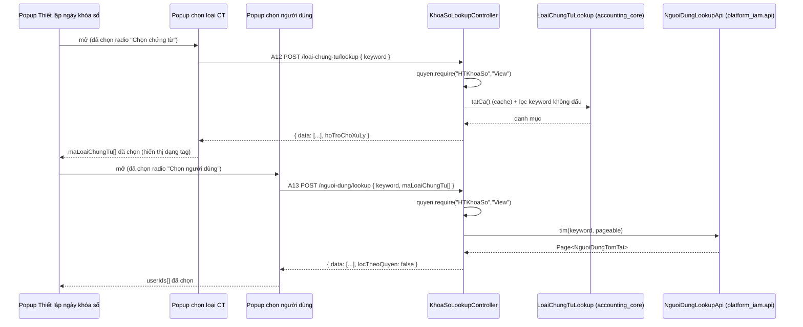

# F05 — Nguồn chọn Loại chứng từ / Người dùng

> Quay lại [00-ke-hoach-tong.md](00-ke-hoach-tong.md)

| Mục | Nội dung |
|---|---|
| Use case | `PMKT-U-09191_ChonNguonChungTu` (+ popup người dùng đi kèm `U-09188`, `U-09189`) |
| Màn hình | `SCR_PopupChonLoaiChungTu.md` · `SCR_PopupChonNguoiDung.md` |
| Endpoint | **A12** `POST /loai-chung-tu/lookup` · **A13** `POST /nguoi-dung/lookup` |
| Quyền | `HTKhoaSo.View` cho cả hai |
| Nguồn | Mới — hai màn chọn dữ liệu (BR10 "Trường Chọn nguồn"), không phải màn CRUD |

---

## 1. Vì sao hai endpoint riêng thay vì dùng lại API danh mục sẵn có

| | Phương án A — FE gọi thẳng API của module chủ dữ liệu (`/api/he-thong/nguoi-dung/search`, API danh mục loại chứng từ) | **Phương án B (chọn) — hai endpoint lookup nằm dưới `/api/he-thong/khoa-so`** |
|---|---|---|
| Quyền cần có | `HTNguoiDung.View`, `DMLoaiChungTu.View` — **Kế toán trưởng thường không được cấp** hai quyền quản trị này | Chỉ `HTKhoaSo.View` — đúng quyền của người đang đứng ở màn khóa sổ |
| Lọc theo ngữ cảnh (BR01 `SCR_PopupChonNguoiDung.md:53`: lọc user theo loại CT đã chọn) | Không làm được — API kia không biết ngữ cảnh khóa sổ | Làm được, tham số `maLoaiChungTu[]` nằm trong body |
| Hình dạng dữ liệu | Trả full DTO người dùng (email, vai trò, trạng thái Keycloak…) — **lộ nhiều hơn cần** | Trả đúng 3–4 field popup cần |
| Chi phí | 0 | 2 endpoint mỏng + 1 hợp đồng công khai mới ở `platform_iam` (§4) |
| Rủi ro | Phải cấp quyền quản trị cho Kế toán trưởng — **mở rộng quyền để lấy dữ liệu đọc là sai hướng** | `accounting_core` phụ thuộc `platform_iam`. **Chốt an toàn**: phụ thuộc một chiều qua `api/`, không import `internal`; và đây là chiều đã tồn tại sẵn trong repo (`core → platform_iam` nằm trong nợ ranh giới hiện có) |

---

## 2. A12 — `POST /api/he-thong/khoa-so/loai-chung-tu/lookup`

### 2.1 Nguồn dữ liệu

Bảng `mst_loai_chung_tu` — **danh mục toàn cục, không tenant, không RLS** (`V1__baseline.sql:1951-1962`), 3 cột: `id`, `code`, `ten`.

Đã có sẵn đường đọc trong `accounting_core`: `LoaiChungTuRepository` + `LoaiChungTuLookup` (`accounting_core/hach_toan/internal/loai_chung_tu/`). Hôm nay `LoaiChungTuLookup` chỉ có `idTheoMa(String)` (`LoaiChungTuLookup.java:39`) ⇒ **bổ sung**:

```java
/** Toàn bộ danh mục, đã cache — dùng cho popup chọn loại chứng từ và cho việc dựng cột hiển thị. */
List<LoaiChungTuItem> tatCa();

/** Tên theo mã, theo LÔ — chống N+1 khi màn danh sách dựng cột "Loại chứng từ". */
Map<String, String> tenTheoMa(Collection<String> maList);
```

Cache hiện tại **chỉ nhớ mã đã tìm thấy** và cố ý không nhớ kết quả rỗng (`LoaiChungTuLookup.java:19-21`). Thêm `tatCa()` thì phải nhớ **cả bảng** — chấp nhận được vì bảng bất biến trong vòng đời tiến trình (chỉ đổi khi chạy seed), nhưng phải nạp một lần rồi giữ, **không** nạp lại mỗi lần gọi.

### 2.2 Hợp đồng

```jsonc
// Request
{ "keyword": "bán", "page": 1, "pageSize": 50 }
```

```jsonc
// Response 200
{
  "data": [
    { "maLoaiChungTu": "BAN_HANG", "tenLoaiChungTu": "Chứng từ bán hàng", "phanHe": null, "hoTroChoXuLy": true },
    { "maLoaiChungTu": "MUA_HANG", "tenLoaiChungTu": "Chứng từ mua hàng", "phanHe": null, "hoTroChoXuLy": true },
    { "maLoaiChungTu": "PNK",      "tenLoaiChungTu": "Phiếu nhập kho",     "phanHe": null, "hoTroChoXuLy": false }
  ],
  "pagination": { "page": 1, "pageSize": 50, "totalItems": 3, "totalPages": 1 },
  "summary": null
}
```

| Field | Nguồn | Ghi chú |
|---|---|---|
| `maLoaiChungTu` | `mst_loai_chung_tu.code` | Khoá dùng để lưu vào `cfg_thiet_lap_khoa_so_chung_tu.ma_loai_chung_tu` |
| `tenLoaiChungTu` | `mst_loai_chung_tu.ten` | Cột "Tên loại CT" của popup |
| `phanHe` | **chưa có nguồn** | Cột "Phân hệ" (`SCR_PopupChonLoaiChungTu.md:34`) — bảng chỉ có 3 cột ⇒ trả `null` đợt 1, xem **Q8** |
| `hoTroChoXuLy` | có bean `ChungTuChoXuLyPort` cho loại này không | **Không có trong BA** — thêm để FE cảnh báo người dùng rằng loại này chưa quét được chứng từ chờ xử lý (R3). Không chặn chọn |

**Bảng field request** (`LoaiChungTuLookupRequest`):

| # | Field | Kiểu | Bắt buộc | Ràng buộc | Nguồn BA |
|---|---|---|---|---|---|
| 1 | `keyword` | `String` | N | Max 255; trim (BR43); không phân biệt dấu; lọc trên `code` **và** `ten` | `SCR_PopupChonLoaiChungTu.md:22` — Ô Tìm kiếm "theo tên loại chứng từ" |
| 2 | `page` | `Integer` | N | 1-based, mặc định 1 | BR1 |
| 3 | `pageSize` | `Integer` | N | Whitelist `10/20/50/100/200`, mặc định 20 | BR1 |

Keyword dùng cùng cơ chế accent-insensitive đã dựng ở `V53__accent_insensitive_search_danh_muc.sql`.

**Không nhận `filters`/`sort` tự do** như `SearchRequest`: đây là popup chọn dữ liệu, không phải màn danh sách có bộ lọc nâng cao. Nhận cả `SearchRequest` sẽ làm lộ một bề mặt lọc mà BA không yêu cầu và không ai test.

**Phân trang · sắp xếp:** danh mục rất nhỏ (BR4 Common liệt kê 9 mã), nhưng vẫn trả `PageResponse` cho đồng nhất với mọi lưới khác và để không phải đổi hợp đồng nếu danh mục phình. Sắp xếp cố định `ten ASC` — BA không cho người dùng đổi sort ở popup này. **Dòng tổng cộng:** không áp dụng (không có cột số).

---

## 3. A13 — `POST /api/he-thong/khoa-so/nguoi-dung/lookup`

### 3.1 Hợp đồng

```jsonc
// Request
{
  "keyword": "nguyen",
  "maLoaiChungTu": ["BAN_HANG", "MUA_HANG"],   // ngữ cảnh BR01 — rỗng/null khi phạm vi là Toàn hệ thống
  "page": 1, "pageSize": 50
}
```

```jsonc
// Response 200
{
  "data": [
    { "userId": "8b1e…", "tenNguoiDung": "Nguyễn Văn A", "loaiTaiKhoan": null, "dangHoatDong": true }
  ],
  "pagination": { "page": 1, "pageSize": 50, "totalItems": 1, "totalPages": 1 },
  "summary": null,
  "locTheoQuyen": false          // §3.2 — cờ nói thật với FE rằng BR01 chưa được áp
}
```

| Field | Nguồn | Ghi chú |
|---|---|---|
| `userId` | `iam_nguoi_dung.id` (qua hợp đồng công khai §4) | Lưu vào `cfg_thiet_lap_khoa_so_nguoi_dung.user_id` |
| `tenNguoiDung` | họ tên đầy đủ | Cột "Tên người dùng" |
| `loaiTaiKhoan` | — | Cột "Vai trò". BA đã ghi thẳng *"(Chưa có chức năng Quản lý người dùng)"* (`SCR_PopupChonNguoiDung.md:35`) ⇒ trả `null`, không bịa |
| `dangHoatDong` | trạng thái tài khoản | Để FE hiển thị người dùng ngừng hoạt động màu xám theo BR5 Common |

**Bảng field request** (`NguoiDungLookupRequest`):

| # | Field | Kiểu | Bắt buộc | Ràng buộc | Nguồn BA |
|---|---|---|---|---|---|
| 1 | `keyword` | `String` | N | Max 255; trim; không phân biệt dấu; lọc trên họ tên | `SCR_PopupChonNguoiDung.md:23` — Ô Tìm kiếm "theo tên người dùng" |
| 2 | `maLoaiChungTu` | `List<String>` | N | Ngữ cảnh BR01. Rỗng/null ⇒ phạm vi "Toàn hệ thống" ⇒ trả tất cả. **Đợt 1 nhận nhưng chưa dùng** — §3.2 | `SCR_PopupChonNguoiDung.md:54` |
| 3 | `page` / `pageSize` | `Integer` | N | Như A12 | BR1 |

Field #2 được nhận vào hợp đồng ngay từ đợt 1 dù chưa dùng: khi Q7 chốt và bật lọc theo quyền, FE **không phải đổi request**. Đây là trường hợp hiếm mà thêm field chưa dùng là đúng — nó đã có nghĩa xác định trong BA, không phải chỗ trống để dành.

**Phân trang · sắp xếp:** `PageResponse` chuẩn; sắp xếp `dangHoatDong DESC, hoTen ASC` — BR5 Common yêu cầu bản ghi "Ngừng hoạt động" xuống cuối. **Dòng tổng cộng:** không áp dụng.

### 3.2 BR01 — lọc người dùng theo quyền: **chưa làm được**

BA (`SCR_PopupChonNguoiDung.md:53-55`):
> *Chỉ hiển thị các người dùng được phân quyền truy cập cho ít nhất một trong các loại chứng từ đã chọn… Nếu phạm vi khóa sổ chọn "Toàn hệ thống", hiển thị tất cả người dùng.*

Để làm được cần ánh xạ `mst_loai_chung_tu.code` → mã chức năng quyền (`BanHangHoa`, `MuaHangHoa`, `NhapKho`…). **Ánh xạ đó không tồn tại trong repo**:

```bash
grep -rn "mst_loai_chung_tu" cell-app/src/main/resources/db/migration/*.sql | grep -i insert   # → không kết quả
```

`mst_loai_chung_tu` chỉ có `(id, code, ten)` và **không có cả dữ liệu seed** trong migration — nghĩa là danh mục này được nạp ở đường khác (provisioning) và không ai đang giữ quan hệ code ↔ quyền.

**Xử lý đợt 1:** trả toàn bộ người dùng đang hoạt động của tenant, kèm `locTheoQuyen: false`. FE dùng cờ này để **không** hiển thị nhãn "đã lọc theo quyền". Không im lặng trả sai — người dùng nghĩ danh sách đã lọc mà thực ra chưa là một lỗi khó phát hiện hơn nhiều so với một cờ.

**Đợt 2 (sau khi BA cấp bảng ánh xạ — Q7):** truy vấn thành `user có ít nhất một quyền <maChucNang>.View` với `maChucNang` suy từ `maLoaiChungTu`. Đặt ánh xạ ở **một bảng** (`mst_loai_chung_tu` thêm cột `ma_chuc_nang`) chứ không phải một `Map` hằng trong Java — nếu ở Java thì thêm loại chứng từ mới lại phải sửa code và deploy.

---

## 4. Đọc dữ liệu người dùng qua ranh giới module

`accounting_core` **không được** import `platform_iam.nguoi_dung.internal.*` (entity `NguoiDung`, repository, service). Hôm nay `platform_iam/nguoi_dung/api/` chỉ có `KeycloakUserSync.java` và một `package-info.java` **không khai `@NamedInterface`**:

```java
/** Public contracts for feature nguoi_dung. */
package vn.dopai.pmkt.cell.platform_iam.nguoi_dung.api;
```

⇒ Theo luật cứng 2 của `../../../cell-app/CLAUDE.md`, package này **chưa phải** hợp đồng công khai hợp lệ — thiếu `@NamedInterface` thì Modulith chặn mọi import từ module khác.

**Việc phải làm (nằm trong PR-3):**

1. Bổ sung `@NamedInterface("nguoi-dung")` vào `platform_iam/nguoi_dung/api/package-info.java`.
2. Thêm `NguoiDungLookupApi` vào cùng package:

```java
public interface NguoiDungLookupApi {

    /** Người dùng đang hoạt động của tenant hiện hành, lọc theo từ khoá tên. */
    Page<NguoiDungTomTat> tim(String keyword, Pageable pageable);

    /** Tên hiển thị theo id, theo LÔ — chống N+1 khi dựng cột "Người dùng" ở màn danh sách. */
    Map<UUID, String> tenTheoId(Collection<UUID> userIds);
}
```

3. `record NguoiDungTomTat(UUID id, String hoTen, boolean dangHoatDong)` đặt ở `api/dto/` **kèm `package-info.java` khai `@NamedInterface` riêng** — lộ `x.api` **không** tự động lộ `x.api.dto` (`../../../cell-app/CLAUDE.md`, luật cứng 2; đã có đúng một lỗi loại này bị `ProxyModularityTest` bắt).

| | A — `accounting_core` đọc thẳng `iam_nguoi_dung` bằng native SQL | **B (chọn) — hợp đồng `NguoiDungLookupApi`** |
|---|---|---|
| Ranh giới Modulith | Không vi phạm *về mặt import Java*, nhưng **vi phạm quyền sở hữu bảng** — đúng loại nợ mà `ProxyModularityTest` sinh ra để chặn | Sạch |
| Khi `platform_iam` đổi schema | `accounting_core` vỡ âm thầm lúc chạy | Vỡ lúc biên dịch |
| Chi phí | 0 | 1 interface + 1 record + 2 `package-info` |

Chọn **B**. `tenTheoId` phục vụ **cả** [F01 §3.2](01-xem-danh-sach-thiet-lap.md) (cột "Người dùng" trên lưới) nên không phải hợp đồng dựng riêng cho một màn.

---

## 5. Bắt buộc chọn tối thiểu (BR03) — kiểm ở đâu

`UC_ChonNguonChungTu.md:30`: *"Nếu không chọn loại chứng từ nào khi click [Áp dụng]: hiển thị cảnh báo MSG_PMKT-E-07528_005, popup vẫn mở"*.

Đây là **validation của FE trong popup con** — popup chọn không gọi API ghi nào, nó chỉ trả giá trị về popup cha. BE **không** có endpoint nào để kiểm ở bước này.

BE kiểm cùng điều kiện đó ở **A4/A5** khi popup cha bấm Lưu (V1/V2 — [F02 §3.1](02-tao-thiet-lap-khoa-so.md)). Hai lớp không thừa: FE cho phản hồi tức thì, BE là chốt chặn cho đường gọi API trực tiếp.

---

## 5bis. Tương tranh & transaction

**Không áp dụng ở mức ghi** — hai endpoint chỉ ĐỌC. `@Transactional(readOnly = true)`, không khoá, không idempotency key.

Hai điểm cài đặt vẫn phải đúng:

| Vấn đề | Xử lý |
|---|---|
| Cache của `LoaiChungTuLookup` bị đọc/ghi từ nhiều luồng | Đã là `ConcurrentHashMap` (`LoaiChungTuLookup.java:26`). `tatCa()` nạp một lần — dùng `computeIfAbsent` hoặc một `volatile` reference, **không** `synchronized` cả method |
| A13 gọi sang module khác giữa transaction | `NguoiDungLookupApi.tim` mở transaction riêng của `platform_iam`; không giữ khoá nào, không có ca deadlock chéo module |

---

## 6. Luồng xử lý



---

## 7. Kiểm thử

### 7.1 Unit test (`@Tag("unit")`)

| Lớp test | Kiểm gì |
|---|---|
| `LoaiChungTuLookupTest` | `tatCa()` nạp một lần rồi dùng cache; `tenTheoMa` với lô 50 mã chỉ chạm repository **một** lần |
| `LoaiChungTuLookupTest` | Keyword "ban" khớp cả "Bán hàng" (không dấu) |
| `KhoaSoLookupServiceTest` | `hoTroChoXuLy` = true đúng với các mã **có** bean `ChungTuChoXuLyPort`, false với mã không có |
| `NguoiDungLookupResponseTest` | `locTheoQuyen` luôn `false` ở đợt 1 và `loaiTaiKhoan` luôn `null` (pin để đợt 2 phải sửa test có chủ đích) |

### 7.2 Test tích hợp (cần Docker)

`KhoaSoLookupIT`: A13 chỉ trả người dùng của **tenant hiện hành** (RLS) · người dùng đã khoá vẫn xuất hiện với `dangHoatDong = false` · gọi A12/A13 với token thiếu `HTKhoaSo.View` → 403.

### 7.3 Test ranh giới

Bổ sung case vào `ProxyModularityTest`: `accounting_core` chỉ được import `platform_iam.nguoi_dung.api` và `…api.dto`, **không** import `…internal`.

---

## 8. BR đã áp dụng

| BR | Áp thế nào |
|---|---|
| BR03 popup (bắt buộc chọn tối thiểu) | §5 — kiểm ở A4/A5, FE kiểm sớm |
| BR01 `SCR_PopupChonNguoiDung` (lọc theo quyền) | **Chưa đạt** — §3.2, cờ `locTheoQuyen: false`, chờ **Q7** |
| BR10 Common (trường Chọn nguồn) | Hai endpoint lookup, trả `PageResponse` chuẩn |
| BR11.1 Common (tìm kiếm nhanh) | Keyword trim (BR43) + không phân biệt dấu |
| BR5 Common (combogrid — cột trạng thái, bản ghi ngừng hoạt động xuống dưới) | `dangHoatDong` trả về; FE sắp xếp và tô xám |
| BR25 Common (phân quyền) | Cả hai endpoint dùng `HTKhoaSo.View`, **không** đòi quyền quản trị của module chủ dữ liệu |
| BR28 Common (multi-tenant) | A13 lọc theo tenant hiện hành; A12 là danh mục toàn cục nên không lọc — ghi rõ ở javadoc để không ai "sửa cho đúng" |
