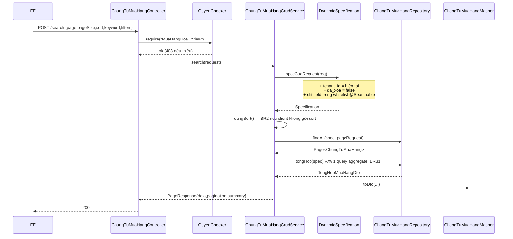
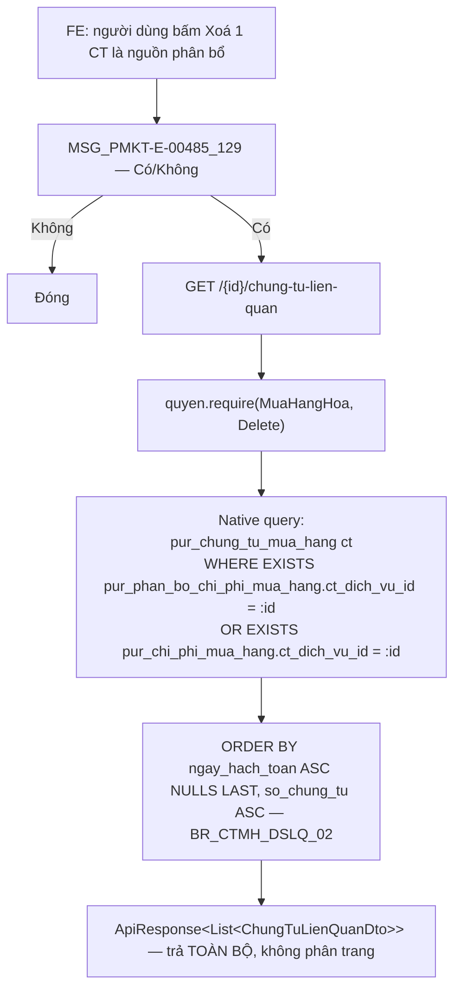
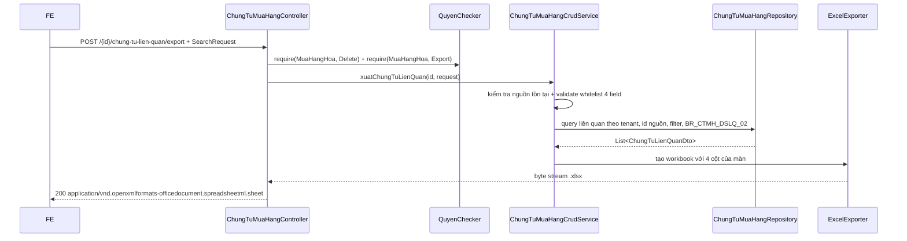

# Kế hoạch triển khai API — Danh sách Chứng từ mua hàng (PMKT-E-00485)

> **Trạng thái:** ĐÃ CODE XONG — chờ review + smoke-test trên DB thật.
> **Ngày cập nhật:** 2026-08-05
> **Người review cần có:** 1 BA (chốt mục §11) + 1 Dev BE (chốt mục §9, §10).
>
> **Kết quả chạy:** `./gradlew unitTest` **XANH** (40 lớp / 8 lớp mới / 53 test mới, 0 fail).
> `./gradlew build` đỏ **25 test — toàn bộ do máy chưa cài Docker** (7 lớp Testcontainers:
> `RedisCache*` ×4, `FileStorageE2eTest`, `FileStorageIntegrationTest`,
> `ToChucNhomCellMigrationTest`); **không test nào đỏ vì code của phiếu này**. Checkstyle: 0 vi phạm
> trên 24 file mới.
>
> **Chưa làm được ở máy này:** smoke-test 5 biểu thức `@Formula` và migration V344 trên Postgres
> thật (cần DB) — xem §10-R1 và §17 bước 8.

| Mục | Nội dung |
|---|---|
| Use case | **PMKT-U-00506 — Xem danh sách chứng từ mua hàng** |
| Màn hình | `SCR_CTMH_DanhSach.md`, `SCR_CTMH_DSChungTuLienQuan.md` |
| Tài liệu nguồn | `../../pmkt-docs/ba/PMKT-E-00485_ChungTuMuaHangDN` + `../../pmkt-docs/ba/Common/business_rules.md` |
| Module BE mới | `../../cell-app/src/main/java/vn/dopai/pmkt/cell/chung_tu_mua_hang` |
| Bảng DB | `pur_chung_tu_mua_hang` (đã có sẵn, 80 cột) |

---

## 0. Bốn quyết định đã chốt

| # | Quyết định | Hệ quả |
|---|---|---|
| **D1** | **Kế thừa `BaseChungTuController` + `AbstractChungTuCrudService` ngay**, nhưng lần này **chỉ cài luồng ĐỌC** | Không phải tái kiến trúc khi làm U-00502/503/504/508/509. Các method ghi cài tạm: ném `400 CHUA_HO_TRO` kèm mã UC phụ trách — xem §4.10 |
| **D2** | `TinhTrangPhanBo` **tính lúc đọc bằng `@Formula`** | Không thêm cột denormalize; luôn đúng; lọc/sort vẫn chạy qua `DynamicSpecification` — §8 |
| **D3** | **Không** bơm bộ lọc "đầu tháng → hiện tại" ở BE — **FE gửi** | Bỏ hẳn `Clock` và code bơm filter; BE trung lập — §6.1 |
| **D4** | Quyền danh sách = **`MuaHangHoa.View`** (đúng `UC_CTMH_XemDanhSach:23`) | Người chỉ có `MuaDichVu.View` sẽ không mở được màn gộp — §11-Q5 |

> ⚠️ **Base đang được sửa song song.** Lúc khảo sát `AbstractChungTuCrudService` còn 4 generic; hiện
> tại là `<E, D, CD, C, U>` (5) + thêm `layDongChiTiet(UUID)`, và `BaseChungTuController` có thêm
> `GET /{id}/dong-chi-tiet`. **Đọc lại chữ ký hai lớp này ngay trước khi code.**

---

## 1. Phạm vi

### 1.1 Trong phạm vi

| # | Chức năng | Nguồn |
|---|---|---|
| F1 | Tìm kiếm động + phân trang + sắp xếp trên danh sách chứng từ mua hàng | UC_CTMH_XemDanhSach, SCR_CTMH_DanhSach |
| F2 | Dòng tổng cộng cuối bảng (3 cột tiền) | BR_CTMH_DS_03 + BR31 |
| F3 | Mô tả cột động cho FE dựng bộ lọc / cấu hình cột | Hạ tầng `core` (`GET /cot`) |
| F4 | Danh sách giá trị hợp lệ của các trường enum (dropdown) | SCR_CTMH_DanhSach — 10 ô tìm kiếm |
| F5 | Xuất Excel theo đúng bộ lọc hiện tại | SCR_CTMH_DanhSach ("Xuất excel") |
| F6 | Xem chi tiết 1 chứng từ: header + dòng chi tiết + thông tin hạch toán | SCR_CTMH_DanhSach cột 4, SCR_CTMH_ChiTiet |
| F7 | **Danh sách chứng từ liên quan** của một chứng từ chi phí | SCR_CTMH_DSChungTuLienQuan, BR_CTMH_DSLQ_01…03 |
| F8 | Lọc theo 4 cột và xuất Excel danh sách chứng từ liên quan | SCR_CTMH_DSChungTuLienQuan — nút Lọc cột / Xuất Excel |

> **Bộ lọc thời gian mặc định "đầu tháng → hiện tại" (BR_CTMH_DS_01) thuộc FE** theo quyết định
> **D3**: BE không bơm điều kiện ngầm. BR11.2.2 (lưu trạng thái bộ lọc theo người dùng) vốn cũng là
> hành vi FE. BE chỉ nhận đúng những gì client gửi.

### 1.2 NGOÀI phạm vi (không cài lần này)

Thêm mới (U-00502), Sửa (U-00503), Xoá (U-00504), Ghi sổ (U-00508), Bỏ ghi sổ (U-00509), Nhân bản,
Phân bổ chi phí (U-00513), Phân bổ chiết khấu (U-00518), Thanh toán ngay (Epic Phiếu chi), Nhận hoá
đơn (PMKT-E-00542).

> Các endpoint tương ứng **vẫn hiện diện** trên API vì kế thừa base (D1), nhưng trả `400
> CHUA_HO_TRO` có `messageId` rõ ràng — xem §4.10. Đây là đánh đổi có chủ đích của D1: không có
> đường ghi nào thật sự chạy, nên không có đường ghi thứ hai đi vòng qua bất biến kế toán.

---

## 2. Hiện trạng đã khảo sát

### 2.1 Java: module là **greenfield 100%**

`grep -rl "pur_chung_tu_mua_hang" cell-app/src/main/java` → **0 kết quả** (kể cả vùng đóng băng
`master_data`). Không có entity nào map bảng này. `V337__chung_tu_chuan_cot_sal_pur.sql:4-8` ghi
bằng văn: nhóm bảng chứa `pur_chung_tu_mua_hang` là các bảng **"CHƯA CÓ CODE NGHIỆP VỤ"**.

### 2.2 DB: schema đã đầy đủ

`pur_chung_tu_mua_hang` = 80 cột, dựng qua 14 migration (V1, V47, V60, V149, V151, V154, V156, V160,
V233, V261, V267, V291, V295, V323, V337). **Không cần tạo bảng mới.** Migration lớn nhất hiện tại là
`V343` ⇒ file mới phải đánh số **V344**.

Bảng phụ dùng cho màn "Chứng từ liên quan":

| Bảng | Vai trò | Cột trỏ về chứng từ chi phí NGUỒN |
|---|---|---|
| `pur_phan_bo_chi_phi_mua_hang` | kết quả phân bổ (cả 3 tab) | `ct_dich_vu_id` (V160:27) |
| `pur_chi_phi_mua_hang` | tab "Chi phí mua hàng" — đã CHỌN nguồn, có thể chưa phân bổ | `ct_dich_vu_id` (V259:14) |
| `pur_chi_phi_nhap_khau` | tab "Phí trước HQ" / "Phí hàng về kho" | **không có** `ct_dich_vu_id` |

> Vì `pur_chi_phi_nhap_khau` không mang cột nguồn, hai tab Phí trước HQ / Phí hàng về kho **chỉ truy
> ngược được qua `pur_phan_bo_chi_phi_mua_hang.ct_dich_vu_id`** (bảng này có `loai_chi_phi CHECK IN
> ('ChiPhiMuaHang','PhiTruocHQ','PhiHangVeKho')`, V275:16-18). Điểm cần BA xác nhận — §11-Q4.

### 2.3 Hạ tầng base đã có sẵn những gì

| Cần | Đã có ở base | Vị trí |
|---|---|---|
| Body tìm kiếm chuẩn | `SearchRequest{page,pageSize,sort,keyword,filters,logic}` | `core/response/SearchRequest.java:31` |
| 14 toán tử lọc | `FilterOperator` (eq, ne, gt, gte, lt, lte, like, startsWith, endsWith, in, notIn, between, isNull, isNotNull) | `core/response/FilterOperator.java:9` |
| Dịch filter → JPA | `DynamicSpecification` + 3 lớp bảo vệ cứng (tenant / `da_xoa=false` / whitelist) | `core/shared/search/DynamicSpecification.java:65` |
| Whitelist cột | `@Searchable` / `@SearchableAudit` / `SearchableRegistry` | `core/shared/search/` |
| Sắp xếp đa cột + tie-break `id` | `SortResolver.sort(...)` | `core/shared/search/SortResolver.java:62` |
| Envelope danh sách | `PageResponse{data,pagination,summary}` | `core/response/PageResponse.java:20` |
| Envelope đơn | `ApiResponse{data,message,messageId}` | `core/response/ApiResponse.java:20` |
| CRUD + search + export + hook `summary()` | `AbstractCrudService` | `core/service/AbstractCrudService.java:37` |
| Ghi sổ / bỏ ghi sổ / nhân bản / dòng chi tiết / hàng loạt | `AbstractChungTuCrudService` + `BaseChungTuController` + `HangLoatChungTuService` | `accounting_core/chung_tu/**` |
| Cột header chứng từ + `@Searchable` sẵn | `BaseChungTuEntity` (`so_chung_tu`, `ngay_chung_tu`, `ngay_hach_toan`, `status`, `chi_nhanh_id`…) | `core/entity/BaseChungTuEntity.java:39` |
| Cột dòng chi tiết (`stt`, soft-delete, tenant) | `BaseChiTietChungTuEntity` | `core/entity/BaseChiTietChungTuEntity.java` |
| Phân quyền | `QuyenChecker.require(maChucNang, hanhDong)` | `core/controller/QuyenChecker.java` |
| Excel | `ExcelExporter` + `ColumnDef` + `ExcelUtil.resolveColumns` + `MauCotPort` | `core/shared/excel/` |

**LIKE tiếng Việt**: `DynamicSpecification` bọc `bo_dau(lower(...))` ⇒ gõ "cong ty" khớp "Công Ty"
(BR11.1) — không phải tự làm.

---

## 3. Kiến trúc

### 3.1 Phân tầng

```
ChungTuMuaHangController extends BaseChungTuController<ChungTuMuaHang, ChungTuMuaHangDto,
        ChiTietChungTuMuaHangDto, LuuChungTuMuaHangRequest, LuuChungTuMuaHangRequest>
        │   @RestController (package-private) @RequestMapping("/api/mua-hang/chung-tu-mua-hang")
        │   quyen.require("MuaHangHoa", ...)   ← từng handler, KHÔNG @PreAuthorize
        ▼
ChungTuMuaHangCrudService extends AbstractChungTuCrudService<… 5 generic …>
        │   ├── kế thừa : moTaCot(), get(), load(), specCuaRequest(), duLieuExport(), kiemTraTonTai()
        │   ├── override: search()  (sort BR2 + dòng tổng), summary()
        │   ├── cài thật: layDongChiTiet(), traSoChungTu()
        │   └── ném 400 : create(), update(), delete(), ghiSo(), boGhiSo(), nhanBan()
        ▼
ChungTuMuaHangRepository extends BaseRepository<ChungTuMuaHang>, ChungTuMuaHangRepositoryCustom
        │                        (= JpaRepository + JpaSpecificationExecutor)
        ▼
ChungTuMuaHang extends BaseChungTuEntity  →  @Table("pur_chung_tu_mua_hang")
ChiTietChungTuMuaHang extends BaseChiTietChungTuEntity → @Table("pur_chi_tiet_chung_tu_mua_hang")
```

### 3.2 Vì sao kế thừa base chứng từ ngay từ đầu (D1)

| | **Kế thừa `BaseChungTuController` (chọn)** | Controller chỉ-đọc viết tay |
|---|---|---|
| Endpoint đọc | có sẵn toàn bộ: `/search`, `/cot`, `/{id}`, `/export`, `/dong-chi-tiet`, `/thong-tin-hach-toan` | ~40 dòng tự viết, dễ lệch hợp đồng wire |
| Khi làm U-00502/503/504 | chỉ thay phần thân method ghi | phải viết lại controller + service |
| Endpoint ghi hiện tại | có mặt nhưng trả `400 CHUA_HO_TRO` — **không** có đường ghi nào chạy thật | không có |
| Bắt buộc cài | `ghiSo`/`boGhiSo`/`nhanBan`/`layDongChiTiet`/`traSoChungTu` + `HangLoatChungTuService` | — |

**Chốt an toàn của D1:** không method ghi nào gọi `repository.save()`. Cả 6 method đều ném
`ApiException.badRequest(...)` ngay dòng đầu, nên không tồn tại đường ghi thứ hai đi vòng qua trình
tự bất biến "gỡ bút toán cũ → lưu → sinh bút toán mới → kiểm kỳ khoá" của `ChungTuTemplate`.

### 3.3 Cấu trúc thư mục (Modulith, mẫu `chung_tu_ban_hang`)

```
chung_tu_mua_hang/
├── package-info.java                    @ApplicationModule(displayName="chung_tu_mua_hang")
└── internal/
    ├── controller/ ChungTuMuaHangController.java
    ├── dto/        ChungTuMuaHangDto.java · ChiTietChungTuMuaHangDto.java
    │               TongHopMuaHangDto.java · ChungTuLienQuanDto.java
    │               LuuChungTuMuaHangRequest.java   (khung cho U-00502)
    ├── entity/     ChungTuMuaHang.java · ChiTietChungTuMuaHang.java
    ├── model/      MaDb.java · LoaiNghiepVuMuaHang.java · HinhThucMuaHang.java
    │               TrangThaiNhanHoaDon.java · TrangThaiThanhToanMuaHang.java
    │               TinhTrangPhanBo.java · MaLoiMuaHang.java · CongThucSql.java
    ├── repository/ ChungTuMuaHangRepository.java · …Custom.java · …Impl.java
    └── service/    ChungTuMuaHangCrudService.java · ChungTuMuaHangHangLoatService.java
                    ChungTuMuaHangMapper.java
```

---

## 4. Hợp đồng API

Base path: **`/api/mua-hang/chung-tu-mua-hang`** (song song `/api/ban-hang/chung-tu-ban-hang` đang chạy).
Mã chức năng: **`MuaHangHoa`**.

| # | Nguồn | Method | Path | Quyền | Trả về | Mục |
|---|---|---|---|---|---|---|
| A1 | base | `POST` | `/search` | `.View` | `PageResponse<ChungTuMuaHangDto>` (**không** bọc `ApiResponse`) | §4.1 |
| A2 | base | `GET` | `/cot` | `.View` | `ApiResponse<List<CotMoTa>>` | §4.2 |
| A3 | **mới** | `POST` | `/lookup` | `.View` | `ApiResponse<Map<String,List<String>>>` | §4.3 |
| A4 | base | `GET` | `/{id}` | `.View.Detail` | `ApiResponse<ChungTuMuaHangDto>` | §4.4 |
| A5 | base | `POST` | `/export?mauId=` | `.Export` | file `.xlsx` (stream) | §4.5 |
| A6 | **mới** | `GET` | `/{id}/chung-tu-lien-quan` | `.Delete` | `ApiResponse<List<ChungTuLienQuanDto>>` | §4.6 |
| A7 | **mới** | `POST` | `/{id}/chung-tu-lien-quan/export` | `.Delete` + `.Export` | file `.xlsx` (stream) | §4.7 |
| A8 | base | `GET` | `/{id}/dong-chi-tiet` | `.View.Detail` | `ApiResponse<List<ChiTietChungTuMuaHangDto>>` | §4.8 |
| A9 | base | `GET` | `/{id}/thong-tin-hach-toan` | `.View.Detail` | `ApiResponse<List<DongSoCaiDto>>` | §4.9 |
| A10 | base | `POST` `PUT` `DELETE` `/{id}/ghi-so` `/{id}/bo-ghi-so` `/{id}/nhan-ban` `/ghi-so-hang-loat` `/bo-ghi-so-hang-loat` `/xoa-hang-loat` `/import` | | theo từng hành động | `400 CHUA_HO_TRO` | §4.10 |

**Envelope lỗi**: `@RestControllerAdvice` (`GlobalExceptionHandler`) trả **JSON phẳng**
`{ code, message, messageId, details }` — *không* có lớp bọc `error`. (Mô tả `{error:{…}}` trong
Postman của chứng từ bán hàng đã cũ, **không sao chép**.)

**Giá trị enum trên wire = tên hằng Java** (`NHAP_KHO`, `DA_GHI_SO`, `CHUA_NHAN`…), dùng **chung** cho
cả `filters` lẫn `data`. `ValueConverter.convert` ép enum bằng `Enum.valueOf(name)` nên đây là giá
trị **bắt buộc** khi lọc. FE dịch nhãn tiếng Việt bằng i18n; BE **không** trả chuỗi hiển thị (luật #2
của `../../CLAUDE.md`). Đây là điểm **khác** chứng từ bán hàng — ở đó DTO trả chuỗi tiếng Việt còn bộ lọc
lại nhận tên hằng, tức FE phải giữ hai bảng ánh xạ.

### 4.1 A1 — `POST /search`

```jsonc
// Request — mọi field đều optional
{
  "page": 1,
  "pageSize": 20,
  "sort": "ngayHachToan:desc,soChungTu:asc",   // bỏ trống → mặc định BR2, xem §6.2
  "keyword": "cong ty a",                      // tìm nhanh, bỏ dấu
  "logic": "AND",
  "filters": [
    { "field": "ngayHachToan",         "op": "between", "value": ["2026-08-01", "2026-08-05"] },
    { "field": "soChungTu",            "op": "like",    "value": "PNK" },
    { "field": "soHoaDon",             "op": "like",    "value": "0001234" },
    { "field": "tenNhaCungCap",        "op": "like",    "value": "viettel" },
    { "field": "loaiNghiepVu",         "op": "in",      "value": ["NHAP_KHO", "KHONG_QUA_KHO"] },
    { "field": "hinhThuc",             "op": "in",      "value": ["NHAP_KHAU"] },
    { "field": "status",               "op": "in",      "value": ["DA_GHI_SO"] },
    { "field": "trangThaiNhanHoaDon",  "op": "in",      "value": ["CHUA_NHAN"] },
    { "field": "trangThaiThanhToan",   "op": "in",      "value": ["CHUA_THANH_TOAN"] },
    { "field": "tinhTrangPhanBo",      "op": "in",      "value": ["PHAN_BO_MOT_PHAN"] }
  ]
}
```

```jsonc
// Response 200
{
  "data": [ { /* ChungTuMuaHangDto — xem §5.1 và §5.3 */ } ],
  "pagination": { "page": 1, "pageSize": 20, "totalItems": 137, "totalPages": 7 },
  "summary": {
    "tongTienThanhToanQuyDoi": 1250000000.00,
    "chiPhiQuyDoi":              35000000.00,
    "tongGiaTriNhapKhoQuyDoi": 1180000000.00
  }
}
```

Lỗi có thể gặp: `400 TOO_MANY_FILTERS` (> 20 điều kiện), `400 KEYWORD_TOO_LONG` (> 100 ký tự),
`400 INVALID_FILTER` (toán tử lạ / sai kiểu / `between` không đủ 2 giá trị), `403` thiếu
`MuaHangHoa.View`. Field ngoài whitelist bị **bỏ qua im lặng** (chỉ `log.warn`) — đúng hành vi sẵn có
của `DynamicSpecification`, không đổi.

### 4.2 A2 — `GET /cot`

Trả mô tả cột sinh **trực tiếp** từ whitelist `@Searchable` của entity, để FE dựng bộ lọc động và màn
cấu hình cột mà không hardcode. Field không có ở đây thì lọc/sort theo nó cũng bị BE bỏ qua ⇒ FE và
BE không bao giờ lệch nhau.

```jsonc
{ "data": [
  { "key": "ngayHachToan",            "label": "Ngày hạch toán",        "kieu": "LocalDate",  "sapXep": true, "timNhanh": false },
  { "key": "soChungTu",               "label": "Số chứng từ",           "kieu": "String",     "sapXep": true, "timNhanh": true  },
  { "key": "soHoaDon",                "label": "Số hoá đơn",            "kieu": "String",     "sapXep": true, "timNhanh": true  },
  { "key": "loaiNghiepVu",            "label": "Loại nghiệp vụ",        "kieu": "LoaiNghiepVuMuaHang", "sapXep": true, "timNhanh": false },
  { "key": "tenNhaCungCap",           "label": "Nhà cung cấp",          "kieu": "String",     "sapXep": true, "timNhanh": true  },
  { "key": "tongTienThanhToanQuyDoi", "label": "Tổng tiền thanh toán",  "kieu": "BigDecimal", "sapXep": true, "timNhanh": false },
  { "key": "chiPhiQuyDoi",            "label": "Chi phí mua hàng",      "kieu": "BigDecimal", "sapXep": true, "timNhanh": false },
  { "key": "tongGiaTriNhapKhoQuyDoi", "label": "Giá trị nhập kho",      "kieu": "BigDecimal", "sapXep": true, "timNhanh": false },
  { "key": "trangThaiNhanHoaDon",     "label": "Trạng thái nhận hoá đơn","kieu": "TrangThaiNhanHoaDon", "sapXep": true, "timNhanh": false },
  { "key": "trangThaiThanhToan",      "label": "Trạng thái thanh toán", "kieu": "TrangThaiThanhToanMuaHang", "sapXep": true, "timNhanh": false },
  { "key": "status",                  "label": "Trạng thái chứng từ",   "kieu": "TrangThaiChungTu", "sapXep": true, "timNhanh": false },
  { "key": "tinhTrangPhanBo",         "label": "Tình trạng phân bổ",    "kieu": "String",     "sapXep": true, "timNhanh": false }
  // … kèm ngayChungTu, hinhThuc, chiNhanhId, nhaCungCapId, dienGiai, ngaySapXep, ngayTao, ngayCapNhat
] }
```

Danh sách chính xác được **pin bằng unit test** `ChungTuMuaHangSearchableTest` (§15.1) — thiếu một
alias là mất im lặng một bộ lọc, không có lưới an toàn nào khác.

### 4.3 A3 — `POST /lookup`

Tập giá trị hợp lệ của các trường enum, để FE dựng 6 dropdown của §5.2 mà không hardcode chuỗi.
Body rỗng.

```jsonc
{ "data": {
  "loaiNghiepVu":        ["NHAP_KHO","KHONG_QUA_KHO","DICH_VU","DICH_VU_CHI_PHI"],
  "hinhThuc":            ["TRONG_NUOC","NHAP_KHAU"],
  "trangThaiChungTu":    ["NHAP","CHO_DUYET","DA_DUYET","DA_GHI_SO","HUY"],
  "trangThaiNhanHoaDon": ["CHUA_NHAN","DA_NHAN_MOT_PHAN","DA_NHAN_DU","KHONG_CO_HOA_DON"],
  "trangThaiThanhToan":  ["CHUA_THANH_TOAN","DA_THANH_TOAN_MOT_PHAN","DA_THANH_TOAN"],
  "tinhTrangPhanBo":     ["CHUA_PHAN_BO","PHAN_BO_MOT_PHAN","HOAN_THANH_PHAN_BO"]
} }
```

`trangThaiChungTu` trả đủ 5 giá trị của `CHECK` constraint; BA chốt màn hiển thị mấy giá trị (§11-Q6).
Handler tự viết ⇒ **phải** gọi `quyen.require(maChucNang(), QuyenChecker.VIEW)` ngay dòng đầu, nếu
không `HandlerAuthorizationArchTest` sẽ đỏ build.

### 4.4 A4 — `GET /{id}`

Header của một chứng từ (không kèm dòng chi tiết — dòng lấy ở A8). Phục vụ click "Số chứng từ" trên
lưới và form Xem chi tiết.

```jsonc
{ "data": {
  "id": "…", "soChungTu": "PNK00021",
  "ngayChungTu": "2026-07-10", "ngayHachToan": "2026-07-12",
  "loaiNghiepVu": "NHAP_KHO", "hinhThuc": "NHAP_KHAU",
  "nhaCungCapId": "…", "tenNhaCungCap": "Công ty ABC", "diaChi": "…", "dienGiai": "…",
  "loaiTienId": "…", "tyGia": 25400.000000,
  "tongTienThanhToanQuyDoi": 120000000.00,
  "chiPhiQuyDoi": 3500000.00,
  "tongGiaTriNhapKhoQuyDoi": 118000000.00,
  "soHoaDon": "0001234, 0001235",
  "trangThaiNhanHoaDon": "CHUA_NHAN",
  "trangThaiThanhToan": "CHUA_THANH_TOAN",
  "status": "NHAP",
  "tinhTrangPhanBo": "PHAN_BO_MOT_PHAN",
  "luyKeDaPhanBoQuyDoi": 1500000.00,
  "tongChiPhiCanPhanBoQuyDoi": 3500000.00,
  "conDongChuaNhanHoaDon": true,
  "updatedAt": "2026-07-12T03:21:44Z"
}, "message": null, "messageId": null }
```

`404` dùng `MaLoiMuaHang.MSG_KHONG_TIM_THAY` (`MSG_PMKT-E-00485_002`) qua override `notFound(UUID)`.
Bản ghi đã xoá mềm bị coi như không tồn tại (`AbstractCrudService.load`).

### 4.5 A5 — `POST /export?mauId=`

Xuất Excel **TOÀN BỘ** bản ghi khớp bộ lọc hiện tại (không chỉ trang đang xem). Body là chính
`SearchRequest` của A1 — gửi lại y nguyên để file khớp đúng lưới người dùng đang nhìn.

- Bộ cột: mẫu người dùng chỉ định (`mauId`) → mẫu mặc định của người dùng cho màn → `cotMacDinh(EXPORT)`.
- `cotMacDinh(EXPORT)` khai đúng 12 cột dữ liệu của `SCR_CTMH_DanhSach` (§5.1), `key` **phải trùng
  alias DTO** — `ColumnDef.key` đọc trên DTO qua reflection, sai tên là cột trống lặng lẽ.
- Trần dòng: `AbstractCrudService.MAX_EXPORT_ROWS` (100 000).
- Response: `Content-Disposition: attachment; filename*=UTF-8''Chung-tu-mua-hang.xlsx`,
  content-type `application/vnd.openxmlformats-officedocument.spreadsheetml.sheet`.
- Quyền `MuaHangHoa.Export` **chưa được seed** ⇒ phải thêm ở V344, nếu không endpoint 403 với mọi
  người dùng kể cả Admin (§9).

### 4.6 A6 — `GET /{id}/chung-tu-lien-quan`

`{id}` = id của **chứng từ chi phí đang bị thao tác xoá**. Trả **toàn bộ** danh sách (BA: "load lên
tất cả"), không phân trang.

```jsonc
{ "data": [ {
  "id": "…", "ngayHachToan": "2026-07-12", "ngayChungTu": "2026-07-10",
  "soChungTu": "PNK00021",
  "loaiChungTuId": null,
  "loaiNghiepVu": "NHAP_KHO", "hinhThuc": "NHAP_KHAU", "hinhThucThanhToan": "TienMat"
} ] }
```

Danh sách A6 trả toàn bộ dữ liệu theo BR_CTMH_DSLQ_01; FE thực hiện lọc cột trên tập dữ liệu đã
nhận. Bốn field được phép lọc: `ngayHachToan`, `ngayChungTu`, `soChungTu`, `loaiChungTu`.
Thứ tự: `ngayHachToan ASC NULLS LAST, soChungTu ASC` (BR_CTMH_DSLQ_02). Kiểm chứng từ nguồn tồn tại
trước khi query để phân biệt `404` với danh sách hợp lệ nhưng rỗng.

### 4.7 A7 — `POST /{id}/chung-tu-lien-quan/export`

Body là `SearchRequest` tùy chọn, chỉ chấp nhận bốn field của form liên quan. FE gửi lại điều kiện
lọc cột hiện hành để file Excel khớp đúng dữ liệu đang hiển thị; body rỗng thì xuất toàn bộ kết quả
A6. BE luôn áp thêm điều kiện cứng `chứng từ nguồn = {id}`, `tenant_id` hiện tại và `da_xoa=false`;
client không thể thay/loại bỏ ba điều kiện này.

Thứ tự file giữ đúng BR_CTMH_DSLQ_02: `ngayHachToan ASC, soChungTu ASC`. Cột Excel theo đúng màn:
Ngày hạch toán, Ngày chứng từ, Số chứng từ, Loại chứng từ. Endpoint kiểm tra chứng từ nguồn tồn tại
trước khi query để phân biệt `404` với danh sách hợp lệ nhưng rỗng. Giới hạn số dòng dùng
`AbstractCrudService.MAX_EXPORT_ROWS`; vượt giới hạn trả lỗi chuẩn của hạ tầng export, không âm thầm
cắt dữ liệu.

### 4.8 A8 — `GET /{id}/dong-chi-tiet`

Các dòng hàng của chứng từ theo đúng thứ tự hiển thị (`stt ASC`), phục vụ form Xem chi tiết
(`SCR_CTMH_ChiTiet`). Nạp kèm bằng `@EntityGraph` trong một truy vấn — để lazy sẽ thành N+1 hoặc
`LazyInitializationException` khi mapper duyệt dòng ngoài transaction.

```jsonc
{ "data": [ {
  "id": "…", "stt": 1, "loaiDongHang": true, "laCpmh": false,
  "vatTuId": "…", "maHang": "VT001", "tenHang": "Thép tấm", "loaiVatTu": "HangHoa",
  "donViTinhId": "…", "khoId": "…", "soLo": "L2026-07", "hanSuDung": "2027-07-01",
  "soLuong": 100.000, "donGia": 250000.00,
  "thanhTien": 25000000.00, "thanhTienQuyDoi": 25000000.00,
  "tyLeChietKhau": 0.00, "tienChietKhau": 0.00, "chietKhauQuyDoi": 0.00,
  "thueSuatGtgt": 10.00, "tienThueGtgt": 2500000.00, "tienThueGtgtQuyDoi": 2500000.00,
  "taiKhoanKhoId": "…", "taiKhoanCongNoId": "…", "taiKhoanThueGtgtId": "…",
  "chiPhi": 0.00, "chiPhiTruocHq": 0.00, "chiPhiHangVeKho": 0.00, "chiPhiCtdv": 0.00,
  "giaTriNhapKho": 25000000.00,
  "daNhanHoaDon": false, "hoaDonMuaId": null
} ] }
```

Tập cột map theo lưới `SCR_CTMH_ChiTiet` (~30 field trong tổng 74 cột của bảng); các cột thuế nhập
khẩu / TTĐB / CBPG / BVMT thuộc màn Thêm mới (U-00502) nên **chưa map** lần này.

### 4.9 A9 — `GET /{id}/thong-tin-hach-toan`

Các dòng **sổ cái đã ghi** (`acc_so_cai`) của chứng từ, lấy qua `SoCaiApi.theoChungTu(id)` của
`accounting_core`. Chứng từ chưa ghi sổ trả danh sách rỗng — đó là trạng thái hợp lệ, không phải lỗi.
Base đã `kiemTraTonTai(id)` trước khi đọc, nên id bịa ra trả `404` chứ không phải `200` rỗng.

### 4.10 A10 — Các endpoint GHI (có mặt, chưa cài)

Kế thừa từ base nên tồn tại trên API surface; tất cả trả **`400`** với envelope lỗi phẳng:

```jsonc
{ "code": "CHUA_HO_TRO",
  "messageId": "MSG_PMKT-E-00485_998",
  "message": "Chức năng Thêm mới chứng từ mua hàng chưa được triển khai (PMKT-U-00502).",
  "details": null }
```

| Endpoint | UC phụ trách |
|---|---|
| `POST /` | PMKT-U-00502 Thêm mới |
| `PUT /{id}` | PMKT-U-00503 Sửa |
| `DELETE /{id}`, `POST /xoa-hang-loat` | PMKT-U-00504 Xoá |
| `POST /{id}/ghi-so`, `POST /ghi-so-hang-loat` | PMKT-U-00508 Ghi sổ |
| `POST /{id}/bo-ghi-so`, `POST /bo-ghi-so-hang-loat` | PMKT-U-00509 Bỏ ghi sổ |
| `GET /{id}/nhan-ban` | chưa có UC trong epic |
| `POST /import` | không hỗ trợ — giữ `IMPORT_NOT_SUPPORTED` mặc định của base |

Ba endpoint hàng loạt đi qua `HangLoatChungTuService` nên trả `200` kèm bảng lỗi từng dòng (đúng cơ
chế lỗi-từng-phần có sẵn), mỗi dòng mang `code = CHUA_HO_TRO`.

---

## 5. Ánh xạ cột: BA ↔ DB ↔ DTO

### 5.1 Bảng danh sách (`SCR_CTMH_DanhSach` §Bảng danh sách)

| # | Cột BA | Field BA | Cột DB thật | Field DTO / alias lọc | Lọc | Sort |
|---|---|---|---|---|---|---|
| 1 | Checkbox | – | – | – | – | – |
| 2 | STT | – | – | FE tự tính `(page-1)*pageSize + i` | – | – |
| 3 | Ngày hạch toán | NgayHachToan | `ngay_hach_toan` | `ngayHachToan` | between | ✔ |
| 4 | Số chứng từ | SoChungTu | `so_chung_tu` | `soChungTu` | like + keyword | ✔ |
| 5 | Số hoá đơn | SoHoaDon | **không có cột** — dẫn xuất, §7 | `soHoaDon` | like + keyword | ✔ |
| 6 | Loại nghiệp vụ | LoaiNghiepVu | `loai_nghiep_vu` | `loaiNghiepVu` | in | ✔ |
| 7 | Nhà cung cấp | TenNhaCungCap | `ten_nha_cung_cap` (denorm sẵn) | `tenNhaCungCap` | like + keyword | ✔ |
| 8 | Tổng tiền thanh toán | TongTienThanhToanQuyDoi | **`tong_tien_thanh_toan_vnd`** | `tongTienThanhToanQuyDoi` | gte/lte | ✔ |
| 9 | Chi phí mua hàng | ChiPhiQuyDoi | **`tong_chi_phi_vnd`** | `chiPhiQuyDoi` | gte/lte | ✔ |
| 10 | Giá trị nhập kho | TongGiaTriNhapKhoQuyDoi | **`gia_tri_nhap_kho_vnd`** | `tongGiaTriNhapKhoQuyDoi` | gte/lte | ✔ |
| 11 | Trạng thái nhận hoá đơn | TrangThaiNhanHoaDon | `trang_thai_nhan_hoa_don` | `trangThaiNhanHoaDon` | in | ✔ |
| 12 | Trạng thái thanh toán | TrangThaiThanhToan | `trang_thai_thanh_toan` | `trangThaiThanhToan` | in | ✔ |
| 13 | Trạng thái chứng từ | TrangThaiChungTu | **`status`** (không phải `trang_thai`) | `status` | in | ✔ |
| 14 | Tình trạng phân bổ | TinhTrangPhanBo | **dẫn xuất, §8** | `tinhTrangPhanBo` | in | ✔ |
| 15 | Chức năng | – | – | FE quyết định theo §5.3 | – | – |

> ⚠️ **Cột tiền trên HEADER không có hậu tố `_quy_doi`.** Quy ước thật của bảng là `*_vnd` (đồng tiền
> hạch toán) / `*_nt` (nguyên tệ); `*_quy_doi` chỉ dùng ở DÒNG CHI TIẾT (V246). DTO giữ tên theo BA và
> **ánh xạ** sang cột `*_vnd` — **không tạo migration đổi tên cột**.

> ⚠️ **`status` vs `trang_thai` — bảng đang có HAI nguồn sự thật.** `trang_thai varchar(20)` (V1+V60,
> chuỗi tiếng Việt `'Đã ghi sổ'`) và `status text CHECK IN ('NHAP','CHO_DUYET','DA_DUYET','DA_GHI_SO',
> 'HUY') NOT VALID` (V337:107). `BaseChungTuEntity` chỉ map `status`, mà cột này **nullable và chưa
> backfill** ⇒ nếu không xử lý, mọi dòng cũ sẽ hiện trạng thái rỗng và bộ lọc trạng thái trả 0 kết
> quả. Xử lý ở migration V344 — §9.

### 5.2 Bộ tiêu chí tìm kiếm (`SCR_CTMH_DanhSach` §Tìm kiếm trên cột)

| Field BA | Control | Alias BE | Toán tử |
|---|---|---|---|
| `searchNgayHTTu` / `…Den` | daterange | `ngayHachToan` | `between` (cho phép hở 1 đầu: `[null,"2026-08-31"]`) |
| `searchSoChungTu` | text (50) | `soChungTu` | `like` |
| `searchSoHoaDon` | text (50) | `soHoaDon` | `like` |
| `searchNhaCungCap` | text (255) | `tenNhaCungCap` | `like` |
| `searchLoaiNghiepVu` | select đa chọn | `loaiNghiepVu` | `in` |
| `searchHinhThuc` | select | `hinhThuc` | `in` |
| `searchTrangThaiChungTu` | select | `status` | `in` |
| `searchTrangThaiNhanHoaDon` | select | `trangThaiNhanHoaDon` | `in` |
| `searchTrangThaiThanhToan` | select | `trangThaiThanhToan` | `in` |
| `searchTinhTrangPhanBo` | select | `tinhTrangPhanBo` | `in` |

Ghép các điều kiện bằng **AND** (BR11.2.2). `keyword` (BR11.1) LUÔN ghép AND với cả nhóm, phạm vi:
`soChungTu`, `soHoaDon`, `tenNhaCungCap`, `dienGiai`.

### 5.3 Field phụ trong DTO để FE ẩn/hiện nút trên dòng

`SCR_CTMH_DanhSach` §Chức năng trên từng dòng quy định điều kiện hiện nút; API phải trả đủ cờ:

| Nút | Điều kiện | Field DTO cần có |
|---|---|---|
| Sửa / Xoá | `status = NHAP` (chưa ghi sổ) | `status` |
| Ghi sổ / Bỏ ghi sổ | theo `status` | `status` |
| Thanh toán ngay | `trangThaiThanhToan ∈ {CHUA_THANH_TOAN, DA_THANH_TOAN_MOT_PHAN}` **và** `status = DA_GHI_SO` | 2 field trên |
| Nhận hoá đơn | `trangThaiNhanHoaDon = CHUA_NHAN` **và** còn dòng `da_nhan_hoa_don = false` | `trangThaiNhanHoaDon` + **`conDongChuaNhanHoaDon`** (bổ sung, dẫn xuất) |

Kèm `updatedAt` (= `ngayCapNhat`) làm token optimistic-lock cho các UC ghi về sau.

---

## 6. Lọc · sắp xếp · phân trang · dòng tổng

### 6.1 Bộ lọc thời gian mặc định — **thuộc FE** (quyết định D3)

BE **không** bơm điều kiện ngầm nào. `SearchRequest` rỗng ⇒ lấy tất cả (trong giới hạn tenant +
`da_xoa=false` do `DynamicSpecification` luôn áp).

FE chịu trách nhiệm BR_CTMH_DS_01: lần đầu vào màn tự set `ngayHachToan between [ngày đầu tháng,
hôm nay]`; các lần sau khôi phục bộ lọc đã lưu (BR11.2.2 vốn là hành vi lưu trạng thái phía FE).

> Tài liệu BR_CTMH_DS_01 ghi lọc "theo **ngày chứng từ**" nhưng lưới không có cột đó và ô lọc duy
> nhất theo ngày là `searchNgayHTTu` = **ngày hạch toán** — xem §11-Q1. Với D3, đây thành quyết định
> của FE + BA, không chặn BE.

### 6.2 Sắp xếp mặc định (BR2)

BR2 yêu cầu: `COALESCE(NgayHachToan, NgayChungTu, NgayTao) DESC`, rồi `SoChungTu ASC`.

`SortResolver` chỉ nhận **một** alias mặc định và chỉ nối thêm `id asc`, nên không diễn tả được BR2.
Cách làm:

1. Entity có field chỉ-đọc `ngaySapXep`
   (`@Formula("coalesce(ngay_hach_toan, ngay_chung_tu, cast(ngay_tao as date))")`), khai
   `@Searchable(sortable = true)`.
2. Service dựng `Sort` trong `search()`:
   - client **có** gửi `sort` → uỷ quyền nguyên cho `SortResolver.sort(...)` (đa cột, whitelist, tie-break `id`);
   - client **không** gửi → `Sort.by(desc("ngaySapXep"), asc("soChungTu"), asc("id"))`.

### 6.3 Phân trang (BR1)

20 dòng/trang mặc định; whitelist `10/20/50/100/200` do `ListSort.ALLOWED_PAGE_SIZES` áp; `page`
1-based. Không phải viết gì thêm.

### 6.4 Dòng tổng cộng (BR_CTMH_DS_03 + BR31)

- Tính bằng **một** truy vấn aggregate trên **đúng `Specification` của request đang xem** — không dựng
  lại điều kiện bằng tay, không cộng dồn trang hiện tại.
- 3 cột: `SUM(tong_tien_thanh_toan_vnd)`, `SUM(tong_chi_phi_vnd)`, `SUM(gia_tri_nhap_kho_vnd)`.
- `SUM` trên tập rỗng trả `null` → quy về `BigDecimal.ZERO` (footer luôn phải hiện một con số).
- **Phạm vi theo BR31** (toàn bộ bản ghi sau filter + keyword), không phải "chỉ bộ lọc thời gian" như
  chữ của BR_CTMH_DS_03 — xem §11-Q2.
- Cài ở fragment `ChungTuMuaHangRepositoryCustom.tongHop(Specification)` (mẫu:
  `ChungTuBanHangRepositoryImpl.java:50`), gọi từ hook `summary(SearchRequest)` +
  `specCuaRequest(request)`.

> **Bẫy đã gặp ở bán hàng, sẽ tránh:** `TongHopBanHangDto` đặt tên field lệch tên cột đem đi `SUM`
> (`tongTienHangHoa` ↔ `tongTienHangHoaQuyDoi`), rất dễ cộng nhầm cột. `TongHopMuaHangDto` sẽ đặt tên
> **trùng khít** alias cột.

---

## 7. Cột "Số hoá đơn"

Không có cột `so_hoa_don` trên `pur_chung_tu_mua_hang`. Có 3 đường liên kết tới hoá đơn:

| Đường | Cột | Ghi chú |
|---|---|---|
| 1 | `pur_hoa_don_mua.chung_tu_mua_hang_id` | chỉ đúng khi 1 hoá đơn gom đúng 1 chứng từ (comment V61:116) |
| 2 | `pur_chi_tiet_hoa_don.chung_tu_mua_hang_id` | chính xác cả khi 1 hoá đơn gom nhiều chứng từ |
| 3 | `pur_chi_tiet_chung_tu_mua_hang.hoa_don_mua_id` | chiều ngược |

### Phương án chọn: `@Formula` dẫn xuất tại thời điểm đọc

```sql
(select string_agg(distinct hd.so_hoa_don, ', ' order by hd.so_hoa_don)
   from pur_hoa_don_mua hd
  where hd.da_xoa = false and hd.so_hoa_don is not null and hd.so_hoa_don <> ''
    and ( hd.chung_tu_mua_hang_id = id
       or exists (select 1 from pur_chi_tiet_hoa_don cthd
                   where cthd.hoa_don_mua_id = hd.id and cthd.da_xoa = false
                     and cthd.chung_tu_mua_hang_id = id) ))
```

**Vì sao không denormalize thành cột thật:** module Hoá đơn mua hàng (PMKT-E-00542) chưa tồn tại, nên
không có ai cập nhật cột đó khi nhận hoá đơn — sau backfill nó sẽ **đứng yên và sai vĩnh viễn**. Dẫn
xuất thì luôn đúng.

**Được gì:** hiển thị (§5.1 cột 5), lọc `like`, tìm nhanh `keyword`, sắp xếp — tất cả chạy qua đúng
`DynamicSpecification`/`SortResolver` chuẩn, không phải viết query riêng.

**Trả giá:** truy vấn tương quan theo dòng. Bù bằng 2 index ở V344 (§9).

---

## 8. Cột "Tình trạng phân bổ" (quyết định D2)

### 8.1 Quy tắc BA (BR_CTMH_PPB_09 + `SCR_CTMH_DanhSach:38`)

- **Để trống** nếu chứng từ không có dòng nào tích "Là CPMH" và không phải CT mua dịch vụ là CPMH.
- Ngược lại:
  - `CHUA_PHAN_BO` — luỹ kế đã phân bổ QĐ = 0
  - `PHAN_BO_MOT_PHAN` — `0 < luỹ kế QĐ < tổng chi phí cần phân bổ QĐ`
  - `HOAN_THANH_PHAN_BO` — `luỹ kế QĐ = tổng chi phí cần phân bổ QĐ`

> BR_CTMH_PPB_09 viết `0 < luỹ kế <= tổng` — dấu `<=` làm "Phân bổ 1 phần" chồng lấn "Hoàn thành".
> Lấy bản chặt của `SCR_CTMH_DanhSach:38` (`<`) — xem §11-Q3.

### 8.2 Dữ liệu nguồn

| Đại lượng | Nguồn |
|---|---|
| Luỹ kế đã phân bổ QĐ | `pur_chung_tu_mua_hang.luy_ke_da_phan_bo` (V160:48, `NOT NULL DEFAULT 0`) |
| Có dòng "Là CPMH" | `exists pur_chi_tiet_chung_tu_mua_hang.la_cpmh = true` (V149:31) |
| Tổng chi phí cần phân bổ QĐ | `Σ(thanh_tien_quy_doi − chiet_khau_quy_doi + tien_thue_gtgt_quy_doi khi bỏ trống cả TK thuế GTGT và TK đối ứng thuế GTGT)` trên các dòng liên quan |

`trang_thai_phan_bo` sẵn có **không dùng được**: nó chỉ có 2 giá trị `ChuaPhanBo/DaPhanBo` và mang
nghĩa của chứng từ **NGUỒN** đi phân bổ, không phải 3 trạng thái + "để trống" mà màn danh sách cần.

### 8.3 `@Formula` một biểu thức `CASE`

```sql
case
  when loai_nghiep_vu in ('DichVuChiPhi','MuaDichVuChiPhi') then
       case when coalesce(luy_ke_da_phan_bo,0) <= 0                    then 'CHUA_PHAN_BO'
            when coalesce(luy_ke_da_phan_bo,0) >= (<TỔNG TẤT CẢ DÒNG>) then 'HOAN_THANH_PHAN_BO'
            else 'PHAN_BO_MOT_PHAN' end
  when exists (select 1 from pur_chi_tiet_chung_tu_mua_hang d
                where d.chung_tu_mua_hang_id = id and d.da_xoa = false and d.la_cpmh = true) then
       case when coalesce(luy_ke_da_phan_bo,0) <= 0                     then 'CHUA_PHAN_BO'
            when coalesce(luy_ke_da_phan_bo,0) >= (<TỔNG DÒNG LÀ-CPMH>) then 'HOAN_THANH_PHAN_BO'
            else 'PHAN_BO_MOT_PHAN' end
  else null
end
```

Mọi tham chiếu ra ngoài chỉ gồm 3 cột top-level (`id`, `loai_nghiep_vu`, `luy_ke_da_phan_bo`) để
Hibernate gắn alias không nhầm.

**Vì sao không thêm cột denormalize + backfill:** UC Phân bổ chi phí (PMKT-U-00513) chưa làm, nên
không có ai tính lại cột sau mỗi lần phân bổ / phân bổ lại / xoá phân bổ — cột sẽ lệch ngay sau lần
phân bổ đầu tiên. `3.crud-matrix.puml` đánh dấu `ENT_PhanBoChiPhiMuaHang = "-"` ở cột XemDanhSach
(hàm ý đọc trường lưu dữ), nhưng trường lưu dữ đó **chưa tồn tại và chưa có ai duy trì** — §11-Q7.

Ngoài `tinhTrangPhanBo`, DTO trả kèm `luyKeDaPhanBoQuyDoi` và `tongChiPhiCanPhanBoQuyDoi` để BA đối
chiếu được con số khi nghiệm thu.

---

## 9. Migration `V344`

Một file: `../../cell-app/src/main/resources/db/migration/V344__pur_ctmh_status_index_quyen_danh_sach.sql`

| # | Việc | Vì sao bắt buộc |
|---|---|---|
| 1 | `UPDATE pur_chung_tu_mua_hang SET status = CASE WHEN trang_thai = 'Đã ghi sổ' THEN 'DA_GHI_SO' ELSE 'NHAP' END WHERE status IS NULL` | `status` do V337 thêm, **nullable, chưa backfill**. `BaseChungTuEntity` map `nullable=false` ⇒ không backfill thì cột "Trạng thái chứng từ" rỗng toàn bộ và bộ lọc trả 0 dòng |
| 2 | `ALTER COLUMN status SET DEFAULT 'NHAP'`, `SET NOT NULL`, `VALIDATE CONSTRAINT ck_pur_chung_tu_mua_hang_status` | khớp mapping của base; constraint đang `NOT VALID` |
| 3 | `INSERT INTO iam_quyen … ('MuaHangHoa.Export', …) ON CONFLICT DO NOTHING` | V10:219-225 chỉ seed 7 mã `MuaHangHoa` (View, View.Detail, Create, Edit, Delete, Post, Unpost). **Thiếu `.Export`** ⇒ A5/A7 sẽ 403 với **mọi** người dùng kể cả Admin |
| 4 | `INSERT INTO iam_quyen … ('MuaHangHoa.Clone', …)` | `BaseChungTuController.nhanBan()` đòi `.Clone`; endpoint tồn tại do kế thừa (D1) nên phải có mã quyền, nếu không 403 che mất thông báo `CHUA_HO_TRO` |
| 5 | `CREATE INDEX … pur_chung_tu_mua_hang (tenant_id, ngay_hach_toan DESC) WHERE da_xoa = false` | bảng **không có index nào** trên `ngay_hach_toan` — sort mặc định đang seq scan |
| 6 | `CREATE INDEX … pur_chung_tu_mua_hang (tenant_id, status) WHERE da_xoa = false` | bộ lọc trạng thái |
| 7 | `CREATE INDEX … pur_phan_bo_chi_phi_mua_hang (tenant_id, ct_dich_vu_id) WHERE da_xoa = false` | truy vấn A6/A7 hiện không có index |
| 8 | `CREATE INDEX … pur_chi_phi_mua_hang (tenant_id, ct_dich_vu_id) WHERE da_xoa = false` | như trên |
| 9 | `CREATE INDEX … pur_chi_tiet_hoa_don (tenant_id, chung_tu_mua_hang_id) WHERE da_xoa = false` | đỡ `@Formula` số hoá đơn (§7) |
| 10 | `CREATE INDEX … pur_hoa_don_mua (tenant_id, chung_tu_mua_hang_id) WHERE da_xoa = false` | như trên |
| 11 | `CREATE INDEX … pur_chi_tiet_chung_tu_mua_hang (tenant_id, chung_tu_mua_hang_id) WHERE la_cpmh = true AND da_xoa = false` | đỡ `@Formula` tình trạng phân bổ (§8) |

`CONCURRENTLY` **không** dùng (Flyway chạy trong transaction). Mọi lệnh `IF NOT EXISTS` / idempotent.
**Không** seed `MuaHangHoa.Import`: import Excel chứng từ không hỗ trợ và sẽ không hỗ trợ ở UC này.

> ⚠️ **Lưu ý vận hành từ V343:20-22**: DB nào đã áp V337–V341 phải chạy `flyway repair` trước khi
> migrate tiếp.

**Sửa thêm 1 file có sẵn:** `common/constant/MaChucNang.java` — thêm
`public static final String MUA_HANG_HOA = "MuaHangHoa";` (hiện file chỉ có `BAN_HANG_HOA`).

---

## 10. Rủi ro kỹ thuật

| # | Rủi ro | Mức | Giảm thiểu |
|---|---|---|---|
| R1 | Năm `@Formula` (§6.2, §7, §8) là SQL thuần, **không có compiler nào kiểm** — sai tên bảng/cột chỉ lộ khi chạy | **Cao → Trung bình** | Tách SQL ra hằng trong `CongThucSql.java` để review được; `CongThucSqlTest` khoá các chuỗi nhúng với enum; `ChungTuMuaHangMappingTest` dựng metadata Hibernate offline nên **lỗi parse formula đã bị chặn ở lane unit**. Còn lại **chỉ** rủi ro "tên bảng/cột không tồn tại" và "SQL không chạy trên Postgres" ⇒ **vẫn bắt buộc smoke-test trên DB thật trước khi merge**; Postman có request riêng cho từng cột |
| R2 | Máy dev hiện **chưa có Docker** ⇒ `./gradlew build` luôn đỏ ở ~25 test Testcontainers | Trung bình | Cổng xanh thực tế là `./gradlew unitTest`; test tích hợp chạy ở CI. Báo cáo trung thực trong PR |
| R3 | Truy vấn tương quan của `@Formula` trên bảng chưa có index | Trung bình | 7 index ở V344 (§9 mục 5–11) |
| R4 | `status` NOT NULL sau V344 có thể chặn INSERT của code khác | Thấp | Không có code Java nào ghi bảng này (đã grep = 0); có `DEFAULT 'NHAP'` |
| R5 | Base đang được sửa song song (đã đổi 4 → 5 generic giữa lúc khảo sát) | Trung bình | Đọc lại `AbstractChungTuCrudService` + `BaseChungTuController` ngay trước khi code (§0) |
| R6 | Endpoint ghi hiện diện trên API nhưng chưa cài (D1) | Thấp | Ném `400 CHUA_HO_TRO` có `messageId` rõ; ghi vào mô tả Postman; §4.10 |
| R7 | Ranh giới Modulith **không có test cưỡng chế** (`arch/` chỉ có `HandlerAuthorizationArchTest`) | Thấp | Tự kỷ luật: không import `chung_tu_ban_hang.internal.*`; `MaDb` là bản riêng của module (§13) |
| R8 | `HandlerAuthorizationArchTest` **fail build** nếu một handler thiếu `quyen.require(...)`, và danh sách miễn trừ bị pin cả kích thước | Thấp | 3 handler tự viết (`/lookup`, `/chung-tu-lien-quan`, `/chung-tu-lien-quan/export`) gọi `quyen.require(...)` ngay dòng đầu |

---

## 11. ⚠️ Điểm cần BA xác nhận (ghi nhận, không chặn code)

| # | Vấn đề | Bằng chứng mâu thuẫn | Xử lý tạm |
|---|---|---|---|
| **Q1** | Bộ lọc mặc định đầu tháng theo **ngày chứng từ** hay **ngày hạch toán**? | `BR_CTMH_DS_01` (SCR:108) ghi "ngày chứng từ"; nhưng lưới không có cột Ngày chứng từ, ô lọc duy nhất là `searchNgayHTTu` = *ngày hạch toán* (SCR:49), BR2 sắp theo ngày hạch toán, `SCR_CTMH_ChonCTPB:37` cũng lọc theo ngày hạch toán | Với D3 đây là quyết định phía FE. Đề nghị dùng **ngày hạch toán** và BA sửa BR_CTMH_DS_01 |
| **Q2** | Dòng tổng tính trên "bộ lọc thời gian" hay **toàn bộ điều kiện lọc**? | `BR_CTMH_DS_03` vs `BR31` | Theo **BR31**: toàn bộ sau filter + keyword |
| **Q3** | "Phân bổ 1 phần": `<` hay `<=`? | `BR_CTMH_PPB_09` dùng `<=` (chồng lấn "Hoàn thành"); `SCR_CTMH_DanhSach:38` dùng `<` | Dùng `<` |
| **Q4** | Chứng từ liên quan có gồm cả 2 tab "Phí trước HQ"/"Phí hàng về kho" **đã chọn nhưng chưa phân bổ**? | `pur_chi_phi_nhap_khau` **không có** `ct_dich_vu_id` ⇒ chỉ truy được sau khi đã phân bổ (qua `pur_phan_bo_chi_phi_mua_hang`) | Lấy hợp của `pur_phan_bo_chi_phi_mua_hang.ct_dich_vu_id` + `pur_chi_phi_mua_hang.ct_dich_vu_id`. Nếu BA cần cả "đã chọn chưa phân bổ" ở 2 tab NK ⇒ **phải thêm cột, mở rộng phạm vi** |
| **Q5** | Màn gộp 2 epic nhưng **một** mã quyền (D4) | `UC_CTMH_XemDanhSach:23` yêu cầu `MuaHangHoa.View`; `V323:259-270` đăng ký **cả** `MuaDichVu` lẫn `MuaHangHoa` trên cùng bảng | Dùng `MuaHangHoa.View`. Người chỉ có `MuaDichVu.View` **không** mở được màn — BA quyết có cần `OR` không |
| **Q6** | `status` có `HUY` — bộ lọc BA không liệt kê | SCR liệt kê 2 giá trị, LDM 3 giá trị, DB `CHECK` 5 giá trị | `/lookup` trả đủ 5; BA chốt màn hiển thị mấy |
| **Q7** | `TinhTrangPhanBo` dẫn xuất lúc đọc hay đọc trường lưu dữ? (D2) | `3.crud-matrix.puml:10` đánh dấu không đọc bảng phân bổ ⇒ hàm ý trường lưu dữ; nhưng trường đó **chưa có cột** và UC phân bổ chưa làm | Dẫn xuất lúc đọc (§8); denormalize khi làm PMKT-U-00513 |
| **Q8** | Tập giá trị `TrangThaiNhanHoaDon` | BA: 4 giá trị. DB: `DEFAULT 'ChuaCoHoaDon'`, V293 chỉ biết 3 chuỗi `ChuaCoHoaDon / KhongCoHoaDon / DaCoHoaDon`, **không có `CHECK`** | Enum 4 hằng theo BA; ánh xạ đọc `ChuaCoHoaDon→CHUA_NHAN`, `DaCoHoaDon→DA_NHAN_DU`, `KhongCoHoaDon→KHONG_CO_HOA_DON`; `DA_NHAN_MOT_PHAN` ghi chuỗi `DaNhanMotPhan`. **BA xác nhận ánh xạ** |
| **Q9** | Nguồn cột "Loại chứng từ" của `SCR_CTMH_DSChungTuLienQuan` | BA cho ví dụ chuỗi "Mua hàng nhập khẩu nhập kho - Tiền mặt"; `loai_chung_tu_id` nullable & chưa backfill | BE trả 3 mã (`loaiNghiepVu`, `hinhThuc`, `hinhThucThanhToan`) + `loaiChungTuId`; **FE ghép nhãn bằng i18n** |
| **Q10** | Chưa có mã quyền cho "Nhận hoá đơn" và "Phân bổ chi phí mua hàng" | `SCR:79`, `1.functions-breakdown.md:16`, `MSG_113` | Ngoài phạm vi lần này; cần trước khi làm U-00513 |

---

## 12. Luồng xử lý

### 12.1 `POST /search`



### 12.2 `GET /{id}/chung-tu-lien-quan`



Truy vấn viết **native trong `…RepositoryImpl`**, không tạo entity cho `pur_phan_bo_chi_phi_mua_hang`
/ `pur_chi_phi_mua_hang`: hai bảng đó thuộc UC Phân bổ chi phí (PMKT-U-00513), tạo entity ở đây là
chiếm chỗ thiết kế của use case chưa làm.

### 12.3 `POST /{id}/chung-tu-lien-quan/export`



---

## 13. Enum ⇄ chuỗi DB: lớp `MaDb`

Các cột enum của bảng (`loai_nghiep_vu`, `hinh_thuc`, `trang_thai_nhan_hoa_don`,
`trang_thai_thanh_toan`) lưu chuỗi PascalCase không dấu (`'NhapKho'`) và **không có `CHECK`
constraint**. Quy ước Java lại bắt hằng enum viết `SCREAMING_SNAKE_CASE` (`NHAP_KHO`) ⇒ cần
`AttributeConverter`.

**Đọc phải KHOAN DUNG — giá trị lạ trả `null`, không ném lỗi.** `V323:262` đăng ký tới **7 biến thể**
cho riêng `loai_nghiep_vu` (`NhapKho`, `MuaHangNhapKho`, `DichVu`, `MuaDichVu`…) vì QA và client mock
từng ghi khác nhau. Dữ liệu cũ mang chuỗi lạ là chuyện có thật; ném lỗi lúc đọc sẽ làm **toàn bộ** màn
danh sách trả 500 chỉ vì một bản ghi rác. Mỗi hằng vì thế khai kèm danh sách **bí danh**.

**Cố ý không dùng lại `chung_tu_ban_hang.internal.model.GiaTriDb`**: lớp đó nằm trong `internal` của
module khác (Modulith cấm import chéo) *và* hành vi đọc của nó là **ném 400** khi gặp giá trị lạ —
hợp với luồng ghi của bán hàng, sai với luồng đọc ở đây.

---

## 14. Mã thông báo (`6.messages.md`)

Tạo lớp `MaLoiMuaHang` — **tuyệt đối không tái dùng** `MSG_PMKT-E-06194_*` của bán hàng.

| Hằng | messageId | Nội dung | Dùng ở |
|---|---|---|---|
| `MSG_DANH_SACH_TRONG` | `MSG_PMKT-E-00485_061` | Không có chứng từ mua hàng nào trong hệ thống | FE hiển thị khi `totalItems = 0` và không có bộ lọc |
| `MSG_KHONG_CO_QUYEN_XEM` | `MSG_PMKT-E-00485_063` | Bạn không có quyền xem danh sách chứng từ mua hàng | 403 của A1/A2/A3 |
| `MSG_TIM_KIEM_RONG` | `MSG_PMKT-E-00485_071` | Không tìm thấy chứng từ nào phù hợp với điều kiện tìm kiếm | FE, khi có bộ lọc |
| `MSG_KHONG_TIM_THAY` | `MSG_PMKT-E-00485_002` | Chứng từ không tồn tại | 404 của A4/A6/A7/A8/A9 |
| `MSG_LOI_HE_THONG` | `MSG_PMKT-E-00485_998` | Có lỗi hệ thống, vui lòng thử lại sau | 5xx và `CHUA_HO_TRO` (§4.10) |
| `MSG_CHAN_XOA_DA_PHAN_BO` | `MSG_PMKT-E-00485_129` | Chứng từ này đã được chọn để phân bổ chi phí… | (thuộc UC Xoá) — A6 là màn mở ra từ đây |

---

## 15. Kiểm thử

### 15.1 Unit test (`@Tag("unit")`, chạy được không cần Docker)

**8 lớp / 53 test — đã chạy xanh.**

| Lớp test | Số test | Kiểm gì |
|---|---:|---|
| `ChungTuMuaHangSearchableTest` | 8 | Pin **đúng** danh sách alias mà `SearchableRegistry.fields(ChungTuMuaHang.class)` trả về. Thiếu alias → filter/sort bị **bỏ qua im lặng** (chỉ `log.warn`), không có lưới an toàn nào khác |
| `ChungTuMuaHangMappingTest` | 4 | **Dựng metadata Hibernate offline** (dialect Postgres, `allow_jdbc_metadata_access=false`) — bắt lỗi mapping và `@Formula` không parse được mà không cần Docker. Kiểm 5 cột dẫn xuất đúng là formula, 3 cột tiền trỏ đúng cột `*_vnd`, và entity KHÔNG map cột di sản `trang_thai` |
| `CongThucSqlTest` | 7 | Khoá các chuỗi nhúng trong SQL với nguồn sự thật: `MA_DICH_VU_CHI_PHI` khớp enum, ba nhãn khớp `TinhTrangPhanBo`, dấu so sánh còn `>=` (không nới thành `>`), `soHoaDon` gom qua **cả hai** đường liên kết + có `distinct` |
| `SapXepMacDinhTest` | 5 | Không gửi `sort` → `ngaySapXep desc, soChungTu asc, id asc`; có gửi → uỷ quyền `SortResolver`; sort toàn field lạ → lùi về khoá mặc định; whitelist cỡ trang |
| `MaDbTest` | 7 | `NhapKho`/`MuaHangNhapKho`/`NHAP_KHO` → cùng một hằng; chuỗi lạ → `null` (**không ném**); converter ghi chuỗi chính tắc; `/lookup` trả tên hằng |
| `TinhTrangPhanBoTest` | 4 | Ánh xạ chuỗi `@Formula` → enum DTO; **ô trống là trạng thái hợp lệ**, không quy về "Chưa phân bổ" |
| `ChungTuLienQuanFilterTest` | 11 | Chỉ cho phép 4 field của form; field/toán tử lạ trả **400** (khác bộ lọc chung vốn bỏ qua im lặng); `between` hở một đầu; nhiều điều kiện ghép AND |
| `LuongGhiChuaHoTroTest` | 7 | 6 method ghi + 2 method mapper đều ném `ApiException` code `CHUA_HO_TRO` kèm mã UC. Service dựng với `repository = null` nên nếu cài đặt lỡ chạm repository thì `NullPointerException` làm test đỏ — tức test này **đồng thời chứng minh "không đường ghi nào chạm `repository.save()`"** |

### 15.2 Test tích hợp (cần Docker — chạy ở CI)

`ChungTuMuaHangSearchIT`: seed vài chứng từ + hoá đơn + dòng Là-CPMH, kiểm 3 thứ **chỉ chạy được trên
Postgres thật**: `@Formula` số hoá đơn, `@Formula` tình trạng phân bổ, và `SUM` dòng tổng khớp với
tổng thủ công của tập đã lọc.

`ChungTuLienQuanIT`: seed nguồn chi phí, chứng từ đích và quan hệ ở cả
`pur_phan_bo_chi_phi_mua_hang`/`pur_chi_phi_mua_hang`; kiểm không lộ dữ liệu tenant khác, không lặp
dòng khi một chứng từ có nhiều quan hệ, đúng thứ tự BR_CTMH_DSLQ_02, link id mở được chi tiết và
file Excel phản ánh đúng bộ lọc đang hiển thị.

### 15.3 Lệnh chạy trước khi báo hoàn thành

```bash
cd cell-app && ./gradlew unitTest
```

```bash
cd cell-app && ./gradlew build
```

> `../../cell-app` là Gradle project **độc lập** (`rootProject.name = "cell-app"`, wrapper riêng); repo
> root không có `gradlew`. Lệnh `./gradlew :cell-app:build` ghi trong `../../CLAUDE.md` sẽ báo
> "no such file or directory". Trên máy chưa cài Docker, `build` luôn đỏ ở các test Testcontainers
> (`RedisCache*`, `FileStorage*`, `ToChucNhomCellMigrationTest`) — đó là giới hạn môi trường, phải
> đối chiếu danh sách lớp lỗi trước khi kết luận hồi quy.

---

## 16. Sản phẩm bàn giao

| # | File | Loại |
|---|---|---|
| 1 | `chung_tu_mua_hang/package-info.java` | mới |
| 2 | `internal/entity/` — `ChungTuMuaHang`, `ChiTietChungTuMuaHang` | mới (2 file) |
| 3 | `internal/model/` — `MaDb`, `LoaiNghiepVuMuaHang`, `HinhThucMuaHang`, `TrangThaiNhanHoaDon`, `TrangThaiThanhToanMuaHang`, `TinhTrangPhanBo`, `MaLoiMuaHang`, `CongThucSql` | mới (8 file) |
| 4 | `internal/dto/` — `ChungTuMuaHangDto`, `ChiTietChungTuMuaHangDto`, `TongHopMuaHangDto`, `ChungTuLienQuanDto`, `LuuChungTuMuaHangRequest` | mới (5 file) |
| 5 | `internal/repository/` — `ChungTuMuaHangRepository`, `…Custom`, `…Impl` | mới (3 file) |
| 6 | `internal/service/` — `ChungTuMuaHangCrudService`, `ChungTuMuaHangHangLoatService`, `ChungTuMuaHangMapper`, `LocChungTuLienQuan` | mới (4 file) |
| 7 | `internal/controller/ChungTuMuaHangController.java` | mới |
| 8 | `db/migration/V344__pur_ctmh_status_index_quyen_danh_sach.sql` | mới |
| 9 | `src/test/.../chung_tu_mua_hang/**` (8 lớp unit — 53 test; 2 IT chờ CI) | mới |
| 10 | `../json/PMKT-chung-tu-mua-hang.postman_collection.json` | mới — 21 request, import thẳng vào Postman |

**Thực tế:** 24 file Java mới + 1 migration + 8 file test unit, **0 file sửa**. Không đụng
`master_data` (vùng đóng băng), không đụng `chung_tu_ban_hang`, không sửa `core` /
`accounting_core`.

> `common/constant/MaChucNang.java` từng nằm trong danh sách "phải sửa" — **không cần nữa**: hằng
> `MUA_HANG_HOA = "MuaHangHoa"` đã có sẵn ở dòng 191 (báo cáo khảo sát ban đầu ghi file chỉ có
> `BAN_HANG_HOA` là đã lỗi thời so với nhánh hiện tại).

### Bộ Postman sẽ có

`0. Auth` (login, tự lưu `{{token}}`) · `1. Danh sách` (search mặc định / theo từng bộ lọc / keyword
bỏ dấu / `/cot` / `/lookup`) · `2. Chi tiết` (`/{id}`, `/dong-chi-tiet`, `/thong-tin-hach-toan`) ·
`3. Chứng từ liên quan` (A6 + A7) · `4. Excel` (A5) · `5. Ca kiểm thử kỳ vọng lỗi` (403 thiếu quyền,
404 id không tồn tại, 400 toán tử lọc sai, 400 quá 20 điều kiện lọc, 400 `CHUA_HO_TRO` khi gọi
endpoint ghi). Biến: `{{baseUrl}}`, `{{identityUrl}}`, `{{token}}`, `{{ctmhId}}`, `{{ctChiPhiId}}`.

---

## 17. Thứ tự thực hiện

1. Đọc lại chữ ký `AbstractChungTuCrudService` + `BaseChungTuController` (§0, R5)
2. Migration V344 + `MaChucNang` → chạy Flyway trên DB dev, kiểm cột `status` đã backfill
3. Model (`MaDb` + 5 enum + `MaLoiMuaHang` + `CongThucSql`) + `MaDbTest`
4. Entity header + dòng chi tiết + `@Searchable` → `ChungTuMuaHangSearchableTest` xanh
5. Repository (+ `tongHop`, + native query chứng từ liên quan)
6. Service (sort BR2, dòng tổng, `layDongChiTiet`, `traSoChungTu`, 6 method ghi ném lỗi) + unit test
7. Controller (`/lookup`, A6, A7) + `cotMacDinh(EXPORT)`
8. Smoke-test 3 `@Formula` trên DB thật (**R1**)
9. `./gradlew unitTest` → xuất Postman → PR

---

## 18. Điều kiện hoàn thành để Dev/BA nghiệm thu

### BA xác nhận

- Đủ 14 cột dữ liệu và điều kiện hiển thị action theo `SCR_CTMH_DanhSach`.
- Bộ lọc, thứ tự mặc định và dòng tổng đúng các BR đã chốt tại §11.
- Danh sách liên quan lấy đúng cả ba nhóm chi phí, không trùng chứng từ, đúng thứ tự.
- File Excel của danh sách liên quan khớp bộ lọc đang hiển thị và đúng 4 cột của màn.
- Các mã/nhãn enum và messageId đã được chốt, không để FE tự suy đoán chuỗi DB.

### Dev BE xác nhận

- Controller không gọi repository; mọi query nằm ở repository, transaction và nghiệp vụ đọc nằm ở service.
- Luồng dùng lại `SearchRequest`, `DynamicSpecification`, `SearchExecutor`, `PageResponse`,
  `ApiResponse`, `QuyenChecker`, `ExcelExporter` và tenant RLS của `core`.
- **Không method ghi nào chạm `repository.save()`** — cả 6 đều ném `CHUA_HO_TRO` (kiểm bằng
  `LuongGhiChuaHoTroTest`).
- Mọi filter/sort đều whitelist; tenant, phạm vi dữ liệu và soft-delete không nhận từ client.
- Không N+1; aggregate là một query riêng; truy vấn liên quan dùng `DISTINCT`/`EXISTS` để không lặp.
- Unit test, integration test, migration test, authorization architecture test và smoke test DB đều xanh.

---

## 19. Tài liệu tham chiếu

- `../../pmkt-docs/ba/PMKT-E-00485_ChungTuMuaHangDN/4.usecases/PMKT-U-00506_XemDanhSach/UC_CTMH_XemDanhSach.md`
- `../../pmkt-docs/ba/PMKT-E-00485_ChungTuMuaHangDN/5.screens/SCR_CTMH_DanhSach.md`
- `../../pmkt-docs/ba/PMKT-E-00485_ChungTuMuaHangDN/5.screens/SCR_CTMH_DSChungTuLienQuan.md`
- `../../pmkt-docs/ba/PMKT-E-00485_ChungTuMuaHangDN/5.screens/SCR_CTMH_ChiTiet.md`
- `../../pmkt-docs/ba/PMKT-E-00485_ChungTuMuaHangDN/5.screens/SCR_CTMH_PopupPhanBo.md` (BR_CTMH_PPB_09)
- `../../pmkt-docs/ba/PMKT-E-00485_ChungTuMuaHangDN/5.screens/SCR_CTMH_ChonCTPB.md` (BR_CTMH_CCTPB_05)
- `../../pmkt-docs/ba/PMKT-E-00485_ChungTuMuaHangDN/6.messages.md`
- `../../pmkt-docs/ba/PMKT-E-00485_ChungTuMuaHangDN/3.crud-matrix.puml`
- `../../pmkt-docs/ba/Common/business_rules.md` — BR1, BR2, BR8, BR11.1, BR11.2.1, BR11.2.2, BR11.3, BR13.1, BR25.2, BR29.4, BR31, BR45, BR46.1
- `../conventions.md`, `../../CLAUDE.md`, `../../cell-app/CLAUDE.md`
- Mẫu code: `cell-app/src/main/java/vn/dopai/pmkt/cell/chung_tu_ban_hang/**`
