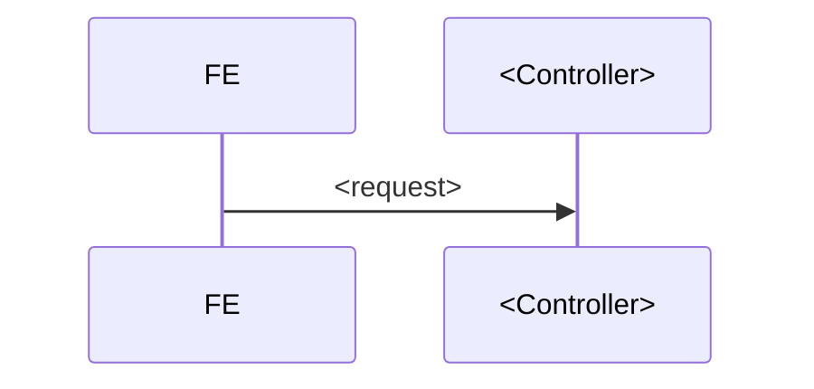

# Biểu mẫu — Kế hoạch triển khai API cho một phiếu yêu cầu

<!--
CÁCH DÙNG
1. Copy file này thành docs/<ten-nghiep-vu>-plan.md
2. Thay mọi <…> bằng nội dung thật.
3. XOÁ hết khối "> 📋 HƯỚNG DẪN" và mọi comment HTML (kể cả khối này) sau khi điền xong.
4. Mục nào thật sự không áp dụng thì ghi "Không áp dụng — <lý do>", ĐỪNG xoá tiêu đề mục:
   người review cần biết mục đó đã được cân nhắc chứ không phải bị quên.

QUY TẮC ĐÁNH SỐ (để các mục trỏ chéo nhau được)
   D1…Dn  quyết định (§0)      F1…Fn  chức năng (§1)
   A1…An  endpoint   (§4)      R1…Rn  rủi ro    (§11)      Q1…Qn  câu hỏi BA (§12)
   Ví dụ trỏ chéo: "xem §12-Q5", "giảm thiểu ở R1", "theo quyết định D2".

NGUYÊN TẮC XUYÊN SUỐT
- Mọi khẳng định về code/DB phải trỏ được về `file:dòng` thật. Không viết "base đã có sẵn
  tìm kiếm động" mà viết "core/shared/search/DynamicSpecification.java:65".
- Mỗi lựa chọn thiết kế phải kèm "vì sao KHÔNG chọn phương án kia".
- Mâu thuẫn tài liệu BA thì trích bằng chứng CẢ HAI phía, đừng chỉ ghi kết luận.
-->

> **Trạng thái:** `<BẢN NHÁP CHỜ REVIEW | ĐÃ CHỐT PHƯƠNG ÁN — sẵn sàng code | ĐANG CODE>`
> **Ngày cập nhật:** `<YYYY-MM-DD>`
> **Người review cần có:** `<1 BA (chốt §12) + 1 Dev BE/DBA (chốt §9, §10, §11)>`

| Mục | Nội dung |
|---|---|
| Use case | `<PMKT-U-xxxxx — Tên use case>` |
| Màn hình | `<SCR_xxx.md, SCR_yyy.md>` |
| Tài liệu nguồn | `<pmkt-docs/ba/PMKT-E-xxxxx_.../>` + `../../pmkt-docs/ba/Common/business_rules.md` |
| Module BE | `<cell-app/src/main/java/vn/vtt/pmkt/cell/<module>/>` |
| Bảng DB | `<ten_bang>` (`<đã có sẵn N cột / phải tạo mới>`) |

---

## 0. Các quyết định đã chốt

> 📋 **HƯỚNG DẪN** — Mục quan trọng nhất của tài liệu. Ghi lại những lựa chọn đã tranh luận xong,
> để lần review sau không phải bàn lại. Mỗi dòng: quyết định + **hệ quả cụ thể lên code**, không
> phải lời hứa chung chung. Nếu quyết định đến từ user/BA thì ghi rõ.

| # | Quyết định | Hệ quả |
|---|---|---|
| **D1** | `<vd: Kế thừa BaseChungTuController ngay, nhưng lần này chỉ cài luồng ĐỌC>` | `<Các method ghi ném 400 CHUA_HO_TRO kèm mã UC phụ trách — §4.x>` |
| **D2** | | |

> ⚠️ **Cảnh báo môi trường:** `<vd: base đang được sửa song song — chữ ký lớp X đã đổi từ 4 → 5
> generic giữa lúc khảo sát; đọc lại ngay trước khi code>`. Xoá dòng này nếu không có.

---

## 1. Phạm vi

### 1.1 Trong phạm vi

| # | Chức năng | Nguồn |
|---|---|---|
| F1 | `<Tìm kiếm động + phân trang + sắp xếp>` | `<UC_xxx, SCR_xxx>` |
| F2 | | |

### 1.2 NGOÀI phạm vi (không cài lần này)

> 📋 **HƯỚNG DẪN** — Liệt kê **đích danh** UC/màn bị loại, kèm mã. Đây là mục chống scope creep;
> viết mơ hồ ("các chức năng khác") là vô dụng. Nếu endpoint của phần ngoài phạm vi **vẫn hiện
> diện** trên API (do kế thừa base), nói rõ nó trả gì.

`<Thêm mới (U-xxxxx), Sửa (U-xxxxx), …>`

---

## 2. Hiện trạng đã khảo sát

### 2.1 Code hiện có

> 📋 **HƯỚNG DẪN** — Dán **lệnh grep thật + kết quả thật**. Kết luận rõ: greenfield hay brownfield.
> Nếu brownfield, chỉ ra file nào đang giữ nghiệp vụ đó.

```bash
<lệnh đã chạy>
```
`<kết quả + kết luận>`

### 2.2 Hiện trạng DB

`<Bảng X = N cột, dựng qua các migration V…>` · **File migration mới đánh theo timestamp:
`V<yyyyMMddHHmmss>__…` (`date +V%Y%m%d%H%M%S`) — không tính `max + 1`.**

| Bảng phụ | Vai trò | Cột khoá nối |
|---|---|---|
| | | |

### 2.3 Hạ tầng base đã có sẵn những gì

> 📋 **HƯỚNG DẪN** — Mục chặn việc viết lại thứ đã có. Cột `file:dòng` là **bắt buộc**; không trỏ
> được nghĩa là chưa khảo sát xong.

| Cần | Đã có ở base | Vị trí |
|---|---|---|
| `<Body tìm kiếm chuẩn>` | `<SearchRequest{...}>` | `<core/response/SearchRequest.java:31>` |

---

## 3. Kiến trúc

### 3.1 Phân tầng

```
<Controller>  extends <base>
        ▼
<Service>     extends <base>
        │   ├── kế thừa : …
        │   ├── override: …
        │   └── cài mới : …
        ▼
<Repository>  extends BaseRepository<…>
        ▼
<Entity>      extends <base>  →  @Table("<ten_bang>")
```

### 3.2 Lựa chọn kiến trúc + lý do

> 📋 **HƯỚNG DẪN** — Bảng so sánh ít nhất 2 phương án. Cột cuối là phương án CHỌN. Phải có dòng
> "rủi ro" — nếu phương án chọn có rủi ro thì nói luôn chốt an toàn nào bù lại.

| | Phương án A | **Phương án B (chọn)** |
|---|---|---|
| `<tiêu chí>` | | |
| Rủi ro | | |

### 3.3 Cấu trúc thư mục

```
<module>/
├── package-info.java
└── internal/
    ├── controller/ …
    ├── dto/ …
    ├── entity/ …
    ├── model/ …
    ├── repository/ …
    └── service/ …
```

---

## 4. Hợp đồng API

Base path: **`/api/<nhom>/<tai-nguyen>`**. Mã chức năng: **`<MaChucNang>`**.

> 📋 **HƯỚNG DẪN** — Bảng tổng trước, rồi **MỖI endpoint MỘT mục con**. Không được bỏ mục con nào,
> kể cả endpoint "hiển nhiên": FE đọc mục này để code, thiếu một cái là một vòng hỏi–đáp.
> Cột "Nguồn" phân biệt `base` (kế thừa) hay `mới` (tự viết) — quyết định ai phải test nó.

| # | Nguồn | Method | Path | Quyền | Trả về | Mục |
|---|---|---|---|---|---|---|
| A1 | `<base\|mới>` | `POST` | `/search` | `.View` | `PageResponse<…>` | §4.1 |
| A2 | | | | | | §4.2 |

**Envelope lỗi**: `<mô tả chính xác hình dạng JSON lỗi của dự án>`.

**Quy ước giá trị enum trên wire**: `<tên hằng Java / chuỗi DB / …>` — dùng chung cho cả `filters`
lẫn `data` hay không, và **vì sao**.

### 4.1 A1 — `<METHOD> <path>`

```jsonc
// Request
{ }
```

```jsonc
// Response 200
{ }
```

Lỗi có thể gặp: `<400 …>`, `<403 …>`, `<404 …>`.

### 4.2 A2 — `<METHOD> <path>`

`<… lặp lại cho tới An …>`

### 4.x — Các endpoint chưa cài (nếu có)

> 📋 **HƯỚNG DẪN** — Chỉ dùng khi kế thừa base làm lộ ra endpoint ngoài phạm vi. Ghi rõ mã lỗi trả
> về và bảng "endpoint → UC phụ trách", để người dùng API biết chờ ai làm.

---

## 5. Ánh xạ cột: BA ↔ DB ↔ DTO

### 5.1 Bảng hiển thị

| # | Cột BA | Field BA | Cột DB thật | Field DTO / alias lọc | Lọc | Sort |
|---|---|---|---|---|---|---|
| 1 | | | | | | |

> ⚠️ Đánh dấu **đậm** mọi cột mà tên DB **lệch** tên BA — đây là nguồn lỗi số 1 khi map.
> Nói rõ có tạo migration đổi tên cột hay không.

### 5.2 Bộ tiêu chí tìm kiếm

| Field BA | Control | Alias BE | Toán tử |
|---|---|---|---|
| | | | |

Cách ghép điều kiện: `<AND/OR>` · phạm vi `keyword`: `<danh sách field>`.

### 5.3 Field phụ trong DTO để FE ẩn/hiện nút

| Nút | Điều kiện | Field DTO cần có |
|---|---|---|
| | | |

---

## 6. Lọc · sắp xếp · phân trang · dòng tổng

### 6.1 Bộ lọc mặc định
`<BE bơm hay FE gửi? + BR tương ứng + lối thoát để lấy toàn bộ>`

### 6.2 Sắp xếp mặc định
`<BR + cách cài. Nếu base không diễn tả được thì nói rõ cài bù thế nào>`

### 6.3 Phân trang
`<mặc định, whitelist page size, 0-based hay 1-based>`

### 6.4 Dòng tổng cộng
`<cột nào, phạm vi tính (trang hiện tại / toàn bộ sau lọc), cài ở đâu, xử lý SUM trên tập rỗng>`

---

## 7…8. Các cột "khó" (dẫn xuất / tính toán)

> 📋 **HƯỚNG DẪN** — Mỗi cột không đọc thẳng từ một cột DB thì tách MỘT mục riêng, gồm:
> quy tắc BA (trích nguyên văn) → dữ liệu nguồn (bảng/cột) → công thức → **phương án chọn và vì sao
> không chọn cách kia**. Nếu công thức là SQL thuần, ghi nó vào đây để review được mà không phải mở code.

### 7. Cột `<tên>`
### 8. Cột `<tên>`

---

## 9. Thiết kế chi tiết DB

> 📋 **HƯỚNG DẪN** — Mục này để **user/DBA review trước khi code**, và là mục duy nhất được phép
> quyết định hình dạng dữ liệu. §10 (migration) chỉ là bản dịch của mục này sang SQL — nếu §10 có
> thứ gì không xuất hiện ở §9 thì §9 chưa xong.
>
> Quy tắc:
> - Cột nào cũng phải nói được **kiểu, NULL/NOT NULL, default, ai ghi** (client gửi / server tính /
>   base tự quản). Cột `server tính` mà request cho gửi lên là lỗi thiết kế.
> - Cột kế thừa từ base entity (`id`, `tenant_id`, `da_xoa`, `version`, audit, `so_chung_tu`,
>   `ngay_chung_tu`, `ngay_hach_toan`, `status`…) **không khai lại** — chỉ ghi tên lớp base ở §9.1.
> - Số liệu tiền/lượng phải ghi rõ `precision, scale` theo BR7; không để `numeric` trần.
> - Nếu KHÔNG cần đổi DB thì ghi "Không áp dụng — dùng nguyên schema `<bảng>` hiện có, xem §9.1",
>   vẫn phải điền §9.1.

### 9.1 Hiện trạng bảng (nguồn sự thật)

Bảng chính: `<ten_bang>` — dựng ở `<V…>`, sửa bởi `<V…, V…>`. Entity: `<Entity.java>` extends
`<BaseChungTuEntity / AggregateRootEntity / …>`.

| Nhóm cột | Cột đã có | Do đâu quản |
|---|---|---|
| Base/audit/tenant | `<liệt kê ngắn hoặc "theo BaseChungTuEntity.java:45-84">` | base, không đụng |
| Nghiệp vụ đã có | `<…>` | module |

`<Kết luận: thiếu những gì so với BA — liệt kê đích danh, đây là input của §9.2>`

### 9.2 Cột thêm mới / sửa trên bảng đã có

| # | Cột DB | Kiểu | NULL | Default | Ai ghi | Field BA / DTO | Vì sao cần |
|---|---|---|---|---|---|---|---|
| 1 | `<so_hoa_don>` | `varchar(20)` | Y | — | client | `soHoaDon` | `<SCR dòng …>` |
| 2 | | | | | server tính | | |

> ⚠️ Cột đổi kiểu/đổi tên phải tách một dòng riêng và ghi **dữ liệu cũ xử lý thế nào** (§9.6).

### 9.3 Bảng mới

> 📋 Mỗi bảng một mục con. Bảng con của aggregate phải nói rõ: cascade từ đâu, xóa mềm theo cha hay
> theo chính nó, và **vì sao không nhét JSONB/array vào bảng cha**.

#### 9.3.1 `<ten_bang_moi>`

| Cột | Kiểu | NULL | Default | Ghi chú |
|---|---|---|---|---|
| `id` | `uuid` | N | — | PK |
| `tenant_id` | `uuid` | N | — | RLS |
| | | | | |

Khóa chính `<…>` · khóa ngoại `<… ON DELETE RESTRICT>` · quan hệ với cha: `<…>`.

### 9.4 Ràng buộc · index · khóa ngoại

| # | Loại | Định nghĩa | Vì sao | Chi phí |
|---|---|---|---|---|
| 1 | unique | `<(tenant_id, …) WHERE da_xoa=false>` | `<chống trùng … — message _xxx>` | `<ghi chậm hơn ~>` |
| 2 | index | `<(tenant_id, ngay_hach_toan DESC)>` | `<sort mặc định §6.2>` | |
| 3 | FK | `<… REFERENCES …>` | `<bảo vệ dòng nguồn>` | |
| 4 | check | `<so_luong >= 0>` | `<BR…>` | |

> 📋 Unique/partial index phải khớp **đúng** điều kiện soft-delete của dự án, nếu không bản ghi đã
> xóa sẽ chặn bản ghi mới. Mỗi index phải trỏ về đúng câu query nào dùng nó — index không có query
> tương ứng là index thừa.

### 9.5 Enum ⇄ giá trị lưu trong DB

| Enum Java | Cột | Giá trị lưu thật | Converter | Giá trị lạ thì sao |
|---|---|---|---|---|
| `<LoaiNghiepVuBanHang>` | `<loai_nghiep_vu>` | `<"Bán hàng trong nước" \| …>` | `<…AttributeConverter>` | `<ném / null / giữ nguyên>` |

### 9.6 Dữ liệu hiện có · backfill · tương thích ngược

| # | Vấn đề | Câu query kiểm tra trước | Cách xử lý |
|---|---|---|---|
| 1 | `<dữ liệu trùng trước khi thêm unique>` | `<SELECT … GROUP BY … HAVING count(*)>1>` | `<report cho BA, không tự xóa>` |
| 2 | `<cột NOT NULL trên bảng đã có dữ liệu>` | | `<thêm NULL → backfill → set NOT NULL>` |

**Cột deprecate (nếu có):** `<cột cũ, ai còn đọc, bao giờ gỡ>` — không xóa cột trong cùng migration
với việc thêm cột thay thế.

### 9.7 Ánh xạ Entity ↔ bảng

| Bảng | Entity | Kế thừa | Quan hệ JPA | Fetch |
|---|---|---|---|---|
| | | | `<@OneToMany cascade=ALL orphanRemoval=true>` | `<LAZY>` |

`<Nói rõ: aggregate root là ai, ai được có repository riêng, lock lạc quan đặt ở đâu.>`

### 9.8 ERD

```mermaid
erDiagram
  <BANG_CHA> ||--|{ <BANG_CON> : "chứa"
```

---

## 10. Migration `V<yyyyMMddHHmmss>`

File: `cell-app/src/main/resources/db/migration/V<yyyyMMddHHmmss>__<mo_ta>.sql`
(version = timestamp lúc tạo file, lấy bằng `date +V%Y%m%d%H%M%S`)

> 📋 Mục này **chỉ dịch §9 sang SQL** — không phát sinh cột/index mới ở đây.

| # | Việc | Vì sao bắt buộc |
|---|---|---|
| 1 | `<backfill / alter / index / seed quyền>` | `<hệ quả nếu không làm>` |

Ghi chú kỹ thuật: `<CONCURRENTLY dùng được không, idempotent chưa, lưu ý flyway repair…>`

**File có sẵn phải sửa kèm:** `<vd: common/constant/MaChucNang.java — thêm hằng …>`

> 📋 **HƯỚNG DẪN** — Nhớ rà **quyền chưa được seed**: endpoint kế thừa từ base thường đòi mã quyền
> (`.Export`, `.Clone`, `.Import`) mà file seed gốc chưa có ⇒ 403 với mọi người dùng kể cả Admin.

---

## 11. Rủi ro kỹ thuật

| # | Rủi ro | Mức | Giảm thiểu |
|---|---|---|---|
| R1 | | Cao/TB/Thấp | |

> 📋 Gồm cả rủi ro **môi trường** (thiếu Docker, base đang bị sửa song song, arch-test chặn build)
> chứ không chỉ rủi ro nghiệp vụ.

---

## 12. ⚠️ Điểm cần BA xác nhận

| # | Vấn đề | Bằng chứng mâu thuẫn | Xử lý tạm |
|---|---|---|---|
| Q1 | | `<trích file:dòng CẢ HAI phía>` | |

> 📋 **HƯỚNG DẪN** — Cột giữa là lý do mục này tồn tại: BA cần thấy *hai* nguồn nói ngược nhau để
> phán quyết, không phải nghe kết luận của dev. Cột cuối cho phép code tiếp mà không bị chặn.

---

## 13. Luồng xử lý

> 📋 Mermaid `sequenceDiagram` cho luồng có nhiều tầng, `flowchart` cho luồng có rẽ nhánh.
> Chỉ vẽ các luồng CHÍNH — vẽ hết mọi endpoint là nhiễu.

### 13.1 `<luồng chính>`



---

## 14. Quy ước dữ liệu đặc thù

`<enum ⇄ chuỗi DB, converter, ràng buộc đặt tên, xử lý giá trị lạ… + vì sao không dùng lại lớp
tương tự của module khác>`

---

## 15. Mã thông báo

| Hằng | messageId | Nội dung | Dùng ở |
|---|---|---|---|
| | `<MSG_PMKT-E-xxxxx_nnn>` | | |

> 📋 Lấy từ `6.messages.md` của **đúng epic**. Tuyệt đối không tái dùng mã của epic khác, và không
> bịa mã mới — mã FE không tra được trong tài liệu là mã vô dụng.

---

## 16. Kiểm thử

### 16.1 Unit test (`@Tag("unit")`, không cần Docker)

| Lớp test | Kiểm gì |
|---|---|
| | |

### 16.2 Test tích hợp (cần Docker — chạy ở CI)

`<lớp IT + những thứ CHỈ chạy được trên DB thật>`

### 16.3 Lệnh chạy trước khi báo hoàn thành

```bash
cd cell-app && ./gradlew unitTest
```

```bash
cd cell-app && ./gradlew build
```

> `../../cell-app` là Gradle project độc lập (wrapper riêng); repo root không có `gradlew`, nên
> `./gradlew :cell-app:build` sẽ báo "no such file or directory". Máy chưa cài Docker thì `build`
> luôn đỏ ở các test Testcontainers — đối chiếu danh sách lớp lỗi trước khi kết luận hồi quy.

---

## 17. Sản phẩm bàn giao

| # | File | Loại |
|---|---|---|
| 1 | | mới / **sửa** |

**Ước lượng:** `<N file mới, M file sửa>`. **Không đụng:** `<master_data (vùng đóng băng), …>`

### Bộ Postman sẽ có
`<các nhóm request + biến môi trường>`

---

## 18. Thứ tự thực hiện

1. `<đọc lại chữ ký base nếu có cảnh báo ở §0>`
2. `<migration + hằng>` → chạy Flyway trên DB dev, kiểm dữ liệu
3. `<model/enum>` + unit test
4. `<entity + whitelist>` → test pin whitelist xanh
5. `<repository>`
6. `<service>` + unit test
7. `<controller>`
8. `<smoke-test những thứ chỉ chạy được trên DB thật>`
9. `./gradlew unitTest` → xuất Postman → PR

---

## 19. Điều kiện hoàn thành để nghiệm thu

### BA xác nhận
- [ ] `<đủ cột, đúng điều kiện hiển thị action>`
- [ ] `<bộ lọc, thứ tự, dòng tổng đúng BR đã chốt ở §11>`

### Dev BE xác nhận
- [ ] Controller không gọi repository; business logic nằm ở service; Entity không lọt ra ngoài.
- [ ] Dùng lại hạ tầng `core` (`SearchRequest`, `DynamicSpecification`, `PageResponse`,
      `ApiResponse`, `QuyenChecker`, `ExcelExporter`, tenant RLS) thay vì tự viết.
- [ ] Mọi filter/sort đều whitelist; tenant / phạm vi dữ liệu / soft-delete không nhận từ client.
- [ ] Mọi handler gọi `quyen.require(...)` (nếu không `HandlerAuthorizationArchTest` đỏ build).
- [ ] Không hardcode magic value; không `any`/`@ts-ignore` phía FE; import bằng path alias.
- [ ] Không N+1; aggregate là query riêng.
- [ ] Unit test, integration test, migration test, arch test đều xanh — **báo trung thực** mục nào chưa đạt.

---

## 20. Tài liệu tham chiếu

- `<pmkt-docs/ba/…/4.usecases/…>`
- `<pmkt-docs/ba/…/5.screens/…>`
- `<pmkt-docs/ba/…/6.messages.md>`
- `<pmkt-docs/ba/…/3.crud-matrix.puml>`
- `../../pmkt-docs/ba/Common/business_rules.md` — `<liệt kê đúng các BR đã dùng>`
- `conventions.md`, `../../CLAUDE.md`, `../../cell-app/CLAUDE.md`
- Mẫu code tham khảo: `<cell-app/src/main/java/vn/vtt/pmkt/cell/…>`
